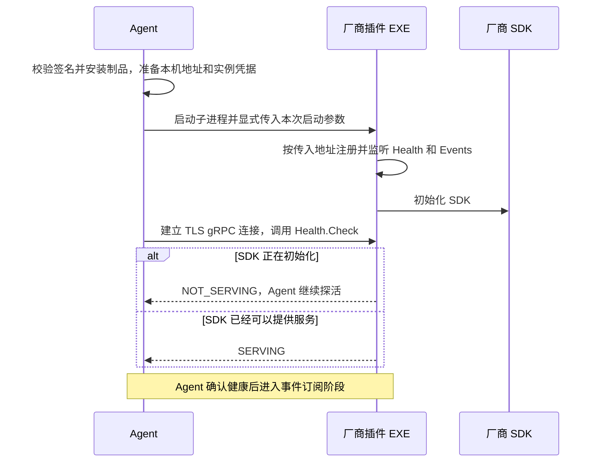
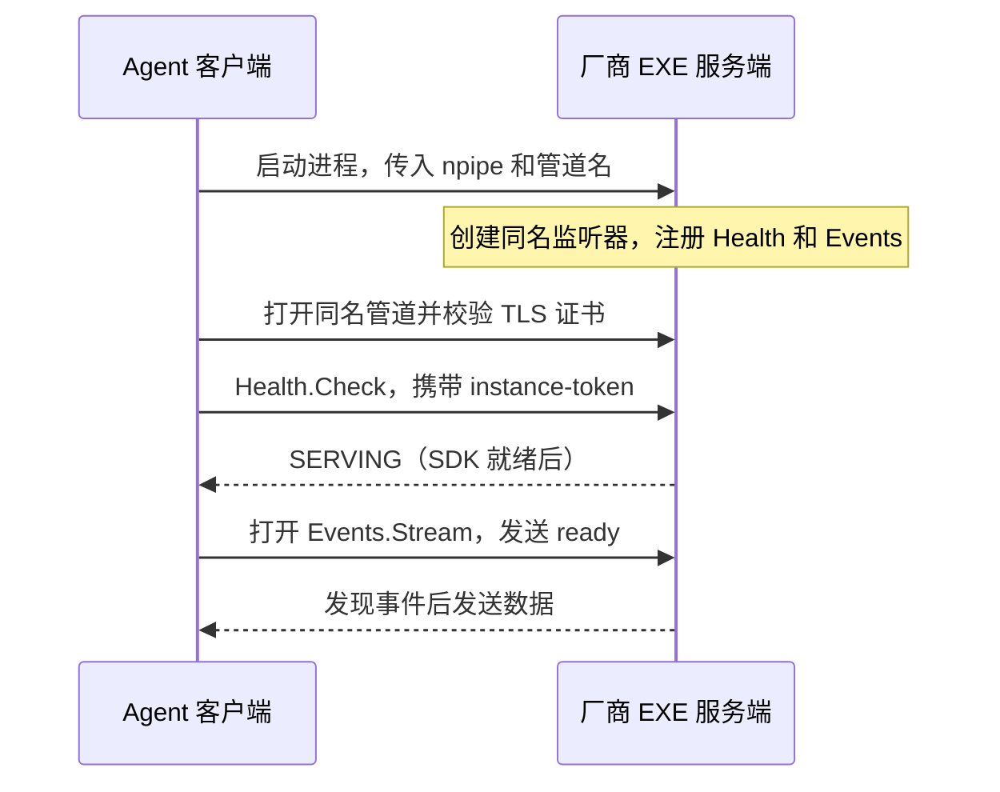
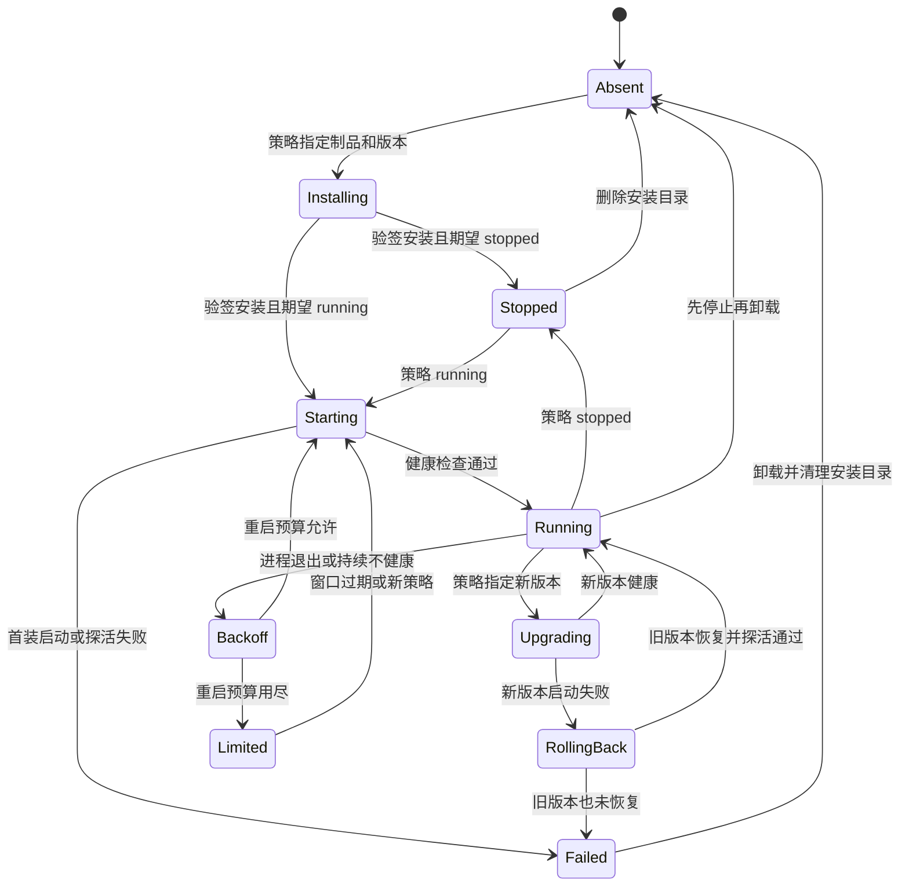

# 发给第三方厂商的 AIDR 首轮联调说明

系统分层、Agent 职责与开源来源映射见 [架构设计](architecture.md)。

## 1. 先确定交付物与分工

首轮以 Windows amd64 为接入目标。请厂商先确认能否提供一个可独立启动的 EXE，以及该 EXE 是否需要外部运行库、SDK 授权文件、驱动、管理员权限或常驻服务。

| 厂商现有形态 | 厂商交付 | 我方交付 |
|---|---|---|
| 可提供独立程序 | 按下面契约实现的 Windows amd64 EXE、依赖和权限清单、一条合成测试事件、版本及测试报告 | Agent、管理端、协议、参考实现、打包发布和验收工具 |
| 只能提供 SDK | SDK、头文件及运行库、授权与分发条件、初始化与释放示例、事件回调或拉取说明、线程和超时约束 | 我方实现一个独立 EXE，内部调用 SDK，对外遵循同一契约 |

首轮约定一个 EXE 和一条小于等于 1,024 字节的合成事件。带 DLL、驱动、授权和服务的正式部署包在厂商交代依赖及权限后扩展。当前 CLI 的打包入口只接收单个 EXE。

## 2. 厂商怎么开发这个 EXE

### 第一步，Agent 启动插件并建立本机连接

**Agent 负责启动和连接，插件 EXE 负责监听和报告就绪。** 厂商适配器由 Agent 作为子进程启动。它在 Agent 分配的本机地址提供 gRPC 服务。Agent 主动拨号，厂商程序无需知道管理服务器地址。当前首轮联调使用下面这套进程启动契约。



#### 1. Agent 交付什么给插件

Agent 下载制品，验证签名、摘要和平台，安装后直接启动组件入口。Agent 显式为这个子进程设置以下变量。它们是**本次启动约定**。用户在系统设置或终端里配置同名变量，不能替代 Agent 启动时传入的值。

| 变量 | 类型 | 插件应如何处理 |
|---|---|---|
| `DEMO_IPC_TRANSPORT` | 普通启动参数 | `npipe` 使用 Windows 命名管道，`unix` 使用 Unix socket，`tcp` 使用 TLS 回环 TCP。 |
| `DEMO_ENDPOINT` | 普通启动参数 | 在这个地址监听。Windows 命名管道示例 `\\.\pipe\supervisor-demo-a17b`。每次启动以实际值为准。 |
| `DEMO_VERSION` | 普通启动参数 | 版本信息，可用于日志；不据此判断制品是否受信。 |
| `DEMO_IPC_CERT` | 实例证书 | PEM 字符串，加载为服务端 TLS 证书。 |
| `DEMO_IPC_KEY` | 实例私钥 | PEM 字符串，加载为服务端 TLS 私钥。只在内存中使用，避免写入日志、诊断包或配置文件。 |
| `DEMO_TOKEN` | 实例认证凭据 | 检查每个 RPC 的 `instance-token` metadata。缺失或不匹配返回 `UNAUTHENTICATED`，避免记录 token。 |
| `DEMO_PARENT_PIPE` | 普通启动参数 | 值为 `1` 时监视标准输入管道。收到 EOF 后停止接收工作、释放 SDK 资源并退出。 |

工作目录是组件的业务数据目录。随包资源应按可执行文件所在位置定位。厂商业务配置、授权、规则和长期凭据走单独的配置或凭据管理流程。

#### 2. 插件监听，Agent 主动拨号

**监听是插件把服务开在约定的本机地址上，拨号是 Agent 主动打开这个地址并连接。** 这里的地址可以是命名管道、Unix socket，也可以是兼容模式的回环 TCP 地址。地址由 Agent 在启动前选定，插件只读取并使用这个地址。

##### 示例：Windows 上启动一个 AIDR 插件

假设 Agent 本次分配了下面的启动参数。管道名仅用于示例，每次启动以实际值为准。

```text
DEMO_IPC_TRANSPORT=npipe
DEMO_ENDPOINT=\\.\pipe\supervisor-demo-a17b
```

| 顺序 | 谁做 | 实际动作 |
|---|---|---|
| 1. 分配并启动 | Agent | 生成实例管道名、TLS 证书和 token，启动厂商 EXE，将本次参数传入它的进程环境。 |
| 2. 监听并注册 | 厂商 EXE | 读取 `npipe` 和管道名，创建同名管道监听器。加载 Agent 提供的证书和私钥，在同一个 gRPC 服务端注册 `Health` 与 `Events`。监听地址上只有一个服务端实例，两个 RPC 可以复用连接。 |
| 3. 拨号并认证 | Agent 和厂商 EXE | Agent 主动打开同一个管道并建立 TLS，确认服务端证书就是本次启动时生成的证书。Agent 调用 RPC 时携带实例 token，插件校验 token。 |
| 4. 探活并建流 | Agent 和厂商 EXE | Agent 先调用 `Health/Check`。SDK 就绪且探活确认后，Agent 再打开 `Events/Stream`，发送 `ready`。插件有事件时沿同一条流发回。 |



如果 Agent 第一次拨号时插件还在初始化或尚未开始监听，Agent 会在启动窗口内继续尝试。地址不匹配或监听未启动时连接无法建立；证书不匹配时 TLS 失败；token 无效时 RPC 返回 `UNAUTHENTICATED`；漏注册接口时通常返回 `UNIMPLEMENTED`。这些是不同的排查点。

**Linux/macOS 与兼容方式。** `unix` 模式按相同顺序监听给定 socket 路径。厂商的 Python/Java 库如果首轮只支持 TCP，应在签名制品明确声明 `tcp`，按实际传入的 `127.0.0.1:端口` 监听。方法、证书与 token 契约保持一致。两类本机连接都由 Agent 发起，厂商插件无需直接连接远程管理端。见 [语言实现示例](aidr-grpc-endpoints.md) 和 [原生 IPC 验收](native-ipc.md)。

#### 3. 插件先初始化 SDK，再报告就绪

Agent 调用 `/grpc.health.v1.Health/Check`，请求为空的 `service` 字段，并携带 `instance-token`。厂商可以先监听并在初始化期间返回 `NOT_SERVING`，也可以在初始化完成后立即开始监听。**只有 SDK 初始化成功并能提供能力时，才返回 `SERVING`。** 初始化失败时请返回 `NOT_SERVING` 并记录可定位的错误，或退出进程并给出失败退出码。当前 Demo 的启动窗口为 4 秒，要求连续 3 次探活成功。超出窗口会报告启动失败；初始化耗时较长的 SDK 需在联调时确认超时策略。

**正式部署边界。** 当前 Demo 将实例私钥和 token 也放入子进程环境，适合在受控测试环境联调。正式交付建议用受控继承的匿名管道等一次性通道传递敏感凭据。保护 Agent 状态、制品信任和 IPC 权限还需要正式安装版的服务身份与文件权限验收。进程环境本身不提供防篡改边界。


### 第二步，把一条测试事件交给 Agent

插件在第一步分配的同一个本机地址注册标准 Health 服务和项目定义的 Events 服务。健康检查和事件流走同一个 gRPC 服务端，不需要再给事件流分配一个地址。

| 方法全名 | 来源 | 插件要做什么 |
|---|---|---|
| /grpc.health.v1.Health/Check | gRPC 标准健康检查 | 校验实例 token。SDK 可提供能力时返回 SERVING。 |
| /demo.component.v1.Events/Stream | [项目 Protobuf](../api/proto/component/v1/events.proto) | 校验 token，读取第一条 ready，发送一条数据并等待 Agent ACK。 |

**Agent 主动连接并建流，插件有事件时在流上发送。** 两个方向都使用 google.protobuf.StringValue。Agent 第一条 value 是 ready；插件第一条 value 可以是下面的 JSON 文本：

    {"type":"aidr.integration_test","severity":"info","message":"vendor adapter online"}

Agent 给事件生成 event_id，终端 SQLite 提交后以 StringValue 回复该 ID。请记录此 ID，收到确认后才发下一条。Agent 再经独立 HTTPS 连接上传，管理端查到同一 ID 才表示平台送达。单条 payload 最多 1,024 UTF-8 字节。

| 联调时需要查的细节 | 去哪里看 |
|---|---|
| 本机和管理端各监听什么、TLS 和 token 怎么用、Python/Go/Java 服务端与客户端示例 | [gRPC 端点与语言示例](aidr-grpc-endpoints.md) |
| 智能体、日志、Skill、MCP 事件格式，以及 Agent 封装、落盘和外发 | [AIDR 数据契约与流程图](aidr-data-contract.md) |
| 实际运行的 Go 参考代码 | [Health 和启动](../internal/component/component.go) · [Events 事件流](../internal/component/events.go) |
| 插件尝试重连、状态变化和恢复边界 | 本文后面的生命周期与故障恢复章节 |

### 第三步，交付、发布和验收

1. 厂商提交 EXE、版本号、Windows 架构、依赖和最小运行权限，以及测试事件样例。调试日志写标准输出或标准错误，日志应能定位初始化失败。
2. 我方用管理侧测试签名工具制作包，包内包含 manifest.json 和组件入口。签名公钥由 Agent 预置信任。管理端和 Agent 运行期间，厂商程序只接触自身的本机 IPC 材料。
3. 我方发布包，并通过策略指定组件 ID、版本、制品 ID 和 running。手工命令从项目根目录执行，在新测试环境先按 README 的手动运行流程启动 server 和带 -events 的 agent。示例：

       build/supervisor-demo.exe sign -id aidr-vendor -version 1.0.0 -artifact aidr-vendor-1 -file C:\delivery\vendor-adapter.exe -out build/aidr-vendor-1.json
       build/supervisor-demo.exe publish -file build/aidr-vendor-1.json

   将下面内容保存为 build/vendor-policy.json。revision 取大于当前策略的值，新环境可以用 1。

       {"revision":1,"components":[{"id":"aidr-vendor","version":"1.0.0","artifact_id":"aidr-vendor-1","desired_state":"running"}]}

   应用并查看：

       build/supervisor-demo.exe policy -file build/vendor-policy.json
       build/supervisor-demo.exe status

4. 验收双方各看一项结果。厂商侧确认 SDK 初始化成功，并收到第一条事件的 event_id。我方确认终端状态为 running，且管理端能用同一个 ID 找到事件。随后用新 revision 验证 stopped、running、absent，检查 SDK 资源释放和卸载后组件消失。
5. 首条事件通过后，再确定业务字段、配置热更新、权限范围、速率上限、终端负载和升级回滚的兼容要求。当前 Demo 已有生命周期与事件流，统一配置接口和生产容量指标尚未定稿。

## 3. Agent 管控、故障恢复和厂商配合

### 3.1 生命周期从哪里发起

管理端发布带 revision 的期望策略。Agent 主动 check-in 领取策略，按组件标识处理差异。厂商插件无需自行下载安装包、启动其他版本或主动联系管理端。策略的三种目标状态是 `running`、`stopped` 和 `absent`。



上图描述流程阶段。当前实际状态字段包含 `installing`、`running`、`stopped`、`degraded`、`backoff`、`restart_limited` 和 `failed`。升级与回滚目前通过期望版本、实际版本、策略 revision 和错误说明辨认，尚未分别作为状态码上报。

| 生命周期动作 | 管理端怎么发起 | Agent 做什么 | 管理端用什么判断结果 |
|---|---|---|---|
| 安装 | 新 revision 指定组件 ID、版本、制品 ID 和期望状态 | 下载签名包，校验签名、摘要和平台，安装到版本目录。`stopped` 只安装，`running` 安装后继续启动。 | 实际版本正确，且状态达到 `stopped` 或 `running`。 |
| 启动 | 将已安装组件设为 `running` | 校验安装文件，启动独立进程，建立本机 gRPC 并探活。只有健康检查通过后才采集事件。 | 实际版本、`running`、组件 PID。采集状态独立显示。 |
| 停止 | 将该组件设为 `stopped` | 停止采集，关闭连接并通知组件退出。短暂等待后由平台运行时终止剩余进程。保留安装文件和业务数据。 | `stopped`，该组件无运行 PID。 |
| 升级 | 新 revision 指定新版本和制品 | 先下载、验签并安装新版本，再停止旧实例。新版本探活通过才把它记为当前版本。 | 实际版本与新版本一致，策略 revision 生效。 |
| 自动回滚 | 新版本启动或探活失败，由 Agent 触发 | 重新校验旧版本文件并尝试恢复旧实例。回滚也失败时保留错误，交由管理端处置。 | 升级失败时会保留失败信息。若回滚成功，实际版本显示旧版。 |
| 卸载 | 新 revision 显式设为 `absent` | 先停止进程，再删除组件的安装版本目录。组件业务数据和已落库事件保留。 | 已应用该 revision，当前能力列表中该组件消失。 |

#### 同一个组件的操作示例

| Revision | 组件 | 期望版本 | 期望状态 | 操作者可见结果 |
|---|---|---|---|---|
| 10 | aidr-vendor | 1.0.0 | running | 安装并启动 1.0.0 |
| 11 | aidr-vendor | 1.0.0 | stopped | 保留安装，停止该进程 |
| 12 | aidr-vendor | 1.0.0 | running | 重新启动 1.0.0 |
| 13 | aidr-vendor | 1.1.0 | running | 健康则切换到 1.1.0，失败则尝试恢复 1.0.0 |
| 14 | aidr-vendor | — | absent | 停止并移除本组件 |

策略 revision 必须递增。同 revision、同内容重复下发不重复操作；旧 revision 或同 revision 的冲突内容会被拒绝。策略中未列出的组件保持原状态，卸载须显式写 `absent`。`received_revision` 表示已接收，`applied_revision` 表示最近成功应用的策略。看到上一条已应用 revision 时，还要核对该组件当前的实际版本、状态和错误。

**厂商需配合的退出与升级行为。** 收到父进程管道 EOF 后尽快停止接收新工作、关闭事件流、释放 SDK 资源并退出。旧版与新版使用同一个业务数据目录；若新版会改变业务数据格式，需事先约定向后兼容或迁移恢复。自动回滚可以恢复旧版程序，业务数据能否回退取决于厂商的迁移设计。正式部署还需验收所有升级中断点及进程树清理。

### 3.2 持续运行与故障处理

Agent 管控分为制品、进程和数据三个层次。管理端分别查看期望版本、实际版本、进程状态和采集状态。Windows 演示在同一能力列表展示进程与采集状态。

| 场景 | Agent 怎么处理 | 厂商需要配合 |
|---|---|---|
| 事件流断开 | 同一实例自动重试建流，重连前后保持 Agent 事件序号连续。上报建流、已收数、重连、背压或接口不支持，以及最近接收事件时间。 | 在已有进程中能重复接受 Events/Stream 调用。每次重新等 ready，取消或断开时释放旧订阅。收到 event_id 才记录为终端已保存。 |
| 启动、升级或回滚 | 安装时从验签通过的 ZIP 记录文件摘要。复用缓存、启动或回滚前检查已安装文件，缺失、额外或变化的文件会被拒绝。 | 把可执行文件和部署依赖放入签名制品。运行期间把日志、缓存和可变配置保存在 Agent 提供的业务数据目录。 |
| 插件反复故障 | 独立探活。运行中退出、持续探活失败、启动失败都计入故障预算。每组件 60 秒内达到 5 次时限流，等待故障滑出窗口或新策略重置，期间可在管理端查看状态。 | 初始化错误写出可定位日志，保持 Health 响应及时。严重故障应报告失败并释放资源。 |
| 管理端慢或制品下载慢 | check-in 和下载在后台运行，已运行的插件各自探活。安装提交和进程切换由协调器串行。 | 插件只连接本机 Agent 数据链路，上传与重试由 Agent 处理，组件侧按事件流背压约定运行。 |

Windows 本机与 Ubuntu WSL2 的生命周期回归通过。专项验证主动切断首条流后可重连且序号持续、已安装入口文件变化后拒绝使用、重启预算窗口到期后恢复。三端六种 Go 构建目标通过。详见 [插件管控加固与验收](agent-hardening.md)。

正式交付仍需落实服务身份与目录 ACL、组件最小权限、配置 revision 和生效回执、完整升级事务恢复。插件没收到 ACK 的源事件重放和源 ID 去重仍待协议确认。当前 Agent 已确认落盘的事件由本地队列独立续传。重启预算目前只在同一个 Agent 进程中记录。

## 厂商回复模板

- 交付形态：独立 EXE / SDK
- 支持系统及 CPU：首轮 Windows amd64 是否可交付
- 依赖、授权、驱动、权限和网络要求：
- 初始化和关闭方式、线程及超时约束：
- 事件来源：回调 / 文件 / 拉取接口，附一条脱敏样例和峰值速率
- 负责人和第一版联调制品日期：


