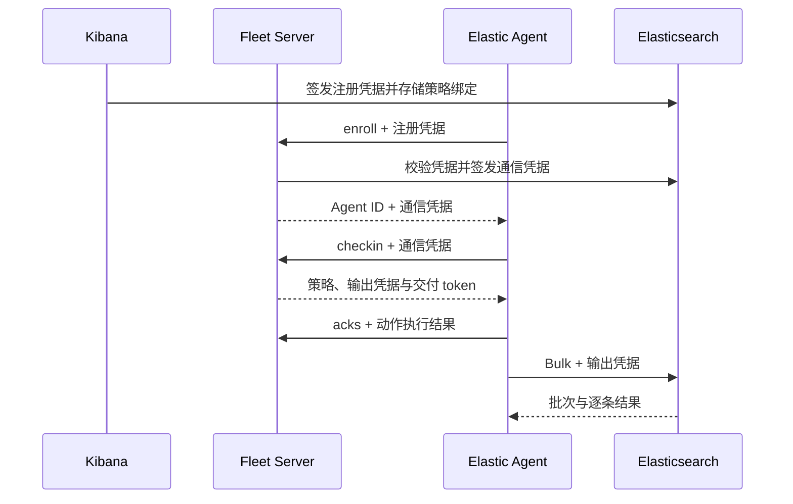

# Elastic Agent 8.17.0 认证与数据面接口规格

范围为受 Fleet 管理的 Agent 和直连 Elasticsearch 的事件输出。Fleet Server 固定到 `d05ee7b30ed62dba0cad7b31ff2ea003897cde82`，Agent 固定到 `96f2b9fc0dbddfcaac1c55e0e0bc9aed3bf6badb`。协议结论来自静态源码与 Elasticsearch 8.17 文档。 [Fleet Server](https://github.com/elastic/fleet-server/tree/d05ee7b30ed62dba0cad7b31ff2ea003897cde82) · [Agent](https://github.com/elastic/elastic-agent/tree/96f2b9fc0dbddfcaac1c55e0e0bc9aed3bf6badb)

## 接口清单与共用约定

| 调用方 → 接收方 | 方法及路径 | 凭据 | 成功状态 |
|---|---|---|---|
| 管理客户端 → Kibana | GET/POST `/api/fleet/enrollment_api_keys` | Kibana 管理身份及 Fleet 路由权限 | 200 |
| 管理客户端 → Kibana | GET/DELETE `/api/fleet/enrollment_api_keys/{keyId}` | 同上 | 200 |
| Agent → Fleet Server | POST `/api/fleet/agents/enroll` | Enrollment API key | 200 |
| Agent → Fleet Server | POST `/api/fleet/agents/{id}/checkin` | Access API key，绑定 `id` | 200 |
| Agent → Fleet Server | POST `/api/fleet/agents/{id}/acks` | Access API key，绑定 `id` | 200；逐项失败时可返回非 200 与 ACK 结果体 |
| Agent → Fleet Server | POST `/api/fleet/agents/{id}/audit/unenroll` | Agent 认证 | 审计接口，见下文 |
| 采集组件 → Elasticsearch | POST `/_bulk` | 对目标数据流有写权限的 output API key | 200，仍须检查逐项结果 |

Fleet 使用 HTTPS 部署。正文为 UTF-8 JSON，示例请求以 `Content-Type: application/json` 发送。Fleet Server 响应使用 `Content-Type: application/json`。`Authorization` 为单值 `ApiKey <base64(id:secret)>`。注册及 check-in 发送 `User-Agent: Elastic Agent v8.17.0`，服务端检查产品名和版本范围。`Elastic-Api-Version: 2023-06-01` 可显式选版本；省略走服务器默认版本。可带 `X-Request-Id` 跟踪。check-in 可通过 `Accept-Encoding` 声明支持 Gzip。Kibana 写操作带 `kbn-xsrf`。Bulk 有独立的 NDJSON 约定。 [Fleet OpenAPI](https://github.com/elastic/fleet-server/blob/d05ee7b30ed62dba0cad7b31ff2ea003897cde82/pkg/api/versions/2023_06_01/api/openapi.yml) · [Agent HTTP 包装](https://github.com/elastic/elastic-agent/blob/96f2b9fc0dbddfcaac1c55e0e0bc9aed3bf6badb/internal/pkg/fleetapi/client/round_trippers.go)



## 管理端注册令牌接口

管理端为 Kibana 8.17.0，固定提交 `86cbc85e621f4f3f701ed230f4e859ac5a80145b`。下列接口位于 Kibana，Agent 继续调用 Fleet Server 的 enroll 接口。写入和删除路由声明 `kbn-xsrf` 请求头。 [路由](https://github.com/elastic/kibana/blob/86cbc85e621f4f3f701ed230f4e859ac5a80145b/x-pack/plugins/fleet/server/routes/enrollment_api_key/index.ts) · [OpenAPI 清单和签发](https://github.com/elastic/kibana/blob/86cbc85e621f4f3f701ed230f4e859ac5a80145b/x-pack/plugins/fleet/common/openapi/paths/enrollment_api_keys.yaml)

| 接口 | 请求 | 成功响应 |
|---|---|---|
| GET `/api/fleet/enrollment_api_keys` | query `page` number 缺省 1、`perPage` number 缺省 20、`kuery` 可选 string，经索引字段约束校验 | 200，`items` object[]、`page`、`perPage`、`total` number；旧 `list` object[] 在 OpenAPI 标记弃用 |
| POST `/api/fleet/enrollment_api_keys` | `policy_id` 必填 string，`name` 可选 string；运行时另接受可选 `expiration` string | 200，`action` 单值 `created`，`item` object |
| GET `/api/fleet/enrollment_api_keys/{keyId}` | `keyId` 必填 string，注册令牌记录 ID | 200，`item` object |
| DELETE `/api/fleet/enrollment_api_keys/{keyId}` | `keyId` 必填 string，无 JSON body | 200，`action` 单值 `deleted` |

`item` 与 `items[]` 字段为 `id`（记录 UUID）、`api_key_id`（Elasticsearch Key ID）、`api_key`（Base64 编码的 ID、冒号与 secret）、`created_at`（ISO 8601 时间）必填 string，`active` 必填 bool，`name`、`policy_id` 为 schema 可省略 string。服务实现另将策略的 `space_ids` 写为 `namespaces`，该字段未列入公开对象 schema。400 错误结构声明 `statusCode` number、`error` string、`message` string。读取和撤销不存在的记录时 handler 显式返回 404 和 `message`。服务先向 Elasticsearch Security 签发 Key，再写入令牌记录。DELETE 先使底层 Key 失效，再把记录设为 inactive。公开 OpenAPI 省略 `expiration`，运行时 route 接受且 handler 传参，但固定提交的 `generateEnrollmentAPIKey` 未把它传给 Security，因此不能按该入参推导过期时间。 [对象 schema](https://github.com/elastic/kibana/blob/86cbc85e621f4f3f701ed230f4e859ac5a80145b/x-pack/plugins/fleet/common/openapi/components/schemas/enrollment_api_key.yaml) · [运行时校验](https://github.com/elastic/kibana/blob/86cbc85e621f4f3f701ed230f4e859ac5a80145b/x-pack/plugins/fleet/server/types/rest_spec/enrollment_api_key.ts) · [服务实现](https://github.com/elastic/kibana/blob/86cbc85e621f4f3f701ed230f4e859ac5a80145b/x-pack/plugins/fleet/server/services/api_keys/enrollment_api_key.ts) · [Handler](https://github.com/elastic/kibana/blob/86cbc85e621f4f3f701ed230f4e859ac5a80145b/x-pack/plugins/fleet/server/routes/enrollment_api_key/handler.ts)

## 认证与身份生命周期

1. 管理员为策略签发 enrollment token。Agent 通过 HTTPS 发起 `POST /api/fleet/agents/enroll`，以 `Authorization: ApiKey <enrollment-token>` 认证，并发送 Agent 版本所在的 `User-Agent`。Fleet Server 先验证 Key 和 Agent 版本，再按 Key ID 找注册记录，确定策略与命名空间。认证缓存未命中时委托 Elasticsearch 认证。 [注册处理](https://github.com/elastic/fleet-server/blob/d05ee7b30ed62dba0cad7b31ff2ea003897cde82/internal/pkg/api/handleEnroll.go#L79) · [认证逻辑](https://github.com/elastic/fleet-server/blob/d05ee7b30ed62dba0cad7b31ff2ea003897cde82/internal/pkg/api/auth.go#L32)
2. Fleet Server 生成 Agent UUID 和新的 access API key。服务端的 Agent 记录保存 Key ID、策略、入网时间和元数据。成功响应将 Key 给 Agent，后续 check-in 和 ACK 用该 Key。失败回滚可删除新 Agent 记录并使新 Key 失效。同一 `enrollment_id` 可关联到未成功 check-in 的旧记录，旧 Key 失效后删除其记录再创建。 [签发、持久化及回滚](https://github.com/elastic/fleet-server/blob/d05ee7b30ed62dba0cad7b31ff2ea003897cde82/internal/pkg/api/handleEnroll.go#L189)
3. Agent 通过 `POST /api/fleet/agents/{id}/checkin` 长轮询领取策略和动作，通过 `POST /api/fleet/agents/{id}/acks` 回报执行结果。路径的 `id` 与认证结果中的 Key ID 必须匹配 Agent 记录。check-in 可以刷新组件/本机元数据。旧 `ack_token` 用于恢复动作序号，动作送达和动作执行回执是两个不同状态。 [身份绑定](https://github.com/elastic/fleet-server/blob/d05ee7b30ed62dba0cad7b31ff2ea003897cde82/internal/pkg/api/auth.go#L90) · [Check-in](https://github.com/elastic/fleet-server/blob/d05ee7b30ed62dba0cad7b31ff2ea003897cde82/internal/pkg/api/handleCheckin.go#L121) · [ACK](https://github.com/elastic/fleet-server/blob/d05ee7b30ed62dba0cad7b31ff2ea003897cde82/internal/pkg/api/handleAck.go)
4. Fleet Server 通过策略下发 Elasticsearch output API key，Agent 的输出组件用它写入目标 Elasticsearch。注册、控制和入库对应独立凭据。未启用的 Agent 进入失效处理，策略应用 ACK 也有旧输出 Key 退役处理。定期续期周期与无人工干预恢复未验证。 [凭据职责](https://www.elastic.co/guide/en/fleet/8.17/fleet-enrollment-tokens.html) · [非活动 Agent](https://github.com/elastic/fleet-server/blob/d05ee7b30ed62dba0cad7b31ff2ea003897cde82/internal/pkg/api/handleCheckin.go#L148) · [Key 更新与失效](https://github.com/elastic/fleet-server/blob/d05ee7b30ed62dba0cad7b31ff2ea003897cde82/internal/pkg/api/handleAck.go#L439)

Agent 端 `enrollCmd.enroll` 获取 ECS 元数据、清洗标签并发送 `PERMANENT` 请求。它将响应的 Key 写入 Fleet 配置，将响应 ID 写入 Agent 配置，通过 `safelyStoreAgentInfo` 保存 YAML，并清除本机动作和状态存储。注册配置使用加密磁盘存储和成功后替换包装。注册收到 HTTP 429、502、503、504 或连接被拒绝时，Agent 使用初始 1 秒、上限 10 秒的指数退避重试。当前固定版本的 Agent 请求结构没有 `enrollment_id`，该字段属于服务端所支持的接口范围。 [注册轮询及保存](https://github.com/elastic/elastic-agent/blob/96f2b9fc0dbddfcaac1c55e0e0bc9aed3bf6badb/internal/pkg/agent/cmd/enroll_cmd.go#L519) · [构造加密存储](https://github.com/elastic/elastic-agent/blob/96f2b9fc0dbddfcaac1c55e0e0bc9aed3bf6badb/internal/pkg/agent/cmd/enroll.go#L505) · [Agent 请求与状态分支](https://github.com/elastic/elastic-agent/blob/96f2b9fc0dbddfcaac1c55e0e0bc9aed3bf6badb/internal/pkg/fleetapi/enroll_cmd.go)

### 注册字段字典

以下 JSON 无数字字段编号。表中“固定输出”表示生成 Go 结构未使用 `omitempty`。入参的实际校验以 handler 为准。 [EnrollMetadata、EnrollRequest、EnrollResponseItem、Error](https://github.com/elastic/fleet-server/blob/d05ee7b30ed62dba0cad7b31ff2ea003897cde82/internal/pkg/api/openapi.gen.go#L374) · [validateRequest](https://github.com/elastic/fleet-server/blob/d05ee7b30ed62dba0cad7b31ff2ea003897cde82/internal/pkg/api/handleEnroll.go#L522)

| 路径 | 类型及约束 | 含义或示例 |
|---|---|---|
| `type` | string，服务端校验枚举 | `PERMANENT` 为 schema 与 Agent 支持值。服务端 switch 也接受 `EPHEMERAL`、`TEMPORARY`，两者的不同生命周期未验证。缺失、空串及其他值进入未知类型错误。 |
| `enrollment_id` | 可选 string | 首次登记失败后的关联标识，如 `demo-attempt`。 |
| `shared_id` | 可选 string，弃用 | 历史预留。 |
| `metadata` | object | 注册元数据容器。 |
| `metadata.local` | 原始 JSON | 主机与 Agent 信息。存在对应路径时服务端设置 `elastic.agent.id` 为新 Agent ID。 |
| `metadata.tags`、`metadata.tags[]` | string[]、string | 用户标签，如 `["lab"]`，入库前去重并排序。 |
| `metadata.user_provided` | 原始 JSON，弃用 | 注册处理不消费。 |
| `action` | string，固定输出 | 单值 `created`。 |
| `item` | object，固定输出 | 成功结果。 |
| `item.id`、`item.policy_id` | string，固定输出 | 新 UUID、来自 enrollment token 对应记录的策略 ID。 |
| `item.access_api_key`、`item.access_api_key_id` | string，固定输出 | 通信凭据及其 ID。示例使用 `<access-key>`、`<key-id>`。 |
| `item.active`、`item.enrolled_at` | bool、RFC3339 string，固定输出 | 新注册为 `true`，时间为 UTC。 |
| `item.status`、`item.type` | string，固定输出 | 成功路径设置 `online`，类型回显请求值。 |
| `item.tags`、`item.local_metadata` | string[]、原始 JSON，固定输出 | 返回存储后的标签及本机元数据。 |
| `item.actions`、`item.user_provided_metadata` | object[]、原始 JSON，固定输出 | 当前注册响应未赋值，Go 零值序列化为 `null`。 |
| `error`、`message`、`statusCode` | string、可选 string、integer | 错误类型、说明与 HTTP 状态。具体各错误到状态映射待核。 |

### 注册线报文

请求 `POST /api/fleet/agents/enroll`，使用注册凭据。固定 Agent 为 `type=PERMANENT`，`metadata.local`、`tags`、`user_provided` 按结构序列化，`enrollment_id` 仅在独立客户端采用服务端能力时发送。

```json
{
  "type": "PERMANENT",
  "metadata": {
    "local": {},
    "tags": ["lab"],
    "user_provided": null
  }
}
```

成功 HTTP 200，保存 `item.id` 和 `item.access_api_key` 后才能进入 check-in。示例中的 Key 是占位字符串。

```json
{
  "action": "created",
  "item": {
    "access_api_key": "<access-key>",
    "access_api_key_id": "<access-key-id>",
    "actions": null,
    "active": true,
    "enrolled_at": "2026-01-01T00:00:00Z",
    "id": "26b0b025-0f29-430c-a003-29efadb46340",
    "local_metadata": {},
    "policy_id": "lab-policy",
    "status": "online",
    "tags": ["lab"],
    "type": "PERMANENT",
    "user_provided_metadata": null
  }
}
```

失败 HTTP 401 示例。401 时检查注册材料有效性，应由调用方纠正配置后重试；限流或临时网关错误走前述退避分支。

```json
{
  "statusCode": 401,
  "error": "ErrNoAuthHeader",
  "message": "no authorization header"
}
```

[Fleet 响应生成](https://github.com/elastic/fleet-server/blob/d05ee7b30ed62dba0cad7b31ff2ea003897cde82/internal/pkg/api/handleEnroll.go#L299) · [错误映射](https://github.com/elastic/fleet-server/blob/d05ee7b30ed62dba0cad7b31ff2ea003897cde82/internal/pkg/api/error.go#L270)

### 后续认证接口字典

| 消息 | 字段路径与类型 | 行为 |
|---|---|---|
| Check-in 请求 | `status` string，`message` string | 声明状态为 `starting` 启动、`online` 在线、`degraded` 降级、`error` 故障。handler 拒绝空值，未知非空值可通过该层校验。 |
| Check-in 请求 | `ack_token` 可选 string，`poll_timeout` 可选 duration string | 前次响应 token 或省略。省略超时用服务端配置，schema 注释默认轮询 5 分钟、写超时 10 分钟。 |
| Check-in 请求 | `components`、`local_metadata` 可选原始 JSON，`upgrade_details` 可选 object | 当前组件、主机身份与升级状态。 |
| Check-in 响应 | `action` string，`ack_token` 可选 string，`actions` 可选 object[] | `action=checkin`。 |
| 动作 | `actions[].agent_id`、`created_at`、`id`、`input_type`、`type` string；`data` JSON；`signed` 可选 object（`data`、`signature` 均为 Base64 string）；`expiration`、`start_time`、`traceparent` 可选 string；`timeout` 可选 int64 秒 | 动作载荷随类型变化。未识别的动作由服务端过滤并记录错误。 |
| ACK 请求 | `events` object[] | 动作确认联合类型。 |
| ACK 响应 | `action` string，`errors` 可省略 bool，`items` 可省略 object[]，`items[].status` integer，`items[].message` 可选 string | `action=acks`，结果与输入顺序对应。 |
| Unenroll 审计 | `reason` string，`timestamp` date-time | `POST /api/fleet/agents/{id}/audit/unenroll`；`key_revoked` 表示凭据撤销，`orphaned` 表示失去管理归属，`uninstall` 表示卸载。 |

[生成 API 类型](https://github.com/elastic/fleet-server/blob/d05ee7b30ed62dba0cad7b31ff2ea003897cde82/internal/pkg/api/openapi.gen.go#L138)

Agent 将 `Authorization: ApiKey <access-key>` 由 HTTP round tripper 注入。HTTP 401 被转换为 `ErrInvalidAPIKey`。连续七次收到该错误后，Agent 生成本地检测到的 `UNENROLL` 动作；其他返回会重置未认证计数。普通 check-in 请求失败经指数退避和抖动重试，请求上下文结束后退出。成功读取 `Warning` 头并报告给协调器，非空 `ack_token` 保存到状态存储。固定版本客户端请求类型不带 `poll_timeout`；`components` 显式序列化，nil 时为 JSON null。组件字段 `components[].id`、`.type`、`.status`、`.message` 都是 string；可省略的 `.units` 为 object[]，每项有同名四个 string 以及可省略动态 object `.payload`。未知组件状态和未知单元类型在收集时变为空串。 [客户端请求](https://github.com/elastic/elastic-agent/blob/96f2b9fc0dbddfcaac1c55e0e0bc9aed3bf6badb/internal/pkg/fleetapi/checkin_cmd.go) · [401 映射](https://github.com/elastic/elastic-agent/blob/96f2b9fc0dbddfcaac1c55e0e0bc9aed3bf6badb/internal/pkg/fleetapi/client/round_trippers.go#L37) · [退避及本地动作](https://github.com/elastic/elastic-agent/blob/96f2b9fc0dbddfcaac1c55e0e0bc9aed3bf6badb/internal/pkg/agent/application/gateway/fleet/fleet_gateway.go#L177)

| `actions[].type` | 用途与 `actions[].data` 的已定义字段 |
|---|---|
| `CANCEL` | 取消指定动作，`target_id` string。 |
| `INPUT_ACTION` | 面向指定 input 的动作，动态 object。 |
| `POLICY_CHANGE` | 应用策略，`policy` object。 |
| `POLICY_REASSIGN` | 重新分配策略，`policy_id` string。 |
| `REQUEST_DIAGNOSTICS` | 请求诊断，`additional_metrics` 可选 string[]，值为 `CONN`（连接）、`CPU`（CPU）。 |
| `SETTINGS` | 更新设置，`log_level` 可选 string。值为 `trace` 跟踪、`debug` 调试、`info` 信息、`warning` 警告、`error` 错误。 |
| `UNENROLL` | 退出管理，载荷类型为任意 JSON。 |
| `UPGRADE` | 升级，`version` string、`source_uri` 可选 string。 |

[动作常量与载荷定义](https://github.com/elastic/fleet-server/blob/d05ee7b30ed62dba0cad7b31ff2ea003897cde82/internal/pkg/api/openapi.gen.go#L25)

### 嵌套对象与枚举

| 路径 | 字段和类型 |
|---|---|
| `metadata.local.elastic.agent` | `id`（管理端分配）、`version`、`build.original`（带点的字面 JSON 键）、`log_level` 为 string；`snapshot`、`upgradeable`、`complete`、`unprivileged` 为 bool。 |
| `metadata.local.host` | `architecture`、`hostname`、`name`、`id` 为 string，`ip`、`mac` 为 string[]。 |
| `metadata.local.os` | `family`、`kernel`、`platform`、`version`、`name`、`full` 为 string。 |
| `actions[].data.policy` | `id` string、`revision` integer、`secret_paths` string[]、`inputs` object[]、`agent`、`fleet`、`output_permissions`、`outputs` 动态 object、`signed` 签名对象，均可省略。 |
| `events[]` 公共字段 | `action_id`、`agent_id`、`message`、`type`、`subtype` string，`timestamp` date-time，`error` 可省略 string。 |
| `events[]` 诊断结果 | 可选 `data` 对象，出现时 `data.upload_id` 为诊断包 ID string。 |
| `events[]` 输入动作结果 | `action_data`、`action_response` 为原始 JSON；`action_input_type` 为 string，`started_at`、`completed_at` 为 date-time。 |
| `events[]` 升级结果 | 可选、弃用的 `payload`，包含 `retry` bool、`retry_attempt` integer（`-1` 表示无后续重试）。 |
| `upgrade_details` | `action_id`、`target_version`、`state` 为 string；可选 `metadata` 按状态选择。 |
| `upgrade_details.metadata` 下载态 | `download_percent` float64（百分比），可选 `download_rate` float64（字节/秒）、`retry_error_msg` string、`retry_until` RFC3339。 |
| `upgrade_details.metadata` 失败态 | `error_msg`、`failed_state` 为 string，后者取下述升级状态集合中除 `UPG_FAILED` 外的值。 |
| `upgrade_details.metadata` 调度态 | `scheduled_at` RFC3339。 |

`events[].type` 声明值为 `ACTION` 动作、`ACTION_RESULT` 结果、`ERROR` 错误和 `STATE` 状态。 `events[].subtype` 声明值为 `ACKNOWLEDGED` 已确认、`CONFIG` 配置、`DATA_DUMP` 数据转储、`FAILED` 失败、`IN_PROGRESS` 执行中、`RUNNING` 运行、`STARTING` 启动、`STOPPED` 停止、`STOPPING` 正在停止和 `UNKNOWN` 未知。Agent 发送 `ACTION_RESULT` 与 `ACKNOWLEDGED`，两字段为兼容保留，Fleet Server 的结果语义看具体动作、错误和载荷。

升级状态为 `UPG_REQUESTED` 已请求、`UPG_SCHEDULED` 已调度、`UPG_DOWNLOADING` 下载中、`UPG_EXTRACTING` 解包、`UPG_REPLACING` 替换、`UPG_RESTARTING` 重启、`UPG_WATCHING` 观察、`UPG_ROLLBACK` 回滚、`UPG_FAILED` 失败。下载态 metadata 可省略；失败态须包含非空 `error_msg`；调度态须包含非零时间 `scheduled_at`。其余状态，包括未知值，落入该 metadata switch 的空默认分支。该验证还受对应升级动作和升级状态前置条件影响。 [服务端分支](https://github.com/elastic/fleet-server/blob/d05ee7b30ed62dba0cad7b31ff2ea003897cde82/internal/pkg/api/handleCheckin.go#L397)

[Agent ECS 序列化结构](https://github.com/elastic/elastic-agent/blob/96f2b9fc0dbddfcaac1c55e0e0bc9aed3bf6badb/internal/pkg/agent/application/info/agent_metadata.go#L25) · [枚举及嵌套定义](https://github.com/elastic/fleet-server/blob/d05ee7b30ed62dba0cad7b31ff2ea003897cde82/internal/pkg/api/openapi.gen.go#L50) · [ACK 处理](https://github.com/elastic/fleet-server/blob/d05ee7b30ed62dba0cad7b31ff2ea003897cde82/internal/pkg/api/handleAck.go#L106)

### Check-in 线报文与动作确认

请求 `POST /api/fleet/agents/{id}/checkin`，使用通信凭据。首次没有 `ack_token` 时省略。下面示例属于已有状态的轮询。

```json
{
  "status": "online",
  "message": "running",
  "ack_token": "<previous-delivery-token>",
  "components": []
}
```

成功 HTTP 200，示例交付一个已排队的设置动作。动作执行结果另发 `acks`。无动作时可省略 `actions` 和 `ack_token`，客户端延用本地已保存 token。服务端收到缺失或无法解析为现有序号的 token 时，可用 Agent 记录中的动作序号回退；存储读取错误仍可能终止请求。

```json
{
  "ack_token": "<delivery-token>",
  "action": "checkin",
  "actions": [
    {
      "agent_id": "26b0b025-0f29-430c-a003-29efadb46340",
      "created_at": "2026-01-01T00:00:00Z",
      "data": {
        "log_level": "info"
      },
      "id": "settings-001",
      "input_type": "",
      "type": "SETTINGS"
    }
  ]
}
```

失败示例为 HTTP 400。缺失或空 `status` 会进入该分支。显式 `poll_timeout` 必须能由 Go `time.ParseDuration` 解析；省略或为零值时用服务端配置。非零时轮询时间为从请求超时减 2 分钟，再约束到至少 1 分钟和配置的最大轮询时间，响应写期限取轮询时间加 1 分钟。

```json
{
  "statusCode": 400,
  "error": "BadRequest",
  "message": "Bad request: checkin status missing"
}
```

请求 `POST /api/fleet/agents/{id}/acks`，同样使用通信凭据。服务端按动作 ID 查找动作，按动作类型解释扩展数据，且非空 `events[].agent_id` 要与认证 Agent 一致。

```json
{
  "events": [
    {
      "action_id": "settings-001",
      "agent_id": "26b0b025-0f29-430c-a003-29efadb46340",
      "message": "settings applied",
      "subtype": "ACKNOWLEDGED",
      "timestamp": "2026-01-01T00:00:01Z",
      "type": "ACTION_RESULT"
    }
  ]
}
```

成功 HTTP 200。服务端生成对象将 false 的 `errors` 省略。空事件列表也可以省略响应 `items`。

```json
{
  "action": "acks",
  "items": [
    {
      "status": 200,
      "message": "OK"
    }
  ]
}
```

动作尚未查得的逐项失败示例为 HTTP 404。逐项失败时 HTTP 状态取整批最大项状态，正文仍是 `AckResponse`。顶层验证或认证失败时使用普通错误体。

```json
{
  "action": "acks",
  "errors": true,
  "items": [
    {
      "status": 404,
      "message": "Not Found"
    }
  ]
}
```

[Check-in 请求校验与 token](https://github.com/elastic/fleet-server/blob/d05ee7b30ed62dba0cad7b31ff2ea003897cde82/internal/pkg/api/handleCheckin.go) · [ACK 响应和逐项处理](https://github.com/elastic/fleet-server/blob/d05ee7b30ed62dba0cad7b31ff2ea003897cde82/internal/pkg/api/handleAck.go)

### 退出审计线报文

`POST /api/fleet/agents/{id}/audit/unenroll` 记录 Agent 时间和退出原因。固定客户端发 `uninstall`，要求非零时间。服务端还接受 `orphaned`、`key_revoked`。HTTP 200 成功响应没有正文。此接口写审计记录，与管理员撤销凭据及动作确认的 Key 退役分别处理。客户端把 401 视为不可重试的凭据错误。

```json
{
  "reason": "uninstall",
  "timestamp": "2026-01-01T00:00:02Z"
}
```

未知原因 HTTP 400。

```json
{
  "statusCode": 400,
  "error": "BadRequest",
  "message": "Bad request: audit/unenroll request invalid reason"
}
```

[服务端审计](https://github.com/elastic/fleet-server/blob/d05ee7b30ed62dba0cad7b31ff2ea003897cde82/internal/pkg/api/handleAudit.go#L40) · [Agent 审计命令](https://github.com/elastic/elastic-agent/blob/96f2b9fc0dbddfcaac1c55e0e0bc9aed3bf6badb/internal/pkg/fleetapi/audit_unenroll_cmd.go)

## Elasticsearch 数据面

采集组件从 Agent 获得输出配置，直接对 Elasticsearch 执行 HTTPS Bulk 请求，以输出 API key 验证写权限。Fleet Server check-in 与 ACK 不承载常规遥测批次。以下区分 Bulk 通用能力与本次选择的数据流 `create` 写入路径。 [凭据说明](https://www.elastic.co/guide/en/fleet/8.17/fleet-enrollment-tokens.html) · [Bulk API 8.17](https://www.elastic.co/guide/en/elasticsearch/reference/8.17/docs-bulk.html)

策略下发的 `actions[].data.policy.outputs.<name>.api_key` 为 `<id>:<secret>` 字符串，由 Fleet Server 在生成输出策略时注入。注册响应 `item.access_api_key` 则由 `Token()` 生成 Base64 格式。两处的进程内字符串格式因此不同，出站 HTTP `Authorization` 使用 `ApiKey` 方案。 [输出策略生成](https://github.com/elastic/fleet-server/blob/d05ee7b30ed62dba0cad7b31ff2ea003897cde82/internal/pkg/policy/policy_output.go#L362) · [两种编码](https://github.com/elastic/fleet-server/blob/d05ee7b30ed62dba0cad7b31ff2ea003897cde82/internal/pkg/apikey/apikey.go#L125)

| 路径 | 类型/线上约束 | 处理 |
|---|---|---|
| HTTP `POST /_bulk` | `Content-Type: application/x-ndjson`，也支持 `application/json` | NDJSON 的每行是一条 JSON，末尾须有换行。默认 HTTP 请求大小限制 100 MB，单条文档也受限制。 |
| `Authorization` | `ApiKey <output-key>` | Elasticsearch 验证凭据，并按写入目标校验相应权限。 |
| 第 1 行的操作对象 | 单键 object | `create` 仅在 ID 不存在时写入；`index` 新建或替换；`update` 更新或 upsert；`delete` 删除。数据流接收写入使用 `create`。 |
| `create._index` | string，使用根 `/_bulk` 时选择目标 | 可为数据流，如 `logs-example-default`。指定目标路径时可作为默认目标。 |
| `create._id` | 可选 string | 缺失时可自动分配。指定 ID 的重复 `create` 可产生冲突。 |
| 下一行 | 业务 JSON object | 原始文档；按集成和目标流映射解释。数据流要求 `@timestamp` 为日期字段。 |
| `took`、`errors`、`items` | 毫秒 integer、bool、object[] | 批次处理时长、是否有逐项失败、按请求顺序排列的逐项结果。 |
| `items[].create._index`、`._id`、`.status` | string、string、integer | 真实目标、文档标识、该条的 HTTP 风格状态。批次 HTTP 成功仍可包含失败条目。 |
| `items[].create._version`、`._seq_no`、`._primary_term`、`.result` | integer、integer、integer、string，成功时可见 | 版本、操作序号、主分片任期和写入结果。创建成功示例 `result=created`。 |
| `items[].create._shards` | object，其 `total`、`successful`、`failed` 为 integer | 分片复制结果。 |
| `items[].create.error` | 可选 object；`type`、`reason` string，可能附其他诊断字段 | 失败原因。错误集合随索引、映射、授权及容量等条件变化，无封闭枚举。 |

[Bulk API 8.17](https://www.elastic.co/guide/en/elasticsearch/reference/8.17/docs-bulk.html) · [Data streams 8.17](https://www.elastic.co/guide/en/elasticsearch/reference/8.17/data-streams.html)

Agent 的 Go 依赖固定 Beats 提交 `56dca4bbda40`。该输出客户端逐项处理 HTTP 状态：小于 300 标记成功，409 作为重复项处理且不重试，429 或 500 以上（含 500）重试。其余小于 500 的失败项按配置丢弃或写入死信。解析项状态失败时将剩余项加入重试集合，`RetryEvents` 提交的是失败子集。此处的 409 是当前客户端的本地处理策略。 [Agent 依赖](https://github.com/elastic/elastic-agent/blob/96f2b9fc0dbddfcaac1c55e0e0bc9aed3bf6badb/go.mod#L15) · [Beats 输出客户端](https://github.com/elastic/beats/blob/56dca4bbda40/libbeat/outputs/elasticsearch/client.go)

脱敏上报与回执示例（每段独立）：

```ndjson
{"create":{"_index":"logs-example-default","_id":"event-001"}}
{"@timestamp":"2026-01-01T00:00:00Z","message":"example"}
```

```json
{"took":3,"errors":false,"items":[{"create":{"_index":"<backing-index>","_id":"event-001","status":201,"result":"created"}}]}
```

### 固定集成样本

用 System 集成 `1.63.0` 的 `system.syslog` 数据流核对一种实际载荷。包 manifest 要求 Kibana `^8.17.0`，下载 ZIP 的 SHA-256 为 `c0a976f6931c32a55a032085a63d4e6df631a392818deae4192d8bb90a7bb02e`。包内证据为 `data_stream/syslog/{manifest.yml,fields/*.yml,agent/stream/*.yml.hbs,elasticsearch/ingest_pipeline/*.yml,sample_event.json}`。样本文件的事件由较早 Agent 生成，字段格式可作参考，8.17 的固定行为以包内配置与固定版本 Agent 源码为准。 [固定包下载](https://epr.elastic.co/epr/system/system-1.63.0.zip)

| 字段路径 | 类型 | 来源、约束与阶段 |
|---|---|---|
| `@timestamp` | date string | 数据流必需；Agent 初始时间随后可被日志解析器改写为源时间。 |
| `data_stream.type`、`.dataset`、`.namespace` | constant_keyword string | 分别为 `logs`、`system.syslog` 和策略命名空间（通常 `default`）。dataset 与 namespace 不含连字符，最长 100 字符。 |
| `event.dataset`、`event.module` | constant_keyword string | 模板声明分别为 `system.syslog`、`system`。 |
| `input.type` | string | 出站事件类型；该包 pipeline 分支值为 `log` 与 `journald`。 |
| `message`、`event.timezone` | string | 原始日志行；文件模板通过 `add_locale` 加本地时区偏移，解析时按偏移解释无时区时间戳。 |
| `log.file.path`、`log.offset` | string、long | 文件采集路径与偏移量。 |
| `tags`、`tags[]` | string[]、string | 用户标签。选项 `preserve_original_event` 为 bool，缺省 false；开启后添加同名标记，管道保留 `event.original`。 |
| `agent.ephemeral_id`、`.id`、`.name`、`.type`、`.version` | string | 发布者运行 ID、标识、名称、类型（样本 `filebeat`）与版本元数据。 |
| `elastic_agent.id`、`.snapshot`、`.version` | string、bool、string | Agent 元数据。 |
| `host.architecture`、`.hostname`、`.id`、`.name`、`.containerized` | string、string、string、string、bool | 主机元数据。日志分支可将 syslog 声明主机名写到 `.hostname`。 |
| `host.ip`、`host.mac` | string[] | 主机接口地址。 |
| `host.os.codename`、`.family`、`.kernel`、`.name`、`.platform`、`.type`、`.version` | string | 主机操作系统元数据。 |
| `event.original`、`process.name`、`process.pid` | string、string、long | 文件日志经服务端 grok 提取进程名和可选 PID；原始事件受保留标记控制。 |
| `system.syslog.timestamp`、`system.syslog.message` | string | 文件解析临时字段，时间和消息迁移到 `@timestamp`、`message`。 |
| `journald.pid`、`journald.process.name` | PID、string | 服务端 Journald 分支读取后写入 `process.pid`、`process.name`，随后移除 `journald` 等临时分组。 |
| `event.ingested`、`event.kind`、`related.hosts` | date、string、string[] | Journald 分支设置为 ingest 时间、单值 `event`、非空 host.hostname 去重追加。 |
| `ecs.version`、`error.message` | string；错误可为 string 或数组 | 文件日志解析器设置 ECS `8.11.0`；日期解析失败可 append 消息，外层失败会 set 消息。 |
| `event.agent_id_status` | string | 打包样例中的 `verified` 为索引后结果，包内 syslog 管道没有为其定义封闭枚举。 |

文件分支接受 `MMM  d HH:mm:ss`、`MMM dd HH:mm:ss`、`MMM d HH:mm:ss` 与 `ISO8601` 四种源时间格式。Journald 分支移除 `journald`、`process.thread`、`syslog`、`systemd` 与 `message_id`。

样本的最终索引结构和 Bulk 出站体有独立字段边界。输入自定义 processors 允许增减字段，ECS 元数据也随采集平台变化。上表覆盖固定包自带样本中的叶字段和包内解析器本身设置的字段，不把这些条件字段视为统一必填。

## 验证范围

- 动态策略子对象与组件 payload 由实际策略、输入和输出配置决定。本文给出封装层字段。
- 背压与断线恢复取决于部署使用的 Agent 输出设置和队列模式。本文已固定直接 Elasticsearch 输出、Beats 逐条失败逻辑及 System 日志集成样本。
- 固定 Fleet Server 提交的 `go test ./internal/pkg/apikey -count=1` 通过。使用 JSON 解析器核对本文 Bulk 与回执示例共两个代码块，均通过。固定 System 包已下载并核对包内字段、模板、管道和样例。本轮验证覆盖凭据解析与静态契约，抓包、实时集群写入和端到端验证仍待实际部署。
- 固定 Fleet Server 的四项 API 单元测试通过，命令为 `go test ./internal/pkg/api -run '^Test(ValidateEnrollRequest|ValidateCheckinRequest|ValidateAckRequest|AckRequest)$' -count=1`。验证范围包含注册、check-in 和 ACK 请求校验及 ACK 序列化契约。
