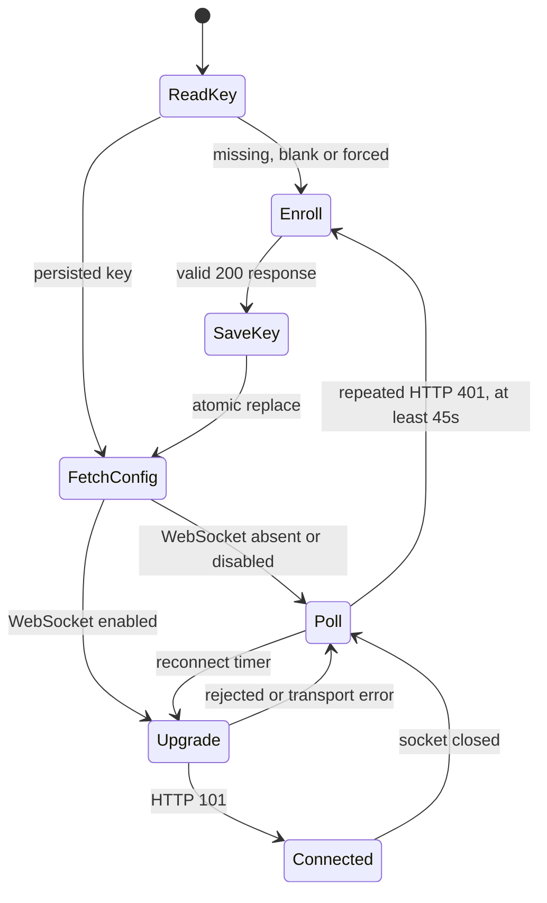

# FleetDM Orbit 注册、身份与 WebSocket 通知

固定 FleetDM 提交为 [3807bd7](https://github.com/fleetdm/fleet/tree/3807bd79fedbd25424ae55738b03cc8a4ae28a80)。Orbit 和 osquery 各有注册凭据。WebSocket 传送唤醒通知，查询、结果和配置继续走 HTTPS。osquery 字段见 [FleetDM 数据面](agent-protocol-fleetdm.md)。

## Orbit 注册和运行期认证

1. Orbit 在进程级注册锁内读取 `<root-dir>/secret-orbit-node-key.txt`。非空且未标记强制重注册时复用。缺失或只含空白则发起 JSON `POST /api/fleet/orbit/enroll`。注册密钥可来自参数、文件、系统密钥库或平台 MDM 交付。收到新密钥后，客户端先写同目录临时文件、同步并关闭，再替换原文件。Windows 在写之前限制 ACL。写入失败时原文件仍保留，注册成功可能已经替换服务端密钥。 [启动密钥加载](https://github.com/fleetdm/fleet/blob/3807bd79fedbd25424ae55738b03cc8a4ae28a80/orbit/cmd/orbit/orbit.go#L334-L452) · [客户端注册和持久化](https://github.com/fleetdm/fleet/blob/3807bd79fedbd25424ae55738b03cc8a4ae28a80/client/orbit_client.go#L769-L977) · [文件名](https://github.com/fleetdm/fleet/blob/3807bd79fedbd25424ae55738b03cc8a4ae28a80/orbit/pkg/constant/constant.go#L22-L32)
2. 管理端在启用时先匹配一次性注册密钥与设备平台及硬件标识，取密钥关联团队。否则验证共享密钥并取其团队。使用 `osquery_identifier`，缺失时使用 `hardware_uuid`，定位已有主机身份证书。存在证书时要求 HTTP 签名且序列号匹配。服务端生成配置长度的随机凭据，并交给数据存储完成主机注册或更新及身份关联。 [服务端注册](https://github.com/fleetdm/fleet/blob/3807bd79fedbd25424ae55738b03cc8a4ae28a80/server/service/orbit.go#L277-L549)
3. `POST /api/fleet/orbit/config` 等 Orbit 接口从 JSON `orbit_node_key` 取值，专门的请求头认证入口使用 `Authorization: Node key <credential>`。服务端用 Orbit 密钥查主机，绑定身份证书的主机同时验证 HTTP 签名。密钥空、找不到主机或身份校验失败返回 401。后端内部错误走独立错误编码。 [认证入口](https://github.com/fleetdm/fleet/blob/3807bd79fedbd25424ae55738b03cc8a4ae28a80/server/service/endpoint_utils.go#L272-L325) · [认证实现](https://github.com/fleetdm/fleet/blob/3807bd79fedbd25424ae55738b03cc8a4ae28a80/server/service/orbit.go#L156-L181)
4. 客户端认证请求收到 401 时启动计时。后续 401 距首次已至少 45 秒才置强制重注册。成功认证清掉计时。已配置本地身份证书路径时，强制分支还尝试删除证书并触发重启。之后获取节点密钥时重新注册。配置接口对网络或 5xx 错误额外重试一次。 [配置拉取及重试](https://github.com/fleetdm/fleet/blob/3807bd79fedbd25424ae55738b03cc8a4ae28a80/client/orbit_client.go#L591-L630) · [客户端失效处理](https://github.com/fleetdm/fleet/blob/3807bd79fedbd25424ae55738b03cc8a4ae28a80/client/orbit_client.go#L978-L1056)

### 注册字段字典

JSON 无字段编号。前九个请求字段是客户端总会序列化的字符串，若服务端收到省略则读为空字符串。后两个为可选空值省略字段。 [请求及响应结构](https://github.com/fleetdm/fleet/blob/3807bd79fedbd25424ae55738b03cc8a4ae28a80/server/fleet/api_orbit.go#L14-L95) · [构造请求](https://github.com/fleetdm/fleet/blob/3807bd79fedbd25424ae55738b03cc8a4ae28a80/client/orbit_client.go#L769-L799)

| 线上字段 | 类型及约束 | 用途／示例 |
|---|---|---|
| `enroll_secret` | string，需通过服务端凭据判定 | 共享或一次性注册密钥，`REDACTED` |
| `hardware_uuid` | string | 硬件标识，也用于缺失 osquery 标识时的关联 |
| `hardware_serial` | string | 设备序列号，用于一次性密钥或设备匹配 |
| `hostname` | string | 设备主机名，`host-example` |
| `platform` | string，schema 无闭集 | osquery 平台，例如 `windows` |
| `platform_like` | string，schema 无闭集 | osquery 平台族 |
| `osquery_identifier` | string | osquery 主机标识，空时用硬件 UUID |
| `computer_name` | string，业务可选 | 设备友好名 |
| `hardware_model` | string | 硬件型号 |
| `eua_token` | string，可省略 | Fleet 签发的 JWT，包含用户 UPN 和 Windows MDM 设备 ID |
| `autopilot_device_id` | string，可省略 | Windows Autopilot ZTDID。一次性密钥关联 Windows 注册时，以服务端注册记录中的 ID 为准 |
| 响应 `orbit_node_key` | string，空值省略 | 成功签发的 Orbit 节点密钥 |
| 后续请求 `orbit_node_key` | string，必需 | JSON 认证入口的 Orbit 凭据 |
| 请求头 `Authorization` | string，专用请求头认证路径必填 | `Node key REDACTED` |

HTTP 注册错误由通用编码器输出 `message`（string）、可选 `code`（integer，具体通用错误类型才使用）、`errors[]`（对象数组，常规项 `name: "base"`、`reason: string`）、`uuid`（string，可省略，关联错误或请求）。端用户交互认证的判定为 HTTP 401 加精确的 `message: "END_USER_AUTH_REQUIRED"`。注册密钥或身份匹配失败为 HTTP 401，公开消息为 `Authentication failed`。运行期节点凭据拒绝为 HTTP 401，公开消息为 `Authentication required`。未指定状态的 `OrbitError` 默认 HTTP 500。 [错误类型](https://github.com/fleetdm/fleet/blob/3807bd79fedbd25424ae55738b03cc8a4ae28a80/server/fleet/errors.go#L570-L607) · [HTTP 编码器](https://github.com/fleetdm/fleet/blob/3807bd79fedbd25424ae55738b03cc8a4ae28a80/server/platform/endpointer/transport_error.go#L28-L46)

### 主机身份证书

商业版主机身份路径以 SCEP 在 `/api/fleet/orbit/host_identity/scep` 签发或更新证书。初始签发校验 CSR 内 `ChallengePassword` 与注册密钥，核对证书名称与现有记录。续期配置可要求旧公钥对新 CSR 的公钥做证明。CA 能力文本包含 `SHA-256`、`AES`、`POSTPKIOperation`、`Fleet-Renewal-Key-Binding`。证书签发后，Agent 的 HTTP 请求由主机密钥签名，服务端验证后将证书身份写入请求上下文，再由 Orbit 注册或运行期认证核对绑定。运行期要求证书 CN 与主机 osquery 标识相同，证书关联主机 ID 存在且一致。SCEP 线上字段与固定依赖的处理见下表。 [服务端 SCEP](https://github.com/fleetdm/fleet/blob/3807bd79fedbd25424ae55738b03cc8a4ae28a80/ee/server/service/hostidentity/scep.go) · [续期证明](https://github.com/fleetdm/fleet/blob/3807bd79fedbd25424ae55738b03cc8a4ae28a80/ee/pkg/hostidentity/types/host_identity_certificates.go) · [Agent 证书管理](https://github.com/fleetdm/fleet/blob/3807bd79fedbd25424ae55738b03cc8a4ae28a80/ee/orbit/pkg/hostidentity/host_identity.go)

| 字段 | 约束 |
|---|---|
| `Signature` | HTTP 签名字节的序列化值 |
| `Signature-Input` | 需包含 `@method`、`@authority`、`@path`、`@query`、`content-digest`。必须有参数 `keyid`、`created`、`nonce`；禁止显式 `alg` |
| `Content-Digest` | 请求体摘要，被签名覆盖 |
| `keyid` | 证书序列号的十进制字符串，服务端据此定位证书，并从证书公钥曲线选择算法 |
| 算法闭集 | ECDSA P-256/SHA-256、ECDSA P-384/SHA-384 |

缺失签名头时，强制签名配置直接给出 401，其余请求进入业务认证。无效签名同样返回 401，内部身份提取错误返回 500。 [签名配置](https://github.com/fleetdm/fleet/blob/3807bd79fedbd25424ae55738b03cc8a4ae28a80/pkg/fleethttpsig/fleethttpsig.go) · [服务端签名中间件](https://github.com/fleetdm/fleet/blob/3807bd79fedbd25424ae55738b03cc8a4ae28a80/ee/server/service/hostidentity/httpsig/middleware.go) · [证书绑定检查](https://github.com/fleetdm/fleet/blob/3807bd79fedbd25424ae55738b03cc8a4ae28a80/ee/server/service/hostidentity/httpsig/httpsig.go)

`X-Fleet-Capabilities` 是双方的逗号分隔字符串集合，顺序无语义。Agent 默认报告 `escrow_buddy`、`setup_experience`。非 macOS 增加 `end_user_auth`，允许客户端配置移除。Windows 另报告 `windows_mdm_sync`、`windows_managed_local_account`、`windows_bitlocker_pin`。服务端报告 `orbit_endpoints`、`token_rotation`、`end_user_email`、`escrow_buddy`、`linux_disk_encryption_escrow`、`luks_recovery_key_escrow`、`linux_escrow_status`、`setup_experience`、`web_setup_experience`、`macos_web_setup_experience`、`windows_disk_encryption_error_keeps_key`、`fleet_agent_names`。解析器接受任意成员，功能判断只检查对应已知值。[能力定义与序列化](https://github.com/fleetdm/fleet/blob/3807bd79fedbd25424ae55738b03cc8a4ae28a80/server/fleet/capabilities.go)

#### SCEP HTTP 与 CMS 字段

| 层与字段 | 编码和固定实现行为 |
|---|---|
| URL 查询 `operation` | `GetCACert` 拉取 CA，`GetCACaps` 拉取能力，`PKIOperation` 提交证书请求。服务端 `GetNextCACert` 未实现 |
| `GetCACert` 响应 | Fleet 返回单个 CA 的 X.509 DER 字节。客户端的 CA 解析器也支持 CMS 证书链 |
| `PKIOperation` POST 正文 | CMS `ContentInfo` 中的 `SignedData`。已签名内容为 CMS `EnvelopedData`，本请求的加密明文是 PKCS #10 CSR。外层签名用临时 RSA 签名证书，CSR 由设备身份密钥签名。内层收件人为 CA |
| CSR `subject.commonName` | X.509 主机标识，更新时必须等于原证书 CN |
| CSR `subjectPublicKeyInfo` | DER 设备公钥，续期证明可绑定该值。服务端还验证 CSR 自身签名 |
| CSR `challengePassword` | 首次签发时以此核对注册密钥。自定义续期扩展存在时改验旧证书密钥证明 |
| CSR 扩展 `1.3.6.1.4.1.63991.1.1` | ASN.1 扩展值内是 UTF-8 JSON。成员 `sn` 为原证书序号的十六进制字符串，可有 `0x` 前缀。成员 `sig` 为标准 Base64 编码的 ECDSA ASN.1 签名 |
| `CertRep` 成功内容 | 签名响应封装加密的签发证书集合，收件人为请求的临时签名证书。Agent 用 CA 链验签、用临时私钥解密并选择与 CSR 公钥一致的证书 |
| `CertRep` 失败内容 | CMS 属性携带失败状态及原因，缺少加密证书正文。Fleet 在解密或签发错误时构造 `badRequest`，空、过深或无法解析的 BER 报文返回 HTTP 400，签发限流返回 HTTP 429 |

[Orbit SCEP 客户端](https://github.com/fleetdm/fleet/blob/3807bd79fedbd25424ae55738b03cc8a4ae28a80/ee/orbit/pkg/scep/scep.go#L147-L214) · [签发与续期检查](https://github.com/fleetdm/fleet/blob/3807bd79fedbd25424ae55738b03cc8a4ae28a80/ee/server/service/hostidentity/scep.go#L112-L273) · [服务端响应](https://github.com/fleetdm/fleet/blob/3807bd79fedbd25424ae55738b03cc8a4ae28a80/ee/server/service/hostidentity/scep.go#L285-L391) · [客户端响应处理](https://github.com/fleetdm/fleet/blob/3807bd79fedbd25424ae55738b03cc8a4ae28a80/server/mdm/scep/enrollment/enrollment.go#L71-L165) · [RFC 8894 SCEP 消息和 HTTP](https://www.rfc-editor.org/rfc/rfc8894.html#section-3)

以下 CMS 签名属性的 OID 前缀为 `2.16.840.1.113733.1.9`。本文列出 Fleet 使用的分支，并记录固定依赖解析器可识别的额外值。

| 属性及 OID 后缀 | 线上类型与取值 |
|---|---|
| `transactionID`，`.7` | PrintableString，由请求公钥哈希生成。响应沿用请求值 |
| `messageType`，`.2` | PrintableString。Orbit 首次和续期均发 `19`（PKCSReq），续期由 CSR 私有扩展识别。回复为 `3`（CertRep）。固定解析器也接受 `17`（RenewalReq）和 `18`（UpdateReq）的请求结构，`20`（CertPoll）、`21`（GetCert）、`22`（GetCRL）返回未实现，其他值返回未知类型 |
| `senderNonce`，`.5` | OCTET STRING。客户端生成 16 字节随机值。固定依赖解析请求时要求非空。固定依赖构造响应时在该字段中复制请求的 nonce |
| `recipientNonce`，`.6` | OCTET STRING，响应复制请求的 `senderNonce`。固定依赖解析响应时要求非空 |
| `pkiStatus`，`.3` | PrintableString。响应 `0`（SUCCESS）包含证书，`2`（FAILURE）包含 `failInfo`，`3`（PENDING）由依赖识别但 Orbit 视为拒绝，不轮询人工审批。未知值为解析错误 |
| `failInfo`，`.4` | PrintableString。固定依赖常量为 `0`（badAlg，不支持算法）、`1`（badMessageCheck，消息校验失败）、`2`（badRequest，事务被拒绝）、`3`（badTime，时间校验失败）、`4`（badCertID，证书标识未知）。Fleet 主机身份 CA 的业务拒绝发 `2` |
| `failInfoText` | RFC 8894 的可选 UTF8String。固定 Fleet 失败路径只设置 `failInfo` |

[固定 smallstep/scep 消息常量与 OID](https://github.com/smallstep/scep/blob/892e41795b99/scep.go#L41-L141) · [证书消息解析及生成](https://github.com/smallstep/scep/blob/892e41795b99/scep.go#L250-L674) · [RFC 8894 属性定义](https://www.rfc-editor.org/rfc/rfc8894.html#section-3.2.1)

## Agent WebSocket

`GET /api/fleet/orbit/notifications` 仅在服务端启用 WebSocket 传输且通知 Hub 可用时注册，关闭时得到 404。客户端把 HTTPS 转换为 WSS，HTTP 转换为 WS。请求使用 WebSocket 升级头和 `Authorization: Node key <credential>`。服务端以区分大小写的前缀匹配，去除值两端空白后认证。失败返回纯文本 HTTP 401，成功升级后按主机 ID 维护连接。客户端可配置根 CA 和 TLS 客户端证书。此处的 WebSocket 管理器升级请求只设置 Orbit 节点密钥，不配置 HTTP 消息签名。要求签名的主机因此回退到常规带签名的 HTTP 轮询。 [路由](https://github.com/fleetdm/fleet/blob/3807bd79fedbd25424ae55738b03cc8a4ae28a80/server/service/handler.go#L1080-L1088) · [服务端升级鉴权](https://github.com/fleetdm/fleet/blob/3807bd79fedbd25424ae55738b03cc8a4ae28a80/server/agentws/handler.go) · [Agent 握手](https://github.com/fleetdm/fleet/blob/3807bd79fedbd25424ae55738b03cc8a4ae28a80/orbit/pkg/wstransport/manager.go#L395-L445)

| JSON 字段 | 类型及缺省 | 枚举与处理 |
|---|---|---|
| `type` | string，服务端总是编码。空或未知类型忽略 | `distributed/read` 触发 HTTPS 查询拉取；`orbit/config` 触发 Orbit 配置拉取；`osquery/config` 触发 osquery 配置拉取 |
| `reason` | string，空值省略，Agent 只记录 | `orbit/config` 取 `activity`（脚本或软件动作）、`mdm`、`disk-encryption`、`settings`、`enroll` |
| `reason` | 同上 | `osquery/config` 取 `settings`、`reports`、`labels` |
| `reason` | 同上 | `distributed/read` 取 `label`、`policy`、`detail`、`refetch` 或 `live-<十进制活动 ID>`。`host-not-found` 是服务端内部标记，触发关闭旧连接 |
| `data` | 任意 JSON RawMessage，可省略 | 预留。固定版本的发送队列只构造 `type` 和 `reason` |

服务端按 `type` 合并尚未发出的通知，并保留最新原因。同一次取队列按类型排序。Agent 无应用层回执或序号。应用消息解码失败时 Agent 结束读循环，恢复轮询，并带抖动重连。服务端读循环消费控制帧并丢弃数据帧，最大入站应用消息为 1024 字节，超限关闭码 1009。默认 Agent 参数为轮询 10 秒、首次握手上限 30 秒、重连退避从 5 秒到 5 分钟，已连接后断开时抖动小于 30 秒，每 30 秒发送空 Ping，Pong 超时为 15 秒。 [通知定义](https://github.com/fleetdm/fleet/blob/3807bd79fedbd25424ae55738b03cc8a4ae28a80/server/fleet/agent_websocket.go) · [队列与帧](https://github.com/fleetdm/fleet/blob/3807bd79fedbd25424ae55738b03cc8a4ae28a80/server/agentws/conn.go) · [Agent 处理](https://github.com/fleetdm/fleet/blob/3807bd79fedbd25424ae55738b03cc8a4ae28a80/orbit/pkg/wstransport/manager.go#L53-L278)

```json
{"type":"distributed/read","reason":"live-42"}
```

唤醒后 Orbit 的本机 Thrift 扩展把 HTTPS 拉到的查询交给 osquery。结果再由 Orbit 通过 HTTPS 上传。调用 osquery 接口时使用本体的 Orbit 密钥，同时发送 JSON `node_key` 和 `Authorization: NodeKey <credential>`，服务端按配置选择其中之一。调度状态依次为 `idle`、`reading`、`delivered`、`awaitingWrite`。执行期间重复触发合并为一次后续迭代。查询结果通过本地插件转换为 HTTPS `queries`、`statuses`、`messages`、`stats`。其中每个查询的动态行值为字符串，空结果正规化为空数组，`accelerate` 以秒计。 [本地分布式扩展](https://github.com/fleetdm/fleet/blob/3807bd79fedbd25424ae55738b03cc8a4ae28a80/orbit/pkg/wstransport/distributed.go) · [HTTP 分布式客户端](https://github.com/fleetdm/fleet/blob/3807bd79fedbd25424ae55738b03cc8a4ae28a80/client/orbit_distributed.go)

## Orbit 配置接口

`POST /api/fleet/orbit/config` 的 JSON 正文使用 `orbit_node_key` 字符串。可选 `X-Fleet-Orbit-Config-Fallback-Changes` 为逗号分隔的变化字段名，用于上报轮询发现但未收到通知的更新。嵌套通知项加前缀 `notifications.`。服务端从经过认证的 Host 读取团队、设备能力、MDM 状态和配置，返回运行参数及通知。客户端应用版本匹配的参数与接收器。缺失指针字段通常表示维持既有设置或禁用可选行为，逐项见下表。 [HTTP 类型](https://github.com/fleetdm/fleet/blob/3807bd79fedbd25424ae55738b03cc8a4ae28a80/server/fleet/api_orbit.go#L47-L84) · [配置字段](https://github.com/fleetdm/fleet/blob/3807bd79fedbd25424ae55738b03cc8a4ae28a80/server/fleet/orbit.go#L9-L182) · [服务端实现](https://github.com/fleetdm/fleet/blob/3807bd79fedbd25424ae55738b03cc8a4ae28a80/server/service/orbit.go#L683-L900)

| 响应字段 | 类型、缺省及消费 |
|---|---|
| `script_execution_timeout` | integer，零值省略。脚本执行超时 |
| `command_line_startup_flags` | 原始 JSON，省略表示无覆盖，配置有效时由运行参数消费 |
| `extensions` | 原始 JSON，省略表示无扩展设置。扩展内部结构随功能和发行版本确定 |
| `notifications` | object。内部 false 和空数组省略。Go 值结构序列化时空对象仍可出现 |
| `update_channels.orbit`、`update_channels.osqueryd`、`update_channels.desktop` | string，指定各 TUF 更新通道。整个 `update_channels` 可省略 |
| `debug_logging` | boolean，缺失或 null 保持当前级别，明确 true/false 应用指定值 |
| `websocket_transport.enabled` | boolean，整个对象缺失或 enabled 为 false 时停用 |
| `websocket_transport.orbit_config_poll_interval` | integer 秒，可省略。省略时客户端继续默认轮询 |
| `websocket_transport.osquery_config_poll_interval` | integer 秒，可省略。省略时 osquery 继续直接向服务端获取自己的配置 |
| `entra_device_token_request.tenant_id`、`entra_device_token_request.client_id`、`entra_device_token_request.nonce` | string。整个对象可省略；nonce 以前置主机硬件 UUID 绑定设备 |

| `notifications` 成员 | 线上类型与用途 |
|---|---|
| `renew_enrollment_profile` | boolean，更新注册配置 |
| `rotate_disk_encryption_key` | boolean，轮换磁盘加密密钥 |
| `needs_mdm_migration` | boolean，迁移符合条件的 MDM |
| `needs_programmatic_windows_mdm_enrollment` | boolean，发起 Windows MDM 注册 |
| `windows_mdm_discovery_endpoint` | string，与 Windows MDM 注册通知配套的发现 URL |
| `needs_programmatic_windows_mdm_unenrollment` | boolean，退出 Windows MDM |
| `windows_mdm_sync_request` | boolean，通知具有相应能力的客户端启动 OMA-DM 会话 |
| `pending_script_execution_ids` | string[]，待执行脚本 ID |
| `enforce_bitlocker_encryption` | boolean，要求保护 Windows 磁盘 |
| `enable_bitlocker_protection` | boolean，重新打开已加密卷的 BitLocker 保护 |
| `bitlocker_pin_request_pending` | boolean，端用户已提交请求 |
| `pending_software_installer_ids` | string[]，待处理安装 ID |
| `run_setup_experience` | boolean，执行 Fleet Setup Experience |
| `create_windows_managed_local_account` | boolean，启用且对应主机尚未托管时创建本地受管账号并托管凭据 |
| `run_disk_encryption_escrow` | boolean，提示 Linux 用户交付磁盘密钥给托管端 |

## 客户端状态与交换示例



| 输入／结果 | 本地状态 | 服务端行为 |
|---|---|---|
| 成功注册 200 | 原子替换本地节点密钥。清理重注册状态 | 绑定或替换主机记录的 Orbit 凭据 |
| 注册 401，`message` 精确为 `END_USER_AUTH_REQUIRED` | 进入支持的终端用户身份认证路径 | 仍等待注册前置条件 |
| 第一次已认证调用返回 401 | 启动计时，保留密钥 | 拒绝本次调用 |
| 再次 401 且距第一次至少 45 秒 | 强制下一次取 key 时注册。若配置身份证书，删除本地证书并请求重启 | 只有完成注册才替换服务端节点密钥 |
| 已认证调用成功 | 清除 401 计时和强制标记 | 处理本次接口 |
| WebSocket 升级 401 或 404 | 回退 HTTP 轮询，按退避策略重连。升级错误本身不调用 HTTP 请求的重注册计时 | 401 表示升级鉴权失败，404 表示未注册升级路由 |
| WebSocket 收到有效唤醒通知 | 合并或触发对应 HTTPS 请求 | 唤醒通知仅承载 `type` 和可选 `reason` |
| WebSocket JSON 解码失败或网络断开 | 结束读循环，恢复轮询和带抖动重连 | 清理连接；传输没有通知重放 |

以下示例采用脱敏域名和凭据。业务正文完整，允许 HTTP 库自动编码长度。上传、响应与续期的真实加密值由实际测试会话产生。WebSocket 的握手 key/accept 使用 RFC 示例值，仅用于显示头的对应关系。 [RFC 6455 握手](https://www.rfc-editor.org/rfc/rfc6455.html#section-4)

### Orbit 注册成功

```http
POST /api/fleet/orbit/enroll HTTP/1.1
Host: fleet.example.invalid
Content-Type: application/json
X-Fleet-Capabilities: escrow_buddy,setup_experience,end_user_auth

{
  "enroll_secret": "REDACTED-ENROLL-SECRET",
  "hardware_uuid": "00000000-0000-4000-8000-000000000002",
  "hardware_serial": "EXAMPLE-SERIAL",
  "hostname": "example-host",
  "platform": "ubuntu",
  "platform_like": "debian",
  "osquery_identifier": "",
  "computer_name": "Example host",
  "hardware_model": "Example hardware"
}
```

```http
HTTP/1.1 200 OK
Content-Type: application/json

{
  "orbit_node_key": "REDACTED-ORBIT-KEY"
}
```

### Orbit 运行期请求收到认证失败

```http
POST /api/fleet/orbit/config HTTP/1.1
Host: fleet.example.invalid
Content-Type: application/json

{
  "orbit_node_key": "REDACTED-ORBIT-KEY"
}
```

```http
HTTP/1.1 401 Unauthorized
Content-Type: application/json

{
  "message": "Authentication required",
  "errors": [
    {
      "name": "base",
      "reason": "Authentication required"
    }
  ],
  "uuid": "00000000-0000-4000-8000-000000000001"
}
```

同一请求认证成功时的最小启用示例如下。具体功能决定是否有更多配置成员。

```http
HTTP/1.1 200 OK
Content-Type: application/json

{
  "notifications": {},
  "websocket_transport": {
    "enabled": true
  }
}
```

### WebSocket 升级和通知

```http
GET /api/fleet/orbit/notifications HTTP/1.1
Host: fleet.example.invalid
Authorization: Node key REDACTED-ORBIT-KEY
Connection: Upgrade
Upgrade: websocket
Sec-WebSocket-Version: 13
Sec-WebSocket-Key: dGhlIHNhbXBsZSBub25jZQ==
```

```http
HTTP/1.1 101 Switching Protocols
Upgrade: websocket
Connection: Upgrade
Sec-WebSocket-Accept: s3pPLMBiTxaQ9kYGzzhZRbK+xOo=
```

以下为升级后服务端文本帧的解码正文。客户端按消息类型走相应的 HTTPS POST。

```json
{
  "type": "distributed/read",
  "reason": "live-42"
}
```
