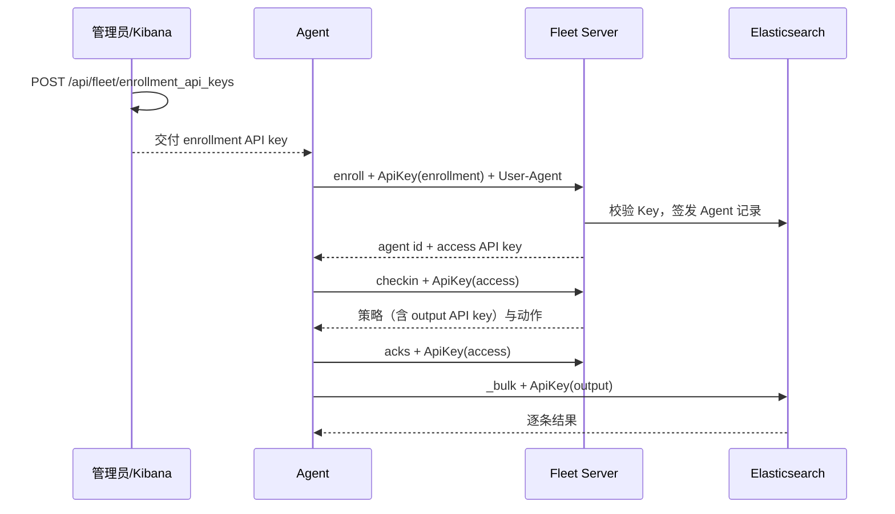

# Elastic Agent / Fleet 认证过程

本文从 [接口规格](elastic.md) 提炼认证过程，配套可运行示例 [demo.py](demo.py)。固定版本、字段边界与未验证项以接口规格为准：Fleet Server `d05ee7b`、Agent `96f2b9f`、Kibana `86cbc85`。

## 角色与凭据

| 角色 | 凭据 | 签发方 | 线上形式 | 用途 |
|---|---|---|---|---|
| 管理员 | Kibana 管理身份 + `kbn-xsrf` | 部署提供 | 会话凭据 | 在 Kibana 签发/撤销注册令牌 |
| Agent | enrollment API key | Kibana | Base64 `id:secret` | 首次注册 |
| Agent | access API key | Fleet Server | Base64 `id:secret` | check-in、ACK、退出审计 |
| 采集组件 | output API key | Fleet Server 随策略下发 | 原始 `<id>:<secret>` 串，出站前编码 | 写入 Elasticsearch |

三类凭据职责分离：注册令牌不能用于 check-in，access key 不能写入 Elasticsearch。

## 认证时序



## 逐步过程

1. **签发注册令牌**：管理员在 Kibana `POST /api/fleet/enrollment_api_keys`，带 `kbn-xsrf`，响应 `item.api_key`。`expiration` 虽被 route 接受，但固定提交的签发函数未传给 Security，不能据此推导过期时间。
2. **注册**：Agent `POST /api/fleet/agents/enroll`，请求头 `Authorization: ApiKey <enrollment>`、`User-Agent: Elastic Agent v8.17.0`，正文 `type=PERMANENT` 与 `metadata`。Fleet Server 校验 Key 和版本，生成 Agent UUID 与新的 access API key；成功响应为 `action=created`，保留 `item.id` 和 `item.access_api_key` 后才能进入下一步。
3. **首次签入**：Agent `POST /api/fleet/agents/{id}/checkin`，带 `ApiKey <access>`。路径 `id` 必须与凭据绑定的 Agent 记录一致。响应给出策略与动作；策略中的 `outputs.<name>.api_key` 是 output 凭据，供采集组件使用。
4. **动作确认**：Agent `POST /api/fleet/agents/{id}/acks`，带 `events[]`。HTTP 200 仍须检查逐项 `items[].status`；逐项失败时 HTTP 状态取最大项状态。
5. **数据面写入**：采集组件用 output API key 对 `POST /_bulk` 发 NDJSON。策略里是原始 `<id>:<secret>`，出站 `Authorization` 使用 `ApiKey <base64(id:secret)>`。批次 HTTP 200 不代表逐条成功，需检查 `items[]`。

## 失败与重试

| 场景 | 线上结果 | Agent 行为 |
|---|---|---|
| 缺少认证头 | 401 `ErrNoAuthHeader` | 纠正配置后重试 |
| 凭据无效 | 401 `ErrInvalidAPIKey` | 连续七次触发本地 `UNENROLL` 动作，其他返回重置计数 |
| 注册限流/网关错误 | 429、502、503、504 | 初始 1 秒、上限 10 秒的指数退避 |
| check-in 失败 | 非 2xx | 指数退避和抖动，上下文结束即退出 |
| Bulk 逐项失败 | 409 / 429 / ≥500 | 409 按重复项处理不重试；429/5xx 重试失败子集 |

## Demo 说明

`demo.py` 在本机启动 mock Kibana、Fleet Server 和 Elasticsearch，用标准库 `http.server` 走完上述五步。运行：

```powershell
python demo.py
```

脚本依次验证：无认证头注册返回 401、正确注册令牌换得 access key、错误 access key 签入返回 401、正确签入下发 output key、Bulk 返回逐条结果。全部断言通过时输出 `PASS`，否则以非零码退出。

Demo 只覆盖凭据流转与请求顺序，不建立真实 TLS、不连接真实 Fleet/ES，也不验证策略内容与集成包处理。
