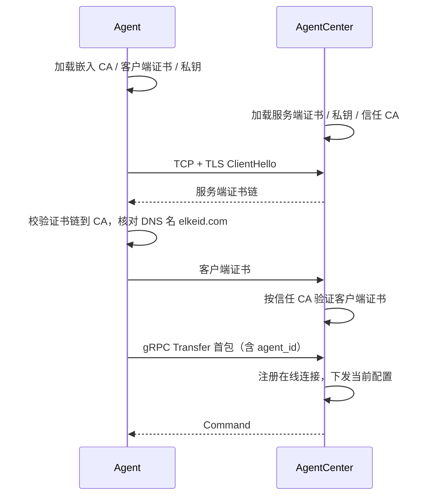

# Elkeid 认证过程

本文从 [接口规格](elkeid.md) 提炼认证过程。固定提交 `c906c512`，双向 TLS 与连接生命周期结论以接口规格为准。

## 角色与凭据

| 角色 | 凭据 | 来源 | 验证方式 |
|---|---|---|---|
| Agent | CA + 客户端证书 + 客户端私钥 | 构建时嵌入 PEM | 连接前解析，自定义校验服务端证书链到指定 CA 并核对 DNS 名 `elkeid.com` |
| AgentCenter | 服务端证书 + 私钥 + 客户端信任 CA | 磁盘加载（`server.ssl.certfile` 等） | 要求并验证客户端证书，失败则退出进程 |
| 业务身份 | `agent_id` | 配置、主机标识或本地 `machine-id` | 首包上报，AgentCenter 以该 ID 登记在线连接 |

该路径没有注册 RPC，也没有签发、续期或吊销 RPC。证书生命周期完全由部署环境提供；Agent 证书轮换需要重新构建并部署，服务端材料在启动时重新加载。

## 认证时序

## 逐步过程

### 1. 双方准备证书材料

- **Agent**：构建时嵌入 CA、客户端证书和客户端私钥
- **AgentCenter**：启动时从磁盘读取服务端证书、私钥和客户端信任 CA
- **失败行为**：任一方加载失败都会退出

### 2. Agent 校验服务端证书

- **发起方**：Agent → AgentCenter（TLS 连接）
- **动作**：通过 `setDialOptions` 解析 PEM；收到服务端证书链后校验到指定 CA，并核对 DNS 名 `elkeid.com`
- **失败行为**：TLS 握手中止，双方不交换任何 RPC 消息

### 3. AgentCenter 校验客户端证书

- **发起方**：Agent 在握手中出示客户端证书
- **执行方**：AgentCenter 要求该证书，并按客户端信任 CA 验证
- **失败行为**：连接直接失败，不会进入 `/grpc.Transfer/Transfer` 流

### 4. Agent 登记业务身份

- **发起方**：Agent → AgentCenter
- **请求**：TLS 建立后打开 `/grpc.Transfer/Transfer` 双向流，首个 `PackagedData` 携带 `agent_id`
- **处理**：AgentCenter 读取首包 ID 登记连接池；ID 冲突时返回 `agentID conflict`，已有连接保留
- **后续**：AgentCenter 用首条心跳初始化在线详情并触发配置下发

### 5. 应用层不附加认证字段

- **协议层**：认证由 TLS 握手承担，应用层没有独立认证字段
- **载荷**：所有键位于 `Payload.fields`，值均为字符串
- **边界**：应用代码不附加 bearer token 或 API key

## 失败与重试

| 场景 | 结果 |
|---|---|
| Agent 证书不被信任 | TLS 握手失败，无 RPC 交换 |
| 服务端 DNS 名不匹配 | Agent 自定义校验拒绝连接 |
| AgentCenter 凭据加载失败 | 进程退出 |
| 首包 agent_id 冲突 | `agentID conflict`，已有连接保留 |
| 连接配额超限 | gRPC `UNKNOWN=2`，消息 `out of max connection limit` |
| 流结束或拨号失败 | 约等 5 秒重开；连续获取连接失败超阈值后传输协程退出 |

