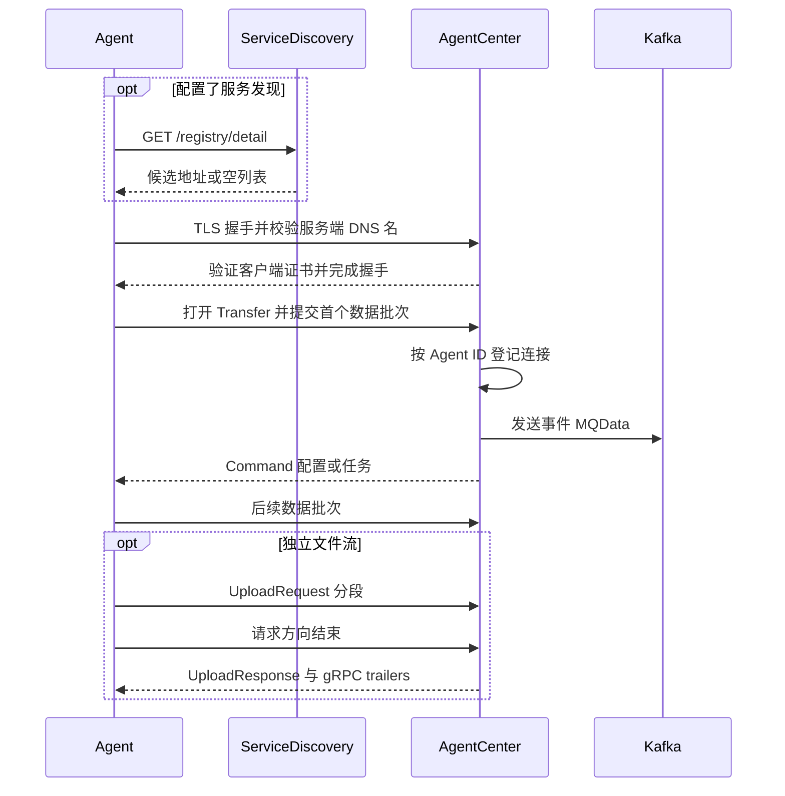
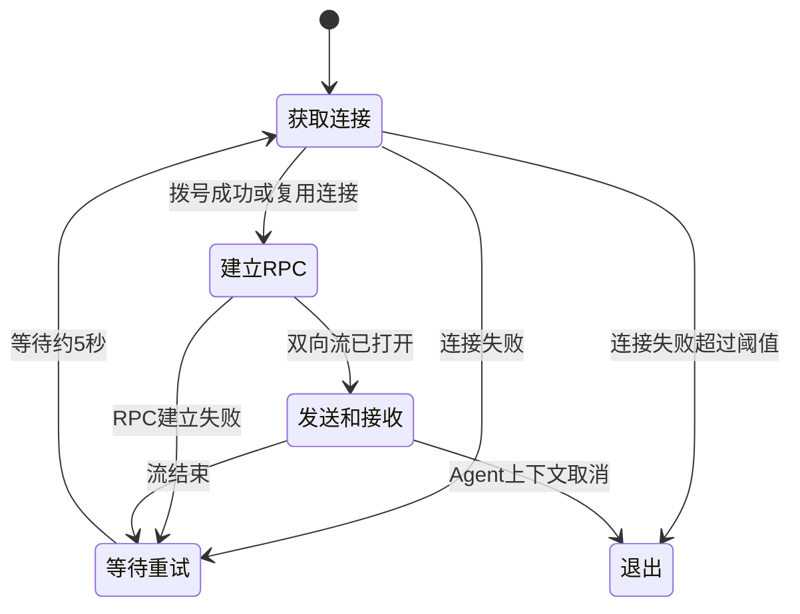

# Elkeid Agent 与 AgentCenter 接口规格

基线为提交 `c906c512d20c0d56f2b779b8558ed69abae718c8`。覆盖 Agent 与 AgentCenter 的 TLS、服务发现、遥测双向流和独立文件流，以及 AgentCenter 生产 Kafka 消息的边界。结论来自固定版本静态源码核对。 [固定源码](https://github.com/bytedance/Elkeid/tree/c906c512d20c0d56f2b779b8558ed69abae718c8)

## 接口总览

| 接口 | 发起方 → 接收方 | 传输与返回 | 实现入口 |
|---|---|---|---|
| `GET /registry/detail?name=hids_svr_grpc&count=10` | Agent → ServiceDiscovery | HTTP，JSON | `resolveServiceDiscovery` → `RegistryDetail` |
| TLS 握手 | Agent → AgentCenter | TCP + TLS，双向证书校验，协商 HTTP/2 | `setDialOptions` → `runServer` / `credential` |
| `POST /grpc.Transfer/Transfer` | Agent → AgentCenter | gRPC 双向流，`PackagedData` / `RawData` → `Command` | `startTransfer` → `TransferHandler.Transfer` |
| `POST /grpc.FileExt/Upload` | Agent → AgentCenter | gRPC 客户端流，`FileUploadRequest` / `UploadRequest` → 单一 `FileUploadResponse` / `UploadResponse` | `handleUpload` → `FileExtHandler.Upload` |
| Kafka Produce | AgentCenter → Kafka | 每条事件作为一个 Protobuf `MQData` 值，键为 UTF-8 Agent ID | `handleRawData` → `SendPBWithKey` |

以下示例使用测试数据。TLS、控制流与数据流都使用项目固定提交，Kafka 生产者连接取部署配置。

- **证据**：[Agent schema](https://github.com/bytedance/Elkeid/blob/c906c512d20c0d56f2b779b8558ed69abae718c8/agent/proto/grpc.proto)
- **证据**：[AgentCenter schema](https://github.com/bytedance/Elkeid/blob/c906c512d20c0d56f2b779b8558ed69abae718c8/server/agent_center/grpctrans/proto/grpc.proto)



## gRPC 传输约定

- **传输**：Agent 使用 `https` 上的 HTTP/2。
- **请求头**：HTTP/2 请求头 `:method=POST`，`:path` 使用总览中大小写敏感的路径，`:authority` 由拨号目标和客户端库决定，`content-type=application/grpc` 且 `te=trailers`。
- **压缩**：实际 Agent 使用 `grpc-encoding=snappy`，压缩器以 Snappy stream writer/reader 编解码。
- **边界**：应用代码未附加 bearer token、API key 或自定义认证元数据。
- **超时**：Upload 设置 600 秒的调用上下文截止时间，grpc-go 可将剩余时间编码为 `grpc-timeout`。
- **帧格式**：每条 DATA 消息使用一字节压缩标志、四字节无符号大端长度和消息本体，长度计算基于随后实际发送的字节。
- **响应**：RPC 响应通常是 HTTP 200，调用结束读 `grpc-status` 及可选 `grpc-message`。
- **结论**：协议文档链接指向 master 分支，内容可能变化，本文结论以固定提交实现为准。
- **证据**：[gRPC HTTP/2 协议](https://github.com/grpc/grpc/blob/master/doc/PROTOCOL-HTTP2.md)
- **证据**：[Snappy 实现](https://github.com/bytedance/Elkeid/blob/c906c512d20c0d56f2b779b8558ed69abae718c8/agent/transport/compressor/snappy.go)
- **证据**：[传输入口](https://github.com/bytedance/Elkeid/blob/c906c512d20c0d56f2b779b8558ed69abae718c8/agent/transport/transfer.go)

```text
:method: POST
:scheme: https
:authority: elk-center.example.test:6751
:path: /grpc.Transfer/Transfer
content-type: application/grpc
te: trailers
grpc-encoding: snappy
```

## 认证、身份和连接生命周期

### 1. Agent 构建时嵌入凭据并校验服务端

- **配置**：Agent 在构建时嵌入 CA、客户端证书和客户端私钥。连接前 `setDialOptions` 解析 PEM 并配置 TLS。
- **校验**：Agent 使用自定义校验，将对端证书链验证到指定 CA，并验证预期 DNS 名称 `elkeid.com`。
- **证据**：[Agent 凭据加载](https://github.com/bytedance/Elkeid/blob/c906c512d20c0d56f2b779b8558ed69abae718c8/agent/transport/connection/product.go)
- **证据**：[Agent 校验逻辑](https://github.com/bytedance/Elkeid/blob/c906c512d20c0d56f2b779b8558ed69abae718c8/agent/transport/connection/connection.go)

### 2. AgentCenter 加载服务端凭据并验证客户端证书

- **配置**：AgentCenter 从磁盘加载服务端证书、私钥及客户端信任 CA，要求并验证客户端证书。凭据加载失败会退出。
- **边界**：TLS 失败发生在 RPC 消息交换前。 gRPC schema 未声明注册、签发、续期和吊销 RPC。该路径中也未找到动态重新加载证书的行为。
- **部署**：部署路径在构建前提供 Agent 端证书材料，AgentCenter 通过 `server.ssl.certfile`、`server.ssl.keyfile`、`server.ssl.cafile` 提供服务端材料。给定源码显示替换 Agent 嵌入材料需要重新构建并部署，替换服务端配置材料由启动时重新加载。
- **边界**：项目说明要求两端部署材料配套，未找到自动签发或轮换控制器，以及证书吊销名单或 OCSP 配置。证书生命周期由部署环境提供。
- **证据**：[Agent 构建说明](https://github.com/bytedance/Elkeid/blob/c906c512d20c0d56f2b779b8558ed69abae718c8/agent/README.md) [服务端配置读取](https://github.com/bytedance/Elkeid/blob/c906c512d20c0d56f2b779b8558ed69abae718c8/server/agent_center/common/init.go)
- **证据**：[AgentCenter TLS](https://github.com/bytedance/Elkeid/blob/c906c512d20c0d56f2b779b8558ed69abae718c8/server/agent_center/grpctrans/grpc_server.go)

### 3. `agent_id` 作为业务身份完成连接登记

- **身份**：`agent_id` 是业务身份。Agent 在初始化时从显式配置、主机标识材料或本地持久化的 `machine-id` 取得或生成 ID。
- **处理**：AgentCenter 在 TLS 建立后读取首包 ID，以该 ID 注册在线连接并记录连接来源地址。
- **配置**：首条 Agent 心跳初始化在线详情并触发当前配置下发。
- **清理**：流关闭后清理连接和心跳指标。
- **证据**：[ID 初始化](https://github.com/bytedance/Elkeid/blob/c906c512d20c0d56f2b779b8558ed69abae718c8/agent/agent/id.go) [流处理](https://github.com/bytedance/Elkeid/blob/c906c512d20c0d56f2b779b8558ed69abae718c8/server/agent_center/grpctrans/grpc_handler/transfer_handler.go)
- **证据**：[心跳处理](https://github.com/bytedance/Elkeid/blob/c906c512d20c0d56f2b779b8558ed69abae718c8/server/agent_center/grpctrans/grpc_handler/rawdata_worker.go)

### 服务发现字段

Agent 可通过 HTTP GET `/registry/detail` 获取候选地址，随后按服务发现、私网配置、公网配置的顺序拨号。单次拨号等待 15 秒。发现只负责地址选择，认证发生于随后的 TLS 握手。Agent 侧无该 GET 的请求体。 [解析与拨号源码](https://github.com/bytedance/Elkeid/blob/c906c512d20c0d56f2b779b8558ed69abae718c8/agent/transport/connection/connection.go)

| 路径 | JSON 类型 | 示例及用途 |
|---|---|---|
| query.name | string | `hids_svr_grpc`，目标服务 |
| query.count | 十进制参数 | `10`，期望候选数量 |
| code | int32 | 响应代码，Agent 未检查 |
| msg | string | 响应说明，Agent 未检查 |
| data | array | 缺失、null 或空数组均无法提供服务器 |
| data[].ip | string | `192.0.2.10`，地址 |
| data[].port | int | `6751`，TCP 端口 |
| data[].weight | int | 权重，Agent 未用来排序 |

- **客户端**：Agent 对缺失成员使用 Go 零值，按响应列表顺序拼接地址。对解析错误、空候选列表或拨号失败进入后续路径。
- **服务端**：固定服务端 `RegistryDetail` 只读取 query.name，忽略 query.count。
- **响应**：name 缺失返回 HTTP 400，body 为 `{"msg":"no server name"}`。其余返回 HTTP 200，body 为 `{"msg":"ok","data":[...]}`，未知服务返回空数组。此路由没有 body.code。
- **边界**：服务端返回的其它字段如下，Agent JSON 目的结构会忽略这些字段。
- **证据**：[路由](https://github.com/bytedance/Elkeid/blob/c906c512d20c0d56f2b779b8558ed69abae718c8/server/service_discovery/server/router.go) [handler](https://github.com/bytedance/Elkeid/blob/c906c512d20c0d56f2b779b8558ed69abae718c8/server/service_discovery/server/handler/registry.go#L106)
- **证据**：[状态刷新与 Registry 结构](https://github.com/bytedance/Elkeid/blob/c906c512d20c0d56f2b779b8558ed69abae718c8/server/service_discovery/endpoint/endpoint.go)

| 路径 | JSON 类型 | 语义 |
|---|---|---|
| data[].name | string | 注册服务名 |
| data[].status | integer | `0 Green`（更新后 ≤45 秒）、`1 Blue`（45–60 秒）、`2 Yellow`（60–75 秒）、`3 Orange`（75–90 秒）、`4 Red`（90–105 秒），各区间下限不含，超过 105 秒在刷新时删除 |
| data[].create_at | int64 | 首次登记时间，Unix 秒 |
| data[].update_at | int64 | 最近更新时间，Unix 秒 |
| data[].extra | object 或 null | 服务自定义登记信息，无统一成员枚举 |

### 服务发现交互示例

服务发现只是连接候选接口。Agent 请求设置 `name=hids_svr_grpc`，解析候选 `ip` 和 `port`，逐个拨号；候选列表为空或不可用时，继续尝试同区域的私网与公网配置。展示省略标准 HTTP 框架自动生成的响应头。

```http
GET /registry/detail?name=hids_svr_grpc&count=10 HTTP/1.1
Host: discovery.example.test

HTTP/1.1 200 OK
Content-Type: application/json; charset=utf-8

{"msg":"ok","data":[{"name":"hids_svr_grpc","ip":"192.0.2.10","port":6751,"status":0,"create_at":1760000000,"update_at":1760000010,"weight":1,"extra":null}]}
```

```http
GET /registry/detail HTTP/1.1
Host: discovery.example.test

HTTP/1.1 400 Bad Request
Content-Type: application/json; charset=utf-8

{"msg":"no server name"}
```

## 遥测传输和失败语义

- **流**：Agent 发起 HTTP/2 gRPC 双向流 `/grpc.Transfer/Transfer`，以 Protobuf 批量上报，调用时启用 Snappy。
- **服务端**：AgentCenter 注册 Snappy、Zstd 和 Gzip 解压支持，设置双向消息上限为 10 MiB。
- **边界**：应用层未定义版本协商。批次里的 `version` 表示 Agent 版本。
- **证据**：[Agent 流](https://github.com/bytedance/Elkeid/blob/c906c512d20c0d56f2b779b8558ed69abae718c8/agent/transport/transfer.go) [服务端配置](https://github.com/bytedance/Elkeid/blob/c906c512d20c0d56f2b779b8558ed69abae718c8/server/agent_center/grpctrans/grpc_server.go)
- **采样**：Agent 每 100 ms 取出内存缓存的全部记录，跳过空批次。缓存上限 2048 条。
- **容量**：已编码记录满时回收新记录，内部 `WriteRecord` 路径满时覆盖索引 0。
- **失败**：发送后原批次被回收，即使发送返回错误也不进入重传队列。
- **重连**：流结束后通常等 5 秒重开，连续取连接失败超过阈值时传输协程退出。
- **证据**：[缓冲区](https://github.com/bytedance/Elkeid/blob/c906c512d20c0d56f2b779b8558ed69abae718c8/agent/buffer/buffer.go) [发送与重连](https://github.com/bytedance/Elkeid/blob/c906c512d20c0d56f2b779b8558ed69abae718c8/agent/transport/transfer.go)
- **封装**：AgentCenter 按记录封装 Kafka 值，以当前批次的 Agent ID 为 key。
- **分支**：任务对账与错误日志记录走额外解码分支，解析或转换失败时跳过该记录。
- **生产者**：主题取 `kafka.topic`。生产者异步，单条最大配置 4 MiB，超时配置 6 秒，定时 flush 为 10 秒。
- **边界**：消息进入生产者输入通道时可能等待；异步生产成功或失败只在服务端消费并记录。遥测流没有批次 ID、持久化确认、偏移恢复或显式去重机制。
- **错误**：接入并发配额不足时处理函数返回 `out of max connection limit`；普通 Go error 的状态映射见下文。
- **证据**：[流处理](https://github.com/bytedance/Elkeid/blob/c906c512d20c0d56f2b779b8558ed69abae718c8/server/agent_center/grpctrans/grpc_handler/transfer_handler.go)
- **证据**：[Kafka 生产器](https://github.com/bytedance/Elkeid/blob/c906c512d20c0d56f2b779b8558ed69abae718c8/server/agent_center/common/kafka/producer.go) [主题配置](https://github.com/bytedance/Elkeid/blob/c906c512d20c0d56f2b779b8558ed69abae718c8/server/agent_center/common/init.go)

### Transfer 双端处理

1. Agent 先建立连接并打开双向流。发送协程按 100 ms 取出缓存；只发送非空批次。首个批次和后续批次使用同一 schema，首包承担连接登记。Agent 接收协程持续解码 `Command`，与发送协程并行。
2. AgentCenter 先占用连接槽，再读取首包。以首包 ID 查询连接池。已有该 ID 时，登记返回 `agentID conflict`，已有连接在这个分支继续存在。登记成功后处理首包，并并行启动接收数据和发送控制的协程。
3. AgentCenter 处理 `1000` 心跳为在线详情，首次详情初始化排队发送策略。日常遥测根据类型处理，满足发布条件的记录送 Kafka。连接上下文结束时清理池条目、指标和配额。程序没有从 Kafka 完成结果映射至 Agent 的应用级回执。
4. Agent 收到有 `task` 的命令时，按目标分发，再进入下一条。无 `task` 时进入配置分支，标记 running，按名称去重配置，先处理 Agent 自身版本，再同步组件。自身更新成功结束当前 Agent；失败记录 abnormal，随后继续处理组件配置。
5. Agent 获取连接失败后等待 5 秒重试，连续失败计数到达六次等待后，下次失败退出该协程。已建立流结束则取消同流发送、接收，等待约 5 秒重新打开。成功获取连接即重置获取连接失败计数。退出受上下文取消打断。

- **证据**：[Agent 双端流](https://github.com/bytedance/Elkeid/blob/c906c512d20c0d56f2b779b8558ed69abae718c8/agent/transport/transfer.go) · [AgentCenter 流入口](https://github.com/bytedance/Elkeid/blob/c906c512d20c0d56f2b779b8558ed69abae718c8/server/agent_center/grpctrans/grpc_handler/transfer_handler.go)
- **证据**：[连接池](https://github.com/bytedance/Elkeid/blob/c906c512d20c0d56f2b779b8558ed69abae718c8/server/agent_center/grpctrans/pool/pool.go#L218)



已确认的连接协议状态与业务状态各自独立。 `grpc-status=0` 是 RPC 正常结束；Go 普通 error 被 grpc-go 编码为 `UNKNOWN=2`。 AgentCenter 中连接配额超限和 Agent ID 冲突属于此类错误。TLS 握手失败发生在打开 HTTP/2 RPC 之前。连接级错误响应示例中普通 error 的应用消息来自固定 handler。

```text
:status: 200
content-type: application/grpc
grpc-status: 2
grpc-message: out of max connection limit
```

[连接配额与错误](https://github.com/bytedance/Elkeid/blob/c906c512d20c0d56f2b779b8558ed69abae718c8/server/agent_center/grpctrans/grpc_handler/transfer_handler.go#L27) · [grpc-go 普通 error 状态映射](https://github.com/grpc/grpc-go/blob/v1.69.4/status/status.go)

### Kafka 发布契约

- **连接**：AgentCenter 使用 `kafka.addrs`、`kafka.topic` 建联。
- **认证**：若 `kafka.sasl.enable` 为 true，则用部署传入的 `kafka.sasl.username` 和 `kafka.sasl.password`，机制 `PLAIN`。
- **发送**：`SendPBWithKey` 先序列化 `MQData`，再把主题、Agent ID 字符串 key 与消息字节投递到客户端异步通道。 `Metadata` 为 nil。
- **边界**：AgentCenter 日志记录 Kafka success 的 topic、partition、offset 或生产错误，上游 Agent 看不到这些值。
- **证据**：[Kafka 初始化](https://github.com/bytedance/Elkeid/blob/c906c512d20c0d56f2b779b8558ed69abae718c8/server/agent_center/common/init.go) · [生产实现](https://github.com/bytedance/Elkeid/blob/c906c512d20c0d56f2b779b8558ed69abae718c8/server/agent_center/common/kafka/producer.go)

## 字段字典

表中名称以固定版本 `.proto` 为准。Protobuf 二进制按字段编号对应，Agent 和服务端的类型名、大小写及部分字段名存在差异。两端均为 proto3。标量缺失读取为类型零值，缺失和显式零值在这里不作为独立状态。重复字段缺失为空列表，map 缺失为空映射语义，单个子消息可以缺失。没有 schema 层的 required。实际语义约束见表。握手认证没有独立应用字段。
[Agent schema](https://github.com/bytedance/Elkeid/blob/c906c512d20c0d56f2b779b8558ed69abae718c8/agent/proto/grpc.proto) [AgentCenter schema](https://github.com/bytedance/Elkeid/blob/c906c512d20c0d56f2b779b8558ed69abae718c8/server/agent_center/grpctrans/proto/grpc.proto)

### Agent → AgentCenter

| 编号 | `PackagedData` | `RawData` | 类型 | 含义及示例 |
|---|---|---|---|---|
| 1 | records | Data | repeated message | 预编码记录列表，发送循环仅发送非空列表 |
| 2 | agent_id | AgentID | string | Agent 业务 ID，如 `demo-agent` |
| 3 | intranet_ipv4 | IntranetIPv4 | repeated string | 私网 IPv4，如 `["192.0.2.2"]` |
| 4 | extranet_ipv4 | ExtranetIPv4 | repeated string | 公网 IPv4 地址列表 |
| 5 | intranet_ipv6 | IntranetIPv6 | repeated string | 私网 IPv6 地址列表 |
| 6 | extranet_ipv6 | ExtranetIPv6 | repeated string | 公网 IPv6 地址列表 |
| 7 | hostname | Hostname | string | 主机名，如 `test-host` |
| 8 | version | Version | string | Agent 构建版本 |
| 9 | product | Product | string | 产品标识，如 `elkeid-agent` |
| 1 | records[].data_type | Data[].DataType | int32 | 记录分类，如 `1000` |
| 2 | records[].timestamp | Data[].Timestamp | int64 | 事件时间；Agent 心跳取 Unix 秒 |
| 3 | records[].data | Data[].Body | bytes | 序列化后的 `Payload`，服务端用 `Item` 解码选定类型 |
| 1 | Payload.fields | Item.Fields | map<string,string> | 类型相关载荷；键和值独立用 string 编码，底层 map entry 字段号分别为 1 和 2 |

### AgentCenter → Agent

| 编号 | Agent 路径 | AgentCenter 路径 | 类型 | 含义 |
|---|---|---|---|---|
| 1 | — | Command.AgentCtrl | int32 | 服务端额外字段，Agent schema 无对应项 |
| 2 | Command.task | Command.Task | message | 可缺失；出现时 Agent 处理 task 并跳过本消息的配置分支 |
| 3 | Command.configs | Command.Config | repeated message | 配置集合，Agent 按名称索引 |
| 1 | Task.data_type | PluginTask.DataType | int32 | 调度类型 |
| 2 | Task.object_name | PluginTask.Name | string | 目标 Agent 产品或插件名 |
| 3 | Task.data | PluginTask.Data | string | 任务参数，格式由接收方按任务类型解析 |
| 4 | Task.token | PluginTask.Token | string | 任务对账值 |
| 1 | Config.name | ConfigItem.Name | string | 配置目标名 |
| 2 | Config.type | ConfigItem.Type | string | 包类型，未声明 Protobuf 枚举 |
| 3 | Config.version | ConfigItem.Version | string | 期望版本 |
| 4 | Config.sha256 | ConfigItem.SHA256 | string | 包内容摘要 |
| 5 | Config.signature | ConfigItem.Signature | string | 签名字段 |
| 6 | Config.download_urls | ConfigItem.DownloadURL | repeated string | 下载候选 URL |
| 7 | Config.detail | ConfigItem.Detail | string | 组件专用详情 |

Agent 自身任务分支为 `1050` 文件流、`1051` 元数据更新、`1060` 停止 Agent。其它发往 Agent 自身的编号没有对应分支。发往组件的任务根据组件名分派，其类型集合分别由组件定义。 `1051` 的 JSON 字段 `idc` 与 `region` 为可选字符串，后者受本地目标集合检查。 [任务与配置处理](https://github.com/bytedance/Elkeid/blob/c906c512d20c0d56f2b779b8558ed69abae718c8/agent/transport/transfer.go)

### AgentCenter → Kafka

| 编号 | MQData 字段 | 类型 | 值来源 |
|---|---|---|---|
| 1 | DataType | int32 | 原记录 DataType |
| 2 | AgentTime | int64 | 原记录 Timestamp |
| 3 | Body | bytes | 原记录 Body |
| 4 | AgentID | string | 上报 ID，也是 Kafka key |
| 5 | IntranetIPv4 | string | 地址列表逗号连接 |
| 6 | ExtranetIPv4 | string | 地址列表逗号连接 |
| 7 | IntranetIPv6 | string | 地址列表逗号连接 |
| 8 | ExtranetIPv6 | string | 地址列表逗号连接 |
| 9 | Hostname | string | 批次主机名 |
| 10 | Version | string | 批次版本 |
| 11 | Product | string | 批次产品标识 |
| 12 | SvrTime | int64 | AgentCenter 的 Unix 秒 |
| 13 | PSMName | string | 本发送路径填空串 |
| 14 | PSMPath | string | 本发送路径填空串 |
| 15 | Tag | string | Agent 分组标签，未查得时为空串 |

下游 schema `MQRawData` 编号与上表相同，3 的类型为嵌套 `Item`，15 的名称为 `Tags`。上表生产路径调用 `SendPBWithKey` 编码 `MQData`。 [字段填充](https://github.com/bytedance/Elkeid/blob/c906c512d20c0d56f2b779b8558ed69abae718c8/server/agent_center/grpctrans/grpc_handler/rawdata_worker.go)

### 文件流

独立 RPC `/grpc.FileExt/Upload` 由 Agent 发起，使用同一 TLS 连接池与 Snappy，客户端多段上传并等待一次结果。

| 编号 | Agent 路径 | AgentCenter 路径 | 类型 | 含义 |
|---|---|---|---|---|
| 1 | FileUploadRequest.token | UploadRequest.Token | string | 关联任务 |
| 2 | FileUploadRequest.data | UploadRequest.Data | bytes | 当前文件分段 |
| 1 | FileUploadResponse.status | UploadResponse.Status | enum | `0 SUCCESS` 完成流处理；`1 FAILED` 服务端文件创建或写入失败分支 |

- **枚举**：枚举缺省为 0，因此单凭省略字段无法区分显式 SUCCESS。
- **边界**：文件接收结果与管理端对账、后续存储结果有各自的处理分支，不能用 RPC result 推定后续处理成功。
- **客户端**：客户端收到回应后仅记录状态字符串，未按 SUCCESS、FAILED 或未知值分支。
- **证据**：[文件发送](https://github.com/bytedance/Elkeid/blob/c906c512d20c0d56f2b779b8558ed69abae718c8/agent/transport/file_ext.go) [文件接收](https://github.com/bytedance/Elkeid/blob/c906c512d20c0d56f2b779b8558ed69abae718c8/server/agent_center/grpctrans/grpc_handler/file_handler.go)

### Upload 双端处理

1. Agent 接到合法文件任务后提交给专用上传协程。任务参数 JSON 为 `path`（本地文件路径 string）和 `buf_size`（分段字节数 int64），任务 token 来自 `Task.token`。两个 JSON 字段缺失时 Go 零值为 `""` 和 `0`，可用输入应提供存在的测试文件和正数字节数。上传协程一次受理一个任务，忙时报告 `last upload task hasn't completed`。
2. Agent 打开文件并获取大小，若大于 `buf_size × 600` 字节则记录带任务 token 的失败。Agent 打开 `FileExt.Upload`，用 `min(buf_size, 500 × 1024)` 分配读取缓冲区，每秒发送一段。所有分段携带同一个 token。结束时关闭请求方向并等一条响应。
3. AgentCenter 用首段 token 关联文件任务，依序写入分段。正常收到客户端 EOF 后 flush、关闭暂存文件、运行后续处理，再发送一次 `SUCCESS`。创建或写入错误分支尝试发送 `FAILED` 后返回 error。收流或 flush 错误直接终止，删除已创建的暂存文件。客户端先判断 `CloseAndRecv` 的 RPC error，成功时记录响应枚举。服务端后续任务对账使用独立的 `status`，其 `succeed`、`failed` 不能从 `UploadResponse.status` 推导，无需等待 Kafka 回执。
4. 没有分段序号、偏移量或文件级断点重传字段。按流顺序解析，上传方发出的后续分段 token 保持一致。线上业务任务使用管理端生成的对账 token。

[Agent 文件流](https://github.com/bytedance/Elkeid/blob/c906c512d20c0d56f2b779b8558ed69abae718c8/agent/transport/file_ext.go) · [接收与对账](https://github.com/bytedance/Elkeid/blob/c906c512d20c0d56f2b779b8558ed69abae718c8/server/agent_center/grpctrans/grpc_handler/file_handler.go)

```textproto
# Agent 端：定位并发送测试文件正常分段
token: "task-2"
data: "Hello"
```

```text
# UploadResponse: SUCCESS，protobuf 零值不落入二进制
# gRPC DATA 帧内容（未压缩）
00 00 00 00 00
# trailers
grpc-status: 0
```

```text
# UploadResponse: FAILED。此处单独展示枚举消息，不预设最后 trailers。
00 00 00 00 02 08 01
```

对于文件流失败，先处理非零 `grpc-status`，仅在 RPC 正常完成时把序列化的 status 用作响应值。服务端允许发送失败消息后再结束于 RPC error，因此客户端不应假定每次失败都可收到枚举。

## 记录分类与载荷

- **类型**：`data_type` 为开放 int32。
- **特判**：AgentCenter 特判 `1000` Agent 心跳、`1001` 插件心跳、`1010` 与 `1011` 错误日志，以及 `2001`、`2003`、`6000`、`5100`、`5101`、`8010` 任务对账。
- **注释**：源码注释分别标明 `5100` 主动资产扫描、`5101` 版本核验、`8010` 基线扫描；其它对账号的具体生产者待核实。
- **通用路径**：未命中特判的类型仍走通用 Kafka 封装。
- **矩阵**：固定提交的公开采集矩阵共 53 个代码和 926 个类型与字段配对，已转录为[采集字段附录](elkeid-fields.md)。发布矩阵可能同时列出外层和处理后字段，逐生产者核对进度见附录。
- **证据**：[接入分派](https://github.com/bytedance/Elkeid/blob/c906c512d20c0d56f2b779b8558ed69abae718c8/server/agent_center/grpctrans/grpc_handler/rawdata_worker.go) [官方字段矩阵](https://github.com/bytedance/Elkeid/blob/c906c512d20c0d56f2b779b8558ed69abae718c8/docs/ElkeidData/raw_data_desc.md)

心跳层所有键均位于 `Payload.fields`，线上值为字符串。以下按类型和条件完整列出 Agent 内置心跳生产者的键。

| DataType | 键 | 填充条件与语义 |
|---|---|---|
| 1000 | kernel_version, arch, platform, platform_family, platform_version | 系统标识 |
| 1000 | state, state_detail | `state` 为 `running`（内部 0）或 `abnormal`（内部 1），`state_detail` 是错误字符串数组的 JSON 文本，如 `[]` |
| 1000 | idc, region, net_mode | 数据中心、区域和接入路径；`net_mode` 为 `unknown`、`sd`、`private`、`public` |
| 1000, 1001 | rx_speed, tx_speed, tx_tps, rx_tps, du | 字节/秒、条目/秒及目录字节数；Agent gRPC 速率按 WireLength 统计 |
| 1000, 1001 | cpu, rss, read_speed, write_speed, pid, nfd, start_time | 仅资源读取成功时写入；分别为进程 CPU 比率、RSS 字节数、I/O 字节/秒、进程 ID、打开描述符数、开始时间 Unix 秒 |
| 1000 | ngr, nproc, total_mem | goroutine 数、可用逻辑 CPU 数、总内存字节数 |
| 1000 | load_1, load_5, load_15, running_procs, total_procs | Linux loadavg 可解析时写入，前三项是窗口负载，后两项是运行与总进程数 |
| 1000 | host_serial, host_id, host_model, host_vendor, dns, gateway | Linux 主机与网络信息 |
| 1000 | cpu_name, boot_time | CPU 名称、启动时间 Unix 秒 |
| 1000 | cpu_usage, mem_usage | 采集成功时写入，为 0–1 比率 |
| 1001 | name, pversion | 插件名和版本；接收端要求存在 name |

- **转换**：AgentCenter 对心跳中的可解析有限数字进行数值转换，Agent 心跳显式保留 `platform_version`、`version`、`host_serial`、`host_id`、`host_model`、`host_vendor`、`cpu_name` 为字符串。
- **插件**：插件心跳保留 `pversion`。
- **补充字段**：两者均补服务端秒级 `last_heartbeat_time`。Agent 详情另补 `agent_id`、`agent_addr`、`create_at`、四类地址数组、`version`、`hostname` 和 `product`。
- **证据**：[资源单位](https://github.com/bytedance/Elkeid/blob/c906c512d20c0d56f2b779b8558ed69abae718c8/agent/resource/resource.go) [gRPC 统计单位](https://github.com/bytedance/Elkeid/blob/c906c512d20c0d56f2b779b8558ed69abae718c8/agent/transport/connection/stats_handler.go)
- **证据**：[心跳生产](https://github.com/bytedance/Elkeid/blob/c906c512d20c0d56f2b779b8558ed69abae718c8/agent/heartbeat/heartbeat.go) [状态枚举](https://github.com/bytedance/Elkeid/blob/c906c512d20c0d56f2b779b8558ed69abae718c8/agent/agent/state.go)
- **证据**：[心跳消费](https://github.com/bytedance/Elkeid/blob/c906c512d20c0d56f2b779b8558ed69abae718c8/server/agent_center/grpctrans/grpc_handler/rawdata_worker.go)

## 线格式样例

下列 `textproto` 中 `data` 使用转义字节表示已编码的 `Payload{fields:{"state":"running"}}`。该示例只验证序列化路径，现场心跳一般还包含附录中的其它键。

```textproto
records {
  data_type: 1000
  timestamp: 1760000000
  data: "\x0a\x10\x0a\x05state\x12\x07running"
}
agent_id: "demo-agent"
intranet_ipv4: "192.0.2.2"
hostname: "test-host"
version: "fixture"
product: "elkeid-agent"
```

```text
# 相同消息作为未压缩的 gRPC DATA 内容。00 表示未压缩；00000058 为 88 字节正文。
00 00 00 00 58 0a 1d 08 e8 07 10 80 f0 9d c7 06 1a 12 0a 10 0a
05 73 74 61 74 65 12 07 72 75 6e 6e 69 6e 67 12 0a 64 65 6d 6f
2d 61 67 65 6e 74 1a 09 31 39 32 2e 30 2e 32 2e 32 3a 09 74 65
73 74 2d 68 6f 73 74 42 07 66 69 78 74 75 72 65 4a 0c 65 6c 6b
65 69 64 2d 61 67 65 6e 74
```

服务端解析后构造的 Kafka 消息示例在此用 `textproto` 展示；实际值是二进制 Protobuf。假设接收 Unix 秒为 1760000001，分组尚未加载，key 是 `demo-agent`。

```textproto
DataType: 1000
AgentTime: 1760000000
Body: "\x0a\x10\x0a\x05state\x12\x07running"
AgentID: "demo-agent"
IntranetIPv4: "192.0.2.2"
Hostname: "test-host"
Version: "fixture"
Product: "elkeid-agent"
SvrTime: 1760000001
```

控制响应样例在 Agent schema 视角下如下。其线上字段 2 在 AgentCenter 对应 `Command.Task`，子字段 2 对应 `PluginTask.Name`。控制消息是独立下行事件。

```textproto
task {
  data_type: 1051
  object_name: "elkeid-agent"
  data: "{\"idc\":\"lab\"}"
  token: "task-1"
}
```

```text
# 上述 Command 的未压缩 gRPC DATA 内容。
00 00 00 00 2a 12 28 08 9b 08 12 0c 65 6c 6b 65 69 64 2d 61 67
65 6e 74 1a 0d 7b 22 69 64 63 22 3a 22 6c 61 62 22 7d 22 06 74
61 73 6b 2d 31
```

Upload 示例的分段在线上为 15 字节消息体，Agent 按正常上传流程会先压缩。下方用压缩标志 0 单独示意二进制对应，不附带 HTTP/2 DATA frame 外层。

```text
00 00 00 00 0f 0a 06 74 61 73 6b 2d 32 12 05 48 65 6c 6c 6f
```

## 尚待核验

- 公开采集矩阵中插件类型与每个固定版本生产者的完整对照，以及错误和对账记录的完整键集。
- 配置包类型、插件参数和签名语义的逐实现核对，以及基于真实部署的证书轮换、运行时 gRPC 状态和 Kafka 交付验证。

## 本地协议验证

- **方法**：用两端固定提交的 `grpc.pb.go` 运行临时 Go 测试 `TestTransportWire`，无远程服务依赖。
- **结果**：测试确认 Agent 的 `PackagedData` 可由 AgentCenter 解为 `RawData`，嵌套 `Payload.fields` 可解为 `Item.Fields`；服务器的 `Command.Task` 能保留目标名与任务 token，`UploadResponse.FAILED` 能按编号 1 解到 Agent 的同名状态。
- **命令**：测试命令 `go test -mod=mod -v .` 通过。
- **边界**：本地样本覆盖序列化互操作；TLS 协商、Kafka 落盘与重连未运行端到端部署。
