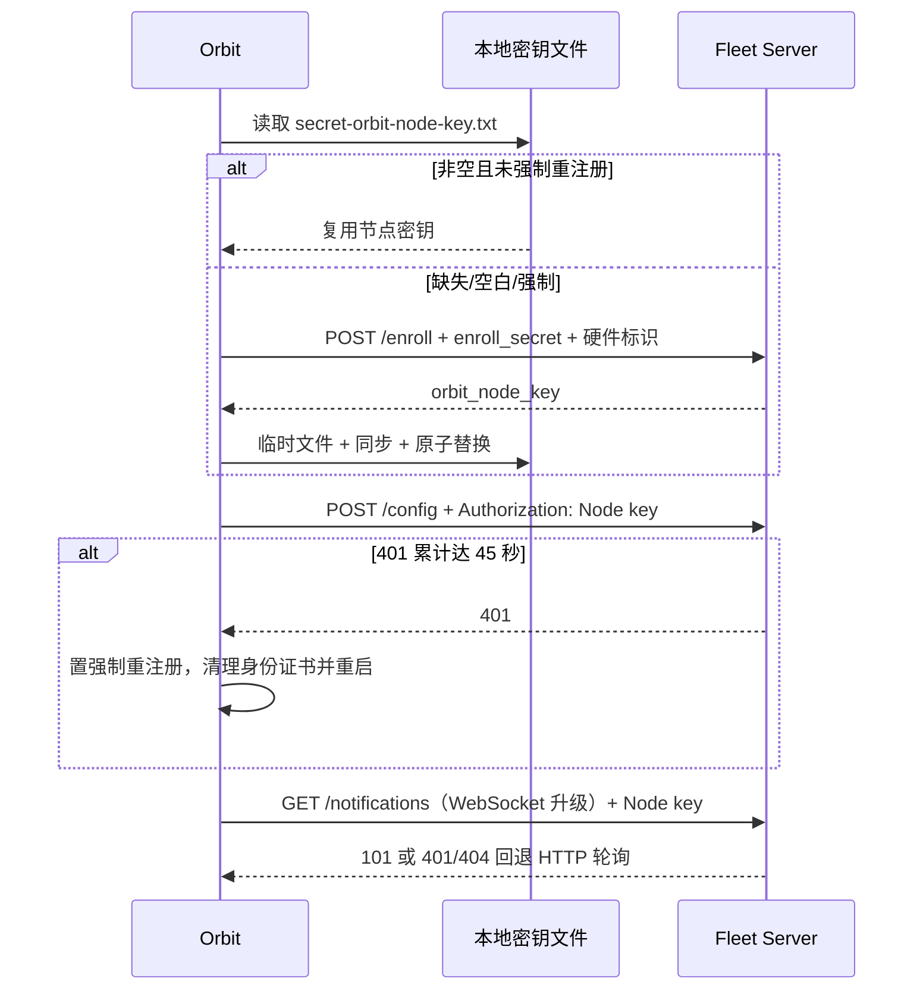

# FleetDM Orbit 认证过程

本文从 [接口规格](fleetdm-orbit.md) 提炼认证过程，配套可运行示例 [demo.py](demo.py)。固定提交 `3807bd7`，主机身份与 SCEP 结论以接口规格为准。

## 角色与凭据

| 角色 | 凭据 | 来源 | 线上形式 |
|---|---|---|---|
| Orbit | 注册密钥 | 参数、文件、系统密钥库或 MDM 交付 | `enroll_secret` |
| Orbit | 节点密钥 | Fleet Server 签发 | `orbit_node_key`，落盘 `secret-orbit-node-key.txt` |
| Orbit 接口 | 节点凭据 | 本地文件复用或重新注册 | `Authorization: Node key <credential>` |
| 主机身份（商业版） | SCEP 证书 + HTTP 签名 | SCEP 签发 | `keyid` 为证书序列号，签名头覆盖方法/路径/摘要 |

注意 Orbit 自身接口使用 `Node key <credential>`（有空格），osquery 接口使用 `NodeKey <credential>`，两者不可混用。

## 认证时序



## 逐步过程

1. **本地密钥加载**：Orbit 在进程级注册锁内读取 `<root-dir>/secret-orbit-node-key.txt`。非空且未标记强制重注册时复用；缺失或只含空白时发起 `POST /api/fleet/orbit/enroll`。注册密钥可来自参数、文件、系统密钥库或平台 MDM 交付。
2. **注册与落盘**：成功响应 200 携带 `orbit_node_key`。客户端先写同目录临时文件、同步并关闭，再替换原文件；Windows 写之前限制 ACL。写入失败时原文件保留，但服务端密钥可能已被替换。
3. **运行期认证**：Orbit 接口从 JSON `orbit_node_key` 取值，或走请求头认证 `Authorization: Node key <credential>`。服务端用密钥查主机；绑定身份证书的主机同时验证 HTTP 签名。密钥空、找不到主机或身份校验失败返回 401。
4. **失效与重注册**：第一次已认证调用收到 401 时启动计时；后续 401 距首次至少 45 秒才置强制重注册。成功认证清除计时。强制分支还会删除本地身份证书并请求重启，之后重新注册。
5. **WebSocket 唤醒**：`GET /api/fleet/orbit/notifications` 用 `Node key` 升级；服务端未启用 WebSocket 时返回 404，鉴权失败返回 401，客户端回退 HTTP 轮询。该升级请求不配置 HTTP 消息签名，要求签名的主机会回退到带签名的轮询。

## 主机身份证书（商业版）

SCEP 路径在 `/api/fleet/orbit/host_identity/scep` 签发或更新证书。首次签发校验 CSR 内 `ChallengePassword` 与注册密钥；续期可用旧公钥对新 CSR 做证明。证书签发后，Agent 的 HTTP 请求由主机密钥签名，服务端验证后把证书身份写入请求上下文，再由 Orbit 注册或运行期认证核对绑定。签名头要求 `@method`、`@authority`、`@path`、`@query`、`content-digest`，以及 `keyid`、`created`、`nonce` 参数，禁止显式 `alg`。

## 失败与重试

| 场景 | 线上结果 | Agent 行为 |
|---|---|---|
| 注册密钥/身份匹配失败 | 401 `Authentication failed` | 无节点密钥可用 |
| 端用户认证要求 | 401 + `message: END_USER_AUTH_REQUIRED` | 进入端用户身份认证路径 |
| 运行期节点凭据拒绝 | 401 `Authentication required` | 启动 45 秒计时 |
| 配置接口网络/5xx | 非业务错误 | 额外重试一次 |
| WebSocket 升级失败 | 401 或 404 | 回退 HTTP 轮询，按退避重连 |

## Demo 说明

`demo.py` 在本机启动 mock Fleet Server，模拟节点密钥文件，走通注册、密钥复用、运行期 401 计时与强制重注册、WebSocket 升级头校验。运行：

```powershell
python demo.py
```

脚本验证：首次注册签发 `orbit_node_key`、二次启动复用本地密钥、401 达到阈值触发强制重注册、升级请求缺少 `Node key` 头被拒。全部通过输出 `PASS`。

Demo 不实现真实 SCEP/CMS 签发、HTTP 消息签名或 WebSocket 数据帧，仅复现凭据流转与升级鉴权边界。
