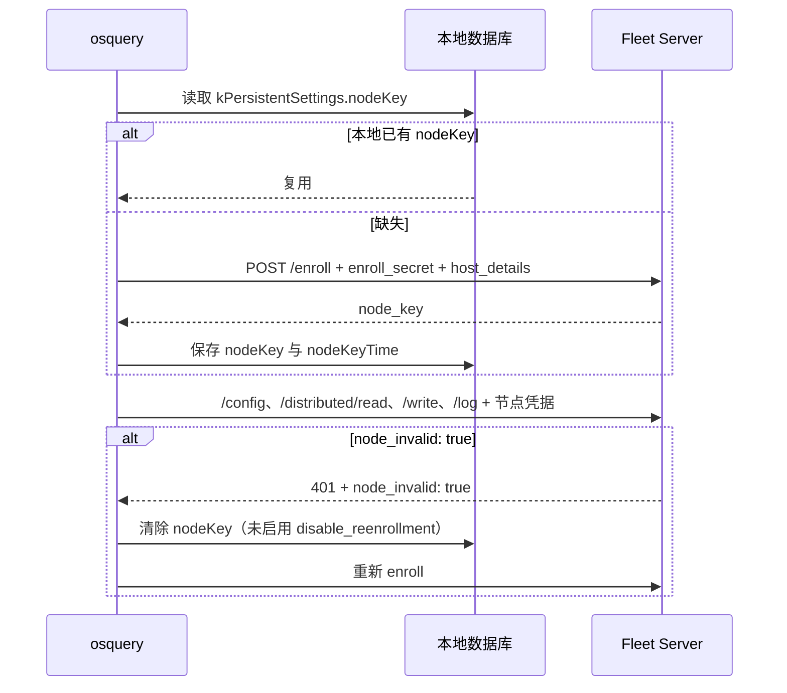

# FleetDM osquery 认证过程

本文从 [接口规格](fleetdm.md) 提炼认证过程，配套可运行示例 [demo.py](demo.py)。固定服务端提交 `3807bd7`，osquery 样本 `5.18.1`，字段与错误边界以接口规格为准。

## 角色与凭据

| 角色 | 凭据 | 签发方 | 用途 |
|---|---|---|---|
| osquery Agent | `enroll_secret` | 管理端配置的共享或一次性注册密钥 | 首次注册 |
| osquery Agent | `node_key` | Fleet Server | 配置、查询、日志与文件采集请求 |
| 主机身份（可选） | SCEP 证书 + HTTP 消息签名 | 商业版 SCEP | 绑定节点凭据与主机身份 |

服务端支持两种节点凭据认证：Body 认证使用 JSON `node_key`；严格请求头认证要求 `Authorization: NodeKey <key>`（scheme 大小写不敏感），并在解析正文前完成认证。

## 认证时序



## 逐步过程

### 1. osquery 读取本地凭据

- **执行方**：osquery，从本地数据库 `kPersistentSettings` 域读取 `nodeKey`
- **有值**：直接复用，不发起注册
- **缺失**：在注册锁内调用注册插件进入注册流程

### 2. osquery 向 Fleet Server 注册

- **发起方**：osquery → Fleet Server
- **请求**：`POST /api/osquery/enroll`；请求体 `enroll_secret`、`host_identifier`、可选 `host_details`
- **处理**：Fleet Server 在启用一次性密钥时先匹配主机属性，否则验证共享密钥；按配置派生主机标识，生成随机 `node_key`
- **响应**：`node_key` 返回给 osquery

### 3. osquery 保存节点凭据

- **执行方**：osquery
- **条件**：响应中的 `node_key` 为非空字符串
- **落盘**：写入本地数据库 `nodeKey`，记录注册请求发起前的 Unix 秒为 `nodeKeyTime`（字符串存储）

### 4. osquery 发起运行期请求

- **发起方**：osquery → Fleet Server
- **场景**：配置、查询结果读取、结果回传、日志上传、文件采集，均携带节点凭据
- **严格请求头模式**：解析请求体前校验 `Authorization: NodeKey <key>`
- **Body 模式**：从 JSON 中读取 `node_key`

### 5. osquery 处理凭据失效

- **触发**：Fleet Server 返回 401 且响应含 `node_invalid: true`
- **处理**：osquery 清除本地 `nodeKey`，下次取凭据时重新注册；启用 `disable_reenrollment` 时保留
- **不触发**：网络失败、JSON 无法解析、仅含 `error`、`node_invalid: false`
- **边界**：严格请求头模式把认证错误统一映射为带 `node_invalid: true` 的 401

## 失败与重试

| 场景 | 线上结果 | 客户端行为 |
|---|---|---|
| 注册凭据无效 | 401 `error: "enroll failed"` + `node_invalid: true` | 无 node_key 可保存，按插件重试配置处理 |
| Body 模式空/未知 node_key | 401 + `node_invalid: true` | 清除本地密钥并重新注册 |
| 身份签名绑定失败 | 401，无 `node_invalid` | 不清除密钥 |
| 严格头缺失或无效 | 401 + `node_invalid: true` | 按失效标记重新注册 |
| 日志 `log_type` 未知 | 500，省略 `node_invalid` | 不清除密钥，按失败路径退避 |

## Demo 说明

`demo.py` 在本机启动 mock Fleet Server，模拟本地 `nodeKey` 存储，完整走通注册、配置拉取、错误凭据触发重注册。运行：

```powershell
python demo.py
```

脚本验证：首次注册换得 node_key、复用本地 nodeKey 不再注册、错误密钥返回 401 与 `node_invalid: true` 后自动重新注册。全部通过输出 `PASS`。

Demo 只覆盖 osquery 主路径 `/api/osquery` 的凭据流转；Orbit 自身的节点密钥与 SCEP 见 `../fleetdm-orbit/authentication.md`。
