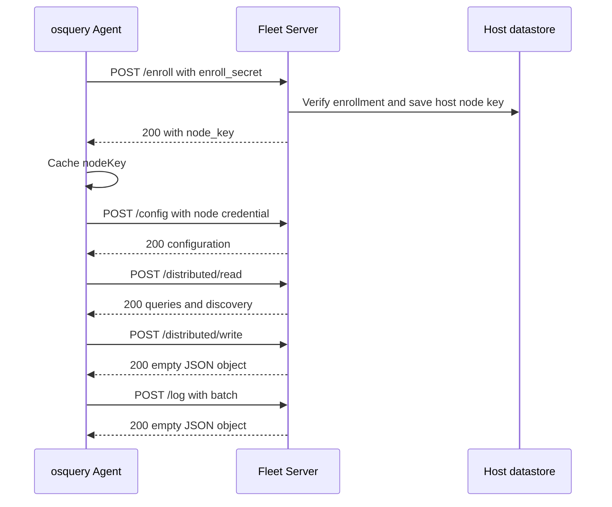

# FleetDM 与 osquery

固定服务端及 Orbit 提交为 `3807bd79fedbd25424ae55738b03cc8a4ae28a80`。本章跟踪 Orbit 启动的 osquery 到 Fleet Server 的 HTTPS 注册、配置、遥测及文件分块上传。Orbit 自身的节点注册、主机身份证书和 WebSocket 见配套文档。 [Orbit 链路](../fleetdm-orbit/fleetdm-orbit.md) · [固定源码](https://github.com/fleetdm/fleet/tree/3807bd79fedbd25424ae55738b03cc8a4ae28a80)

## 注册与认证

1. Orbit 的 `FleetFlags` 为 osquery 配置 TLS 地址及注册、配置、日志和分布式查询插件路径。下文采用主路径 `/api/osquery`。服务端还接受 `/api/v1/osquery` 别名，Orbit 使用别名。这里的 `v1` 不参与 Fleet 管理 API 的版本协商。 [Agent flags](https://github.com/fleetdm/fleet/blob/3807bd79fedbd25424ae55738b03cc8a4ae28a80/orbit/pkg/osquery/flags.go) · [服务端 handler.go](https://github.com/fleetdm/fleet/blob/3807bd79fedbd25424ae55738b03cc8a4ae28a80/server/service/handler.go#L850-L908)
2. `POST /api/osquery/enroll` 提交注册密钥和主机标识。服务端 `EnrollOsquery` 在一次性密钥功能启用时先查对应记录并匹配主机属性。常规路径验证共享密钥，取所属团队。随后按配置派生主机标识。已关联身份凭据的主机还需通过 HTTP 消息签名凭据匹配。服务端按配置长度生成随机节点密钥，绑定主机记录并返回给 Agent。 [注册实现](https://github.com/fleetdm/fleet/blob/3807bd79fedbd25424ae55738b03cc8a4ae28a80/server/service/osquery.go#L140-L275)
3. 配置、查询和日志请求使用节点密钥。允许 body 认证的路径保留 `node_key`。严格模式在解析 body 前要求 `Authorization: NodeKey <key>`，缺失、格式错误或无效回 401 和 `node_invalid: true`。`AuthenticateHost` 按密钥查询主机，WebSocket 启用时可在 osquery 密钥未命中后查询同一主机的 Orbit 密钥。关联身份凭据时额外验签，认证成功后异步记录最近上线时间。 [请求头认证](https://github.com/fleetdm/fleet/blob/3807bd79fedbd25424ae55738b03cc8a4ae28a80/server/service/osquery_header_auth.go#L50-L128) · [服务端认证](https://github.com/fleetdm/fleet/blob/3807bd79fedbd25424ae55738b03cc8a4ae28a80/server/service/osquery.go#L74-L136)
4. Agent 端以 osquery `5.18.1` 为固定源码样本。Orbit 的更新器可从发布通道解析实际安装的 osquery，因此部署中的精确版本需核对客户端产物。样本的 TLS 注册插件从文件或环境变量读取注册密钥，提交主机属性，接受非空字符串 `node_key`，仅在该字段缺失时尝试兼容字段 `id`。osquery 先从本地数据库 `kPersistentSettings` 域读取 `nodeKey`，非空即复用。缺失时在锁内调用注册插件，保存 `nodeKey` 及 `nodeKeyTime`（注册请求前的 Unix 秒数，以字符串存储）。[Orbit 通道更新](https://github.com/fleetdm/fleet/blob/3807bd79fedbd25424ae55738b03cc8a4ae28a80/orbit/pkg/update/runner.go#L127-L172) · [注册插件](https://github.com/osquery/osquery/blob/5.18.1/plugins/remote/enroll/tls_enroll.cpp#L124-L165) · [本地凭据](https://github.com/osquery/osquery/blob/5.18.1/osquery/remote/enroll/enroll.cpp#L65-L128)
5. 已解析的 JSON 响应含布尔值 `node_invalid: true` 时，客户端报告节点密钥无效。默认清除本地 `nodeKey`，后续获取节点密钥时重新注册。启用 `disable_reenrollment` 时保留本地密钥。网络失败、无法解析 JSON、仅含 `error` 或 `node_invalid: false` 均不触发这一清除分支。在 Body 认证路径中，已绑定身份的主机验签失败返回 HTTP 401，省略 `node_invalid`。严格请求头认证的外层会把认证错误统一映射到带 `node_invalid: true` 的 401。 [客户端处理](https://github.com/osquery/osquery/blob/5.18.1/osquery/remote/utility.h#L139-L179) · [开关默认值](https://github.com/osquery/osquery/blob/5.18.1/osquery/remote/enroll/enroll.cpp#L50-L54) · [服务端身份验证](https://github.com/fleetdm/fleet/blob/3807bd79fedbd25424ae55738b03cc8a4ae28a80/server/service/osquery.go#L114-L125)
6. 管理端 `DELETE /api/v1/fleet/hosts/{id}` 接收十进制主机 ID，执行列表权限与目标主机删除权限检查，然后删除主机记录。该路径顺带使该记录的节点密钥失去查找目标。成功返回空 JSON 对象，错误由通用管理 API 编码。重新注册命中已有主机时，在事务里覆盖 `hosts.node_key`，同时更新 `last_enrolled_at`，旧密钥失效。节点密钥处理路径未定义独立的刷新令牌或周期性续期。 [删除路由](https://github.com/fleetdm/fleet/blob/3807bd79fedbd25424ae55738b03cc8a4ae28a80/server/service/handler.go#L496) · [删除逻辑](https://github.com/fleetdm/fleet/blob/3807bd79fedbd25424ae55738b03cc8a4ae28a80/server/service/hosts.go#L1194-L1255) · [密钥覆盖](https://github.com/fleetdm/fleet/blob/3807bd79fedbd25424ae55738b03cc8a4ae28a80/server/datastore/mysql/hosts.go#L3154-L3186)

## 注册字段字典

JSON 字段无编号。字段缺失在 Go 结构的字符串上解码为零值，在 map 或指针上解码为 nil。下表的必填性以处理行为为准。 [注册 contract](https://github.com/fleetdm/fleet/blob/3807bd79fedbd25424ae55738b03cc8a4ae28a80/server/service/contract/osquery.go)

| 路径 | 类型与约束 | 含义与示例 |
|---|---|---|
| 请求 `enroll_secret` | string，需通过密钥验证 | 初次注册凭据，`REDACTED` |
| 请求 `host_identifier` | string，可能根据服务端配置和上报信息派生 | Agent 主机标识，`host-example` |
| 请求 `host_details` | map<string, map<string, string>>，可缺省 | 按表名分组的属性 |
| `host_details.system_info.uuid` | string，可缺省 | 硬件 UUID |
| `host_details.system_info.hardware_serial` | string，可缺省 | 硬件序列号 |
| `host_details.os_version.platform` | string，可缺省 | 平台，例如 `windows`。注册 schema 未定义平台闭集 |
| 响应 `node_key` | string，空值省略 | 成功时签发给 Agent 的节点密钥 |
| 错误响应 `error` | string，osquery 错误信封总是写出 | 服务端诊断文本，非固定枚举 |
| 错误响应 `uuid` | string，osquery 错误信封总是写出 | 服务端错误关联标识，便于匹配诊断日志 |
| 错误响应 `node_invalid` | boolean，无效密钥时写 `true`，其他错误省略 | 缺省或 `false` 不触发 osquery 的重注册清理分支 |
| 请求头 `Authorization` | string，严格模式必填 | `NodeKey REDACTED`，scheme 大小写不敏感 |
| 请求体 `node_key` | string，使用 body 认证时必填 | 已注册节点凭据，严格模式忽略此字段 |

Fleet 的 osquery 错误编码器输出 `error`、`uuid`，无效节点分支另外输出 `node_invalid: true` 并返回 HTTP 401。其他 `OsqueryError` 使用调用端指定状态码，未指定时为 HTTP 500。以下为脱敏响应，`uuid` 仅作示例。[错误编码器](https://github.com/fleetdm/fleet/blob/3807bd79fedbd25424ae55738b03cc8a4ae28a80/server/service/transport_error.go#L67-L91)

```json
{"error":"authentication error: invalid node key","uuid":"00000000-0000-4000-8000-000000000001","node_invalid":true}
```

## 管理端注册密钥接口

全局密钥通过 `GET /api/v1/fleet/spec/enroll_secret` 读取和 `POST /api/v1/fleet/spec/enroll_secret` 应用。管理端验证对应读写权限，应用时替换全局凭据集合，上限 50 项。字符串去首尾空白后不能为空。试运行仅检查合法性和密钥是否可用。已有 osquery 节点使用注册所得的独立节点密钥，替换注册密钥集合只影响后续注册验证。 [路由](https://github.com/fleetdm/fleet/blob/3807bd79fedbd25424ae55738b03cc8a4ae28a80/server/service/handler.go#L351-L367) · [全局实现](https://github.com/fleetdm/fleet/blob/3807bd79fedbd25424ae55738b03cc8a4ae28a80/server/service/appconfig.go#L3109-L3219)

有企业许可时，`GET /api/v1/fleet/fleets/{id}/secrets` 读取指定 Fleet 的密钥，`PATCH /api/v1/fleet/fleets/{fleet_id}/secrets` 替换指定 Fleet 的密钥集合。请求的空数组应用空集合，缺失或 null 会报参数错误。每项仅采用 `secret`，所属 Fleet 取自 URL。基础版委托实现返回缺少许可。 [请求和响应](https://github.com/fleetdm/fleet/blob/3807bd79fedbd25424ae55738b03cc8a4ae28a80/server/service/teams.go#L443-L496) · [企业版实现](https://github.com/fleetdm/fleet/blob/3807bd79fedbd25424ae55738b03cc8a4ae28a80/ee/server/service/teams.go#L1328-L1415)

| 路径 | 线上类型与约束 | 含义 |
|---|---|---|
| 全局 POST 正文及 GET 响应 `spec` | object，包含 `secrets` | 全局配置包装 |
| `spec.secrets` 或 Fleet 正文与响应的 `secrets` | object[]，最多 50 项 | 注册密钥集合 |
| 每项 `secret` | 非空 string | 注册密钥值，示例 `REDACTED` |
| 每项 `created_at` | RFC 3339 string，读取时使用 | 首次加入时间 |
| 每项 `fleet_id` | 可省略的 uint | 密钥所属 Fleet。全局密钥无此值 |
| URL `id`、`fleet_id` | uint，十进制，必填 | 指定 Fleet |
| 全局 POST 查询 `dry_run` | boolean，可省略，默认 false | true 时只校验 |
| 管理错误 `message`、`code`、`errors[]`、`uuid` | string、可选 integer、可选对象数组、可选 string | 错误线上信封。常规 `errors[].name` 与 `errors[].reason` 是字符串。全局应用成功响应为空对象 |

字段定义为 `EnrollSecret` 和 `EnrollSecretSpec`，失败由 [通用错误编码器](https://github.com/fleetdm/fleet/blob/3807bd79fedbd25424ae55738b03cc8a4ae28a80/server/platform/endpointer/transport_error.go#L28-L46) 编码。 [类型与上限](https://github.com/fleetdm/fleet/blob/3807bd79fedbd25424ae55738b03cc8a4ae28a80/server/fleet/app.go#L2130-L2177)

## 数据面与控制面

| HTTPS POST | 方向与处理 | 确认和边界 |
|---|---|---|
| `/api/osquery/config` | Agent 拉取配置。可携带正文 `etag`。服务端按主机返回配置 | 条件返回由 `GetClientConfigWithETag` 处理。配置是控制面 |
| `/api/osquery/distributed/read` | Agent 拉取查询。服务端向响应写查询、发现条件及可选加速时长 | 查询分发是控制面 |
| `/api/osquery/distributed/write` | Agent 上传查询结果、状态、消息及统计。服务端将其转换为类型化结果，并按查询用途分派 | 成功响应无逐查询接收编号，失败走错误编码 |
| `/api/osquery/log` | Agent 批量上传状态或结果。服务端由 `log_type` 分派，结果日志的目标输出错误可回给 osqueryd | 整批响应，无逐条确认字段 |

Body 认证模式对日志和查询上传分别配置请求体大小上限。严格请求头模式先认证，这两条路由跳过路由级大小限制。Orbit 配置分布式查询 TLS 尝试上限 10，按 osquery 版本决定是否启用 TLS gzip 接收。部署中的跨连接排序和接收端去重仍待核实。 [路由](https://github.com/fleetdm/fleet/blob/3807bd79fedbd25424ae55738b03cc8a4ae28a80/server/service/handler.go#L850-L908) · [Agent flags](https://github.com/fleetdm/fleet/blob/3807bd79fedbd25424ae55738b03cc8a4ae28a80/orbit/pkg/osquery/flags.go)

| 路径（省略共用的 `node_key`） | 类型与约束 | 含义 |
|---|---|---|
| config 请求 `etag` | string 或缺失/null，空字符串为已启用但无验证器 | 正文条件请求验证器 |
| distributed/read 响应 `queries.<id>` | map 值为 string | 查询 ID 到 SQL |
| distributed/read 响应 `discovery.<id>` | map 值为 string | 查询 ID 到发现条件 SQL |
| distributed/read 响应 `accelerate` | 服务端 uint，零值省略，客户端要求可解析成 int32 | 加速窗口，秒。客户端以当前 Unix 秒加此值保存到期时间 |
| distributed/write 请求 `queries.<id>[].<column>` | 查询 ID 到数组，行对象的列值为 string | 动态列由 SQL 决定。服务器忽略行数组解析错误，不能据此保证整组结果完整 |
| distributed/write 请求 `statuses.<id>` | JSON 数字或可解析为整数的字符串 | `0` 成功，其他整数失败。其他 JSON 类型与不可解析的字符串报错。服务端没有穷举失败值 |
| distributed/write 请求 `messages.<id>` | map 值为 string | 每项查询的消息 |
| distributed/write 请求 `stats.<id>.wall_time_ms` | uint64，缺失为 0 | 墙钟时间，毫秒 |
| distributed/write 请求 `stats.<id>.user_time` | uint64，缺失为 0 | 查询前后用户态 CPU 时间的正增量，毫秒 |
| distributed/write 请求 `stats.<id>.system_time` | uint64，缺失为 0 | 查询前后内核态 CPU 时间的正增量，毫秒 |
| distributed/write 请求 `stats.<id>.memory` | uint64，缺失为 0 | 查询前后进程表 `resident_size` 的正增量，字节。它是进程级采样差值 |
| log 请求 `log_type` | string，必须匹配闭集 | `status` 走状态日志，`result` 走结果日志。空值及其他值返回错误 |
| log 请求 `data[]` | JSON 数组，每项在入口解码为 RawMessage | 状态或结果日志，结果预处理字段见下表 |
| 写入错误 `error` | string，失败时返回 | 批次诊断文本，连同 `uuid` 和条件性的 `node_invalid` 编码 |

字段对应 `getClientConfigRequest`、`getDistributedQueriesResponse`、`submitDistributedQueryResultsRequestShim.toRequest`、`Stats`、`submitLogsRequest` 与 `submitLogsEndpoint`。 [配置](https://github.com/fleetdm/fleet/blob/3807bd79fedbd25424ae55738b03cc8a4ae28a80/server/service/osquery.go#L444-L488) · [查询下发](https://github.com/fleetdm/fleet/blob/3807bd79fedbd25424ae55738b03cc8a4ae28a80/server/service/osquery.go#L1136-L1149) · [查询回传](https://github.com/fleetdm/fleet/blob/3807bd79fedbd25424ae55738b03cc8a4ae28a80/server/service/osquery.go#L1715-L1805) · [统计](https://github.com/fleetdm/fleet/blob/3807bd79fedbd25424ae55738b03cc8a4ae28a80/server/fleet/osquery.go#L14-L31) · [日志](https://github.com/fleetdm/fleet/blob/3807bd79fedbd25424ae55738b03cc8a4ae28a80/server/service/osquery.go#L3953-L3994)

### 日志批次的缓冲与字段

查询统计单位按 osquery 样本的 `recordQueryPerformance` 与 `processes` 表定义核对。 [性能计算](https://github.com/osquery/osquery/blob/5.18.1/osquery/distributed/distributed.cpp#L380-L446) · [进程表单位](https://github.com/osquery/osquery/blob/5.18.1/specs/processes.table#L20-L23)

osquery 5.18.1 在 `kLogs` 本地数据库域存放日志，按状态、结果两组发送。TLS 插件默认每 4 秒最多取 1024 行，单行上限 1 MiB。超长或非法 JSON 行在构造批次时跳过。`logger_tls_compress` 可启用请求体 gzip，默认关闭。失败留在缓冲区并按组退避，默认退避上限 3600 秒。成功后清理对应数据库记录，缓冲超限清理旧日志。服务端按批回应，协议无逐行确认或端到端幂等键。 [TLS 插件](https://github.com/osquery/osquery/blob/5.18.1/plugins/logger/tls_logger.cpp) · [缓冲实现](https://github.com/osquery/osquery/blob/5.18.1/plugins/logger/buffered.cpp) · [加速窗口](https://github.com/osquery/osquery/blob/5.18.1/osquery/distributed/distributed.cpp#L348-L360)

服务端将状态日志交给配置的状态输出，输出错误可返回 413。结果预处理以 `ScheduledQueryResult` 读取下表字段。服务端根据主机调度检查结果，将符合条件的结果保存为查询报告或转发至外部日志目的地。外部写失败会回给客户端重试，内部结果处理错误采用不同处理路径。外部目的地扩展及重复投递的持久化结果仍待核实。 [结果类型](https://github.com/fleetdm/fleet/blob/3807bd79fedbd25424ae55738b03cc8a4ae28a80/server/fleet/query_results.go) · [服务器处理](https://github.com/fleetdm/fleet/blob/3807bd79fedbd25424ae55738b03cc8a4ae28a80/server/service/osquery.go#L4012-L4258)

状态日志的生产端字段如下。Fleet 入口接收原始 JSON，未按此枚举校验。 [状态序列化](https://github.com/osquery/osquery/blob/5.18.1/plugins/logger/buffered.cpp#L247) · [严重度枚举](https://github.com/osquery/osquery/blob/5.18.1/osquery/core/plugins/logger.h#L40-L45)

| `data[]` 路径 | 类型及含义 |
|---|---|
| `hostIdentifier` | string，主机标识 |
| `calendarTime` | string，可读日志时间 |
| `unixTime` | uint64，Unix 秒 |
| `severity` | integer，`0 O_INFO` 信息、`1 O_WARNING` 警告、`2 O_ERROR` 错误、`3 O_FATAL` 致命 |
| `filename` | string，产生日志的源文件 |
| `line` | uint64，源文件行号 |
| `message` | string，日志文本 |
| `version` | string，osquery 版本 |
| `decorations.<key>` 或 `<key>` | string 类型的动态装饰字段，无装饰时省略。配置为顶层时直接展开 |

结果日志中，Fleet 类型化预处理读取以下字段。

| `data[]` 下的路径 | 类型与缺失值 | 含义 |
|---|---|---|
| `name` | string，缺失为 "" | 查询名称。正常解码且名称为空时，预处理忽略该结果 |
| `hostIdentifier` | string，缺失为 "" | 上报的主机标识，认证身份仍由节点凭据确定 |
| `unixTime` | uint，缺失为 0 | 日志时间戳，示例使用 Unix 秒 |
| `snapshot[].<column>` | 原始 JSON 行数组，缺失为 nil | 快照结果行，列由查询决定 |
| `columns.<column>` | 原始 JSON，缺失为 nil | 事件格式中的单条结果行 |
| `action` | string，缺失为 "" | 服务端将 `snapshot` 且具备单行 `columns` 的事件识别为快照事件。该结构的解码未限制其他字符串 |

osquery 生产端还发送以下字段。类型化预处理会忽略额外字段，外部转发从原始 JSON 构造输出。事件格式一行一对象，批格式将快照或差分整组写在一个对象中。 [序列化](https://github.com/osquery/osquery/blob/5.18.1/osquery/core/query.cpp#L237-L356) · [差分字段](https://github.com/osquery/osquery/blob/5.18.1/osquery/core/sql/diff_results.cpp)

| `data[]` 路径 | 类型与出现条件 | 含义 |
|---|---|---|
| `calendarTime` | string，共用 | 可读日志时间 |
| `epoch` | 非负整数，共用 | 查询结果纪元 |
| `counter` | 非负整数，共用 | 纪元内结果计数 |
| `numerics` | boolean，共用，默认 false | true 时数值列使用 JSON 数字 |
| `decorations.<key>` 或 `<key>` | string，存在装饰时写出 | 可配置的附加字段，支持嵌套或顶层 |
| `diffResults.added[].<column>`、`diffResults.removed[].<column>` | 两个动态行数组，批差分格式 | 新增和移除的结果行 |
| `action` | string，事件格式均有，批快照有，批差分省略 | 生产端取 `added`、`removed` 或 `snapshot`。类型化预处理未把这些值作为闭集校验 |

脱敏示例，分别为注册请求、注册成功响应及查询结果上传正文。

```json
{"enroll_secret":"REDACTED","host_identifier":"host-example","host_details":{"os_version":{"platform":"windows"}}}
{"node_key":"REDACTED"}
{"node_key":"REDACTED","queries":{"42":[{"name":"example"}]},"statuses":{"42":0}}
```

## 文件采集上传

Agent 将已选择的文件归档为 tar，可按 `carver_compression` 启用 zstd，默认关闭。随后向 `POST /api/osquery/carve/begin` 提交元数据，服务端校验总长度与块划分、建立存储会话并返回非空会话 ID。Agent 从 `block_id=0` 顺序向 `POST /api/osquery/carve/block` 上传。服务端校验会话与请求关联，严格认证模式额外校验主机归属，只接收下一个预期块。osquery 5.18.1 的 `postCarve` 在单块提交失败时记录日志并继续循环，没有同块重试或恢复上传偏移。循环结束写本地成功状态，因此本地状态不能确认所有块已持久化。两路由均有 `/api/v1/osquery` 别名。 [Agent 归档](https://github.com/osquery/osquery/blob/5.18.1/osquery/carver/carver.cpp#L175-L225) · [上传实现](https://github.com/osquery/osquery/blob/5.18.1/osquery/carver/carver.cpp#L288-L363) · [路由](https://github.com/fleetdm/fleet/blob/3807bd79fedbd25424ae55738b03cc8a4ae28a80/server/service/handler.go) · [服务端处理](https://github.com/fleetdm/fleet/blob/3807bd79fedbd25424ae55738b03cc8a4ae28a80/server/service/carves.go#L115-L438)

| 路径 | 类型、默认值与约束 | 含义与示例 |
|---|---|---|
| begin 请求 `node_key` | string，body 认证时必填 | 节点凭据 |
| begin 请求 `block_count` | int64，缺失为 0，须与总大小和块大小配合 | 总块数，`1` |
| begin 请求 `block_size` | int64 字节，缺失为 0，上限 256 MiB | 每块上限，`4096` |
| begin 请求 `carve_size` | int64 字节，0 被拒绝，上限 8 GiB，需满足 `(block_count - 1) × block_size < carve_size ≤ block_count × block_size` | 归档总大小，`3` |
| begin 请求 `carve_id` | string，缺失为 "" | Agent 采集 ID |
| begin 请求及 block 请求 `request_id` | string，上传解析要求非空且最多 64 字节，并与会话记录匹配 | 采集请求关联 ID |
| begin 响应及 block 请求 `session_id` | string，上传解析要求非空且最多 255 字节 | 接收端签发的会话 ID |
| block 请求 `block_id` | int64，上传解析要求在线首位且给出十进制值，须等于已保存的最大块号加一且小于总块数 | 块序号 |
| block 请求 `data` | base64 string，解码后不超过已声明块大小 | 块字节，`YWJj` |
| begin 和 block 响应 `success` | boolean，false 零值省略 | `true` 表示对应的创建或保存成功 |
| 失败响应 | OsqueryError 写 `error`、`uuid` 及条件性 `node_invalid`。会话认证失败用通用 `message` 信封 | 拒绝原因 |

块上传采用紧凑 JSON，服务端按 `block_id`、`session_id`、`request_id`、`data` 的固定顺序和标点读取，先核对会话与请求 ID，再按标准 Base64 解码数据。[流式解码](https://github.com/fleetdm/fleet/blob/3807bd79fedbd25424ae55738b03cc8a4ae28a80/server/service/carves.go#L203-L356)

字段来源为 `CarveBeginRequest`、`CarveBeginResponse`、`CarveBlockRequest`、`CarveBlockResponse`。 [文件上传结构](https://github.com/fleetdm/fleet/blob/3807bd79fedbd25424ae55738b03cc8a4ae28a80/server/fleet/api_carves.go#L50-L90)

以下三行分别为建立会话响应、单块请求和单块成功回执。会话及请求标识均为占位值。

```json
{"session_id":"SESSION","success":true}
{"block_id":0,"session_id":"SESSION","request_id":"REQUEST","data":"YWJj"}
{"success":true}
```

## 运行流程和错误判定



| 条件 | 服务端线上结果 | Agent 状态或处理 |
|---|---|---|
| 注册凭据无效或一次性注册密钥不匹配主机 | 401，`error: "enroll failed"`，`node_invalid: true` | 无可保存的 `node_key`，TLS 注册插件按其重试配置处理 |
| 注册遇到证书绑定失败 | 401，通用 `message: "Authentication failed"` 信封 | 无可保存的 `node_key` |
| Body 认证模式下空或未知节点密钥 | 401，`node_invalid: true` | 按客户端配置清除节点密钥并在下次取凭据时注册 |
| Body 认证模式下主机身份签名绑定失败 | 401，无 `node_invalid` | 不触发节点密钥清理 |
| 请求头严格模式下缺少或无法解析请求头，以及认证函数返回任何错误 | 外层统一包成 401，`error: "authentication error: invalid authorization header"`，`node_invalid: true`，不读正文 | 识别失效标记的客户端按配置重新注册 |
| 配置 `etag` 与服务端相同 | 200，JSON `{"etag":"ok"}` | 保留已缓存配置 |
| 查询回传状态值非整数 | Fleet 的 osquery 错误信封 | 批处理失败，服务端未开始分派；客户端保留何种待发送状态取决于插件 |
| 日志批次使用未知 `log_type` | 500，osquery 错误信封，省略 `node_invalid` | 不清除密钥，日志缓冲按失败路径处理 |

[注册失败分支](https://github.com/fleetdm/fleet/blob/3807bd79fedbd25424ae55738b03cc8a4ae28a80/server/service/osquery.go#L179-L243) · [严格模式前置认证](https://github.com/fleetdm/fleet/blob/3807bd79fedbd25424ae55738b03cc8a4ae28a80/server/service/osquery_header_auth.go#L75-L94)

`GET`、`HEAD` 等方法不能替代这些 Agent JSON POST。配置的 `etag` 是正文成员。未发送或发送 null 时返回完整、无验证器的配置。空字符串请求生成并返回验证器。现有非空验证器匹配时只返回 `{"etag":"ok"}`，有差异时返回新的完整配置及验证器。完整配置成员由 Agent Options、计划查询和部署设定决定，不能把示例的配置当做完整 osquery 配置 schema。Fleet 默认的 Body 认证路由大小上限为查询回传 5 MiB、日志 10 MiB，严格认证路由跳过这两项路由级限制。 [配置处理](https://github.com/fleetdm/fleet/blob/3807bd79fedbd25424ae55738b03cc8a4ae28a80/server/service/osquery.go#L444-L591) · [大小上限](https://github.com/fleetdm/fleet/blob/3807bd79fedbd25424ae55738b03cc8a4ae28a80/server/fleet/request.go#L40-L51)

## 请求和响应示例

以下是按固定接口编写的 HTTP/1.1 测试样例，统一采用 `/api/osquery` 主路径；Orbit 实际请求走 `/api/v1/osquery` 别名，字段与处理相同。JSON 配置和动态查询由示例部署给出。密钥、验证器、会话 ID 与请求 ID 全是占位值，发送前应替换成测试服务器实际发放的值并重算 Content-Length。换行用 LF 表示，HTTP 行边界在线上使用 CRLF。样例完整展示正文，省略代理生成的可选 HTTP 首部。JSON 空白可以变化，文件块请求须保留紧凑 JSON 及示例字段顺序。

### 注册成功

```http
POST /api/osquery/enroll HTTP/1.1
Host: fleet.example.invalid
Content-Type: application/json
Content-Length: 163

{
  "enroll_secret": "REDACTED-ENROLL-SECRET",
  "host_identifier": "host-example",
  "host_details": {
    "os_version": {
      "platform": "windows"
    }
  }
}
```

```http
HTTP/1.1 200 OK
Content-Type: application/json
Content-Length: 37

{
  "node_key": "REDACTED-NODE-KEY"
}
```

### 首次条件配置拉取

```http
POST /api/osquery/config HTTP/1.1
Host: fleet.example.invalid
Authorization: NodeKey REDACTED-NODE-KEY
Content-Type: application/json
Content-Length: 16

{
  "etag": ""
}
```

```http
HTTP/1.1 200 OK
Cache-Control: private, no-cache
Content-Type: application/json; charset=utf-8
Content-Length: 115

{
  "options": {},
  "schedule": {},
  "etag": "0000000000000000000000000000000000000000000000000000000000000000"
}
```

### 配置未变化

```http
POST /api/osquery/config HTTP/1.1
Host: fleet.example.invalid
Authorization: NodeKey REDACTED-NODE-KEY
Content-Type: application/json
Content-Length: 80

{
  "etag": "0000000000000000000000000000000000000000000000000000000000000000"
}
```

```http
HTTP/1.1 200 OK
Cache-Control: private, no-cache
Content-Type: application/json; charset=utf-8
Content-Length: 13

{"etag":"ok"}
```

### 查询下发

```http
POST /api/osquery/distributed/read HTTP/1.1
Host: fleet.example.invalid
Content-Type: application/json
Content-Length: 37

{
  "node_key": "REDACTED-NODE-KEY"
}
```

```http
HTTP/1.1 200 OK
Content-Type: application/json
Content-Length: 93

{
  "queries": {
    "42": "SELECT 1 AS healthy;"
  },
  "discovery": {},
  "accelerate": 5
}
```

### 查询结果回传

```http
POST /api/osquery/distributed/write HTTP/1.1
Host: fleet.example.invalid
Content-Type: application/json
Content-Length: 272

{
  "node_key": "REDACTED-NODE-KEY",
  "queries": {
    "42": [
      {
        "healthy": "1"
      }
    ]
  },
  "statuses": {
    "42": 0
  },
  "stats": {
    "42": {
      "wall_time_ms": 3,
      "user_time": 0,
      "system_time": 0,
      "memory": 0
    }
  }
}
```

```http
HTTP/1.1 200 OK
Content-Type: application/json
Content-Length: 2

{}
```

### 状态日志上传

```http
POST /api/osquery/log HTTP/1.1
Host: fleet.example.invalid
Content-Type: application/json
Content-Length: 345

{
  "node_key": "REDACTED-NODE-KEY",
  "log_type": "status",
  "data": [
    {
      "hostIdentifier": "host-example",
      "calendarTime": "Thu Nov 26 12:00:00 2026 UTC",
      "unixTime": 1795694400,
      "severity": 0,
      "filename": "example.cpp",
      "line": 42,
      "message": "Agent online",
      "version": "5.18.1"
    }
  ]
}
```

```http
HTTP/1.1 200 OK
Content-Type: application/json
Content-Length: 2

{}
```

### 缺少严格模式节点凭据

```http
POST /api/osquery/distributed/read HTTP/1.1
Host: fleet.example.invalid
Content-Type: application/json
Content-Length: 2

{}
```

```http
HTTP/1.1 401 Unauthorized
Content-Type: application/json
Content-Length: 141

{
  "error": "authentication error: invalid authorization header",
  "uuid": "00000000-0000-4000-8000-000000000001",
  "node_invalid": true
}
```

### 日志类别不受支持

```http
POST /api/osquery/log HTTP/1.1
Host: fleet.example.invalid
Content-Type: application/json
Content-Length: 76

{
  "node_key": "REDACTED-NODE-KEY",
  "log_type": "example",
  "data": []
}
```

```http
HTTP/1.1 500 Internal Server Error
Content-Type: application/json
Content-Length: 92

{
  "error": "unknown log type: example",
  "uuid": "00000000-0000-4000-8000-000000000001"
}
```

### 建立单块采集会话

```http
POST /api/osquery/carve/begin HTTP/1.1
Host: fleet.example.invalid
Content-Type: application/json
Content-Length: 148

{
  "node_key": "REDACTED-NODE-KEY",
  "block_count": 1,
  "block_size": 4096,
  "carve_size": 3,
  "carve_id": "CARVE",
  "request_id": "REQUEST"
}
```

```http
HTTP/1.1 200 OK
Content-Type: application/json
Content-Length: 48

{
  "session_id": "SESSION",
  "success": true
}
```

### 上传唯一数据块

```http
POST /api/osquery/carve/block HTTP/1.1
Host: fleet.example.invalid
Content-Type: application/json
Content-Length: 74

{"block_id":0,"session_id":"SESSION","request_id":"REQUEST","data":"YWJj"}
```

```http
HTTP/1.1 200 OK
Content-Type: application/json
Content-Length: 21

{
  "success": true
}
```
