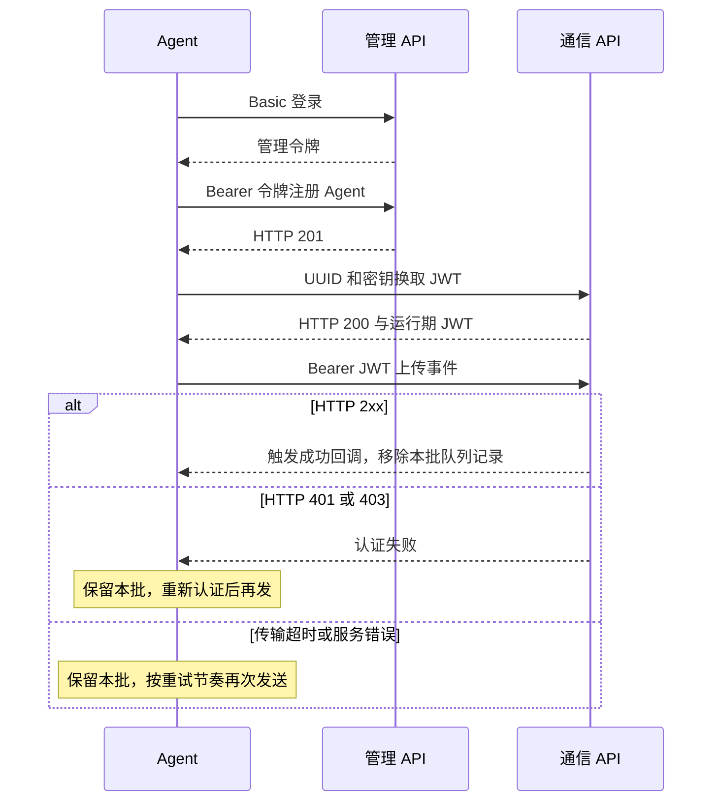

# AIDR 已引用的 wazuh-agent 实验实现

本章固定到独立仓库 `wazuh/wazuh-agent` 的 `ca211324af5c88caf77fcd57cab0e98475f8e4ce`。AIDR 既有调研引用该版本的多类型队列。本章的 HTTP 接口来自这个版本的 Agent 实现和配套消息文档。管理端处理只能从接口契约与本仓库测试替身核对，生产端配对留作未验证。正式 4.x Agent 与 Manager 配对另见 [Wazuh 4.x 调研](wazuh.md)。 [固定仓库](https://github.com/wazuh/wazuh-agent/tree/ca211324af5c88caf77fcd57cab0e98475f8e4ce) · [AIDR 既有调研](../research.md)

## 接口目录

示例中的两个主机名分别代表管理 API 和通信 API。令牌、登录信息和密钥均为占位值。共用 HTTP/1.1 `Host`、`User-Agent` 和 `Accept: application/json`。有正文时设置 `Content-Type: application/json`，HTTP 库负责帧边界。下表的成功条件来自 Agent 源码。

| 接口 | 认证输入 | 正文 | Agent 接受条件 |
|---|---|---|---|
| 管理 `POST /security/user/authenticate` | Basic | 空 | 2xx 且 `data.token` 为字符串 |
| 管理 `POST /agents` | Bearer 管理令牌 | 单个注册 JSON 对象 | 201，响应体不影响保存条件 |
| 通信 `POST /api/v1/authentication` | 正文 UUID 和密钥 | 单个认证 JSON 对象 | 2xx 且 `token` 为字符串。随后解析 JWT 到期时间 |
| 通信 `POST /api/v1/events/stateful` | Bearer 运行期令牌 | 换行分隔的元数据和结果 | 任意 2xx |
| 通信 `POST /api/v1/events/stateless` | Bearer 运行期令牌 | 换行分隔的元数据和事件 | 任意 2xx |
| 通信 `GET /api/v1/commands` | Bearer 运行期令牌 | 空 | 2xx 后解析 JSON，仅 `commands` 数组的元素入队 |
| 通信 `GET /api/v1/files` | Bearer 运行期令牌 | 空。查询参数 `file_name` 是组名加共享文件扩展名 | 2xx 后将响应字节写入目标文件，文件写入失败则返回失败 |

## 认证与注册

HTTPS 路径可验证服务端证书。`full` 验证证书和主机名，`certificate` 验证证书，`none` 跳过该检查。固定提交的客户端证书代码未发现为 Agent 装载客户端证书和私钥的配置。Agent 的运行期身份来自 UUID、密钥及换取的 JWT。 [HTTPS 验证实现](https://github.com/wazuh/wazuh-agent/blob/ca211324af5c88caf77fcd57cab0e98475f8e4ce/src/agent/http_client/src/https_socket.cpp)



1. 注册操作设置 Agent 名称和 32 字符字母数字密钥。名称缺省时使用系统主机名，取不到时使用 `Unknown`。未输入密钥时本地生成 32 字符，输入密钥时校验长度和字符范围。Agent 在缺少已有 UUID 时生成 UUID。随后向管理 API `POST /security/user/authenticate` 发送 HTTP Basic 凭据，正文为空。客户端要求 2xx，并读取 JSON `data.token`。
2. Agent 用该令牌以 Bearer 方式调用 `POST /agents`，提交自身元数据。仅 HTTP 201 时调用 `AgentInfo.Save`。该方法重置存储默认值后保存名称、密钥、UUID、组列表。响应正文没有客户端依赖字段。 [元数据及持久化实现](https://github.com/wazuh/wazuh-agent/blob/ca211324af5c88caf77fcd57cab0e98475f8e4ce/src/agent/agent_info/src/agent_info.cpp)
3. 运行期 Agent 转向通信 API，向 `POST /api/v1/authentication` 提交 `uuid` 和 `key`。客户端接受 2xx 中的顶层 `token`，读取 JWT `exp`。在到期前 2 秒唤醒更新。业务接口返回 401 或 403 时触发重新鉴权。JWT 签发、服务端密钥存储和服务端吊销行为需要配套服务端源码确认。

[消息文档](https://github.com/wazuh/wazuh-agent/blob/ca211324af5c88caf77fcd57cab0e98475f8e4ce/docs/ref/messages.md) · [注册实现](https://github.com/wazuh/wazuh-agent/blob/ca211324af5c88caf77fcd57cab0e98475f8e4ce/src/agent/src/agent_enrollment.cpp) · [运行期认证](https://github.com/wazuh/wazuh-agent/blob/ca211324af5c88caf77fcd57cab0e98475f8e4ce/src/agent/communicator/src/communicator.cpp)

| 字段或头部 | 类型与条件 | 含义 |
|---|---|---|
| `Authorization` | string | 初次管理认证为 Basic，注册和已认证通信走 Bearer，两次认证签发的令牌分别使用 |
| `User-Agent` | string | 产品、版本、类型、架构、系统类型，样例 `WazuhXDR/x.y.z (Endpoint; x86_64; Linux)` |
| 管理认证响应 `data.token` | string，客户端读取必需 | 管理 API 令牌 |
| 注册正文 `id`、`name` | string | Agent UUID、名称 |
| 注册正文 `key` | 32 字符字母数字 string | Agent 运行期密钥 |
| 注册正文 `type`、`version` | string | `type` 固定发送 `Endpoint`，版本由本构建提供 |
| 注册正文 `host.architecture`、`host.hostname` | string，外层 `host` 为空时省略 | 架构和主机名 |
| 注册正文 `host.ip[]` | string | 外层 `host.ip` 是地址字符串数组 |
| 注册正文 `host.os.name`、`host.os.type`、`host.os.version` | string | 操作系统名称、类型和版本 |
| 运行期认证正文 `uuid`、`key` | string，客户端总是发送 | Agent UUID、对应运行期密钥 |
| 运行期认证响应 `token` | string，客户端读取必需 | JWT，载荷 `exp` 为时间点，运行期计算使用 Unix 秒 |
| 运行期认证错误 `message` | string，可选 | 客户端在相应错误分支尝试读取的诊断 |

## 数据上传与命令

HTTP 客户端支持 `http` 和 `https`，按 scheme 使用默认端口 80 或 443。非空请求体使用 `Content-Type: application/json`，事件批次的正文按下述换行格式组装。命令和上报请求循环遇到 401/403 更新令牌。发送失败时该轮未触发成功回调，队列批次继续保留。默认循环和超时分支等待 1 秒，其他失败按设定的重试间隔等待。 [HTTP 构造](https://github.com/wazuh/wazuh-agent/blob/ca211324af5c88caf77fcd57cab0e98475f8e4ce/src/agent/http_client/src/http_client.cpp) · [请求循环](https://github.com/wazuh/wazuh-agent/blob/ca211324af5c88caf77fcd57cab0e98475f8e4ce/src/agent/communicator/src/communicator.cpp)

| 方法与路径 | 请求及结果 |
|---|---|
| `POST /api/v1/events/stateful` | Bearer，持久状态类事件。通过回调从本地队列取批次，以 2xx 触发成功回调 |
| `POST /api/v1/events/stateless` | Bearer，无状态事件。使用同类取批及确认机制 |
| `GET /api/v1/commands` | Bearer，空正文。客户端读取 `commands[]`，仅数组会加入队列 |
| `GET /api/v1/files?file_name=<name>` | Bearer，`file_name` 为组配置文件名，成功正文按字节保存 |

事件批次的队列序列化先写可用的 Agent 元数据，再按队列顺序用换行拼接每条非空 `metaData` 及序列化 `data`，空对象被省略。元数据包以 `agent` 为对象键，复用注册的 `id`、`name`、`type`、`version` 和 `host`，另有 `agent.groups[]`，值为组名字符串。事件 `data` 的字段取决于模块。`MessageType` 是 Agent 内部枚举，依声明顺序为 `STATELESS=0`、`STATEFUL=1`、`COMMAND=2`，远程数据路径由 URL 表达类别。`moduleName` 和 `moduleType` 属于本地队列结构。`commands[].document_id` 为 string，`commands[].action.name` 为 string，`commands[].action.args` 为 object，缺失或类型不符合时本地提取默认为空字符串或空对象。当前客户端的成功处理以 HTTP 状态触发，服务端是否幂等及是否逐条持久化需要配套实现确认。 [发送实现](https://github.com/wazuh/wazuh-agent/blob/ca211324af5c88caf77fcd57cab0e98475f8e4ce/src/agent/communicator/src/communicator.cpp) · [批次序列化与命令提取](https://github.com/wazuh/wazuh-agent/blob/ca211324af5c88caf77fcd57cab0e98475f8e4ce/src/agent/src/message_queue_utils.cpp) · [本地枚举定义](https://github.com/wazuh/wazuh-agent/blob/ca211324af5c88caf77fcd57cab0e98475f8e4ce/src/agent/multitype_queue/include/message_entry/message.hpp)

## 交互案例

### 管理登录和注册

管理登录无正文。收到 2xx 后读取以下 JSON 中的 `data.token`，再把它放到注册请求的 `Authorization: Bearer <管理令牌>`。

```http
POST /security/user/authenticate HTTP/1.1
Host: manager.example
Authorization: Basic <base64(user:password)>
User-Agent: WazuhXDR/x.y.z (Endpoint; x86_64; Linux)
Accept: application/json
Content-Length: 0
```

```json
{
  "data": {
    "token": "<management-token>"
  }
}
```

`POST /agents` 的完整正文示例。该请求发送给相同管理主机，正文类型为 `application/json`。接收端可按测试替身返回 `HTTP/1.1 201 Created` 与空正文。Agent 在收到 201 后落盘，并在启动通信链路时读取所存值。

```json
{
  "id": "0194857f-39b5-7bfb-a7bc-c5c6835f03d1",
  "name": "example-host",
  "key": "AAAAAAAAAAAAAAAAAAAAAAAAAAAAAAAA",
  "type": "Endpoint",
  "version": "x.y.z",
  "host": {
    "architecture": "x86_64",
    "hostname": "example-host",
    "ip": [
      "192.0.2.10"
    ],
    "os": {
      "name": "Ubuntu",
      "type": "Linux",
      "version": "24.04"
    }
  }
}
```

### 运行期认证和命令

**运行期认证成功。** Agent 发送 `POST /api/v1/authentication`。请求和响应中的值都是占位值。

```json
{
  "uuid": "0194857f-39b5-7bfb-a7bc-c5c6835f03d1",
  "key": "AAAAAAAAAAAAAAAAAAAAAAAAAAAAAAAA"
}
```

```json
{
  "token": "<JWT>"
}
```

**成功取到命令。** `GET /api/v1/commands` 返回 HTTP 200，正文示例为：

```json
{
  "commands": [
    {
      "document_id": "example-1",
      "action": {
        "name": "fetch-config",
        "args": {}
      }
    }
  ]
}
```

| 其他场景 | 响应或结果 | Agent 行为 |
|---|---|---|
| 管理登录失败 | 非 2xx 或缺少字符串 `data.token` | 本次不调用注册接口 |
| 注册未成功 | 响应状态非 201 | 本次注册不保存 Agent 信息 |
| 运行期认证失败 | 401 或 403，可带 `message` | 获取令牌失败，后续重新尝试认证 |
| 上传遇到过期或失效凭据 | 401 或 403 | 保留待发事件，刷新令牌后再次发送 |
| 上传超时或收到 5xx | 无有效成功响应 | 保留待发事件，按循环规则退避重试 |
| 本轮未取得命令 | 测试替身返回 408 | 不入队，随后继续轮询 |

认证失败时客户端可读取的 JSON 形状如下。文字为示意，生产服务器错误文案尚未核实。

```json
{
  "message": "Authentication failed"
}
```

### 事件批次的真实消息边界

`POST /api/v1/events/stateful` 请求使用通信主机和 `Authorization: Bearer <运行期令牌>`。此批次含一个命令执行结果。第一行是 Agent 元数据，第二行是该记录的元数据，第三行是单元素数组。每行一个完整 JSON 值，行间为 LF。换行具有分隔含义，逐行 JSON 需以紧凑格式发送。示例包含命令失败结果，HTTP 200 仅表示 Agent 可以清理已经发出的队列条目。 [队列序列化](https://github.com/wazuh/wazuh-agent/blob/ca211324af5c88caf77fcd57cab0e98475f8e4ce/src/agent/src/message_queue_utils.cpp) · [结果生成](https://github.com/wazuh/wazuh-agent/blob/ca211324af5c88caf77fcd57cab0e98475f8e4ce/src/agent/src/command_handler_utils.cpp)

```ndjson
{"agent":{"groups":[],"id":"0194857f-39b5-7bfb-a7bc-c5c6835f03d1","name":"example-host","type":"Endpoint","version":"x.y.z"}}
{"id":"example-1","module":"command","operation":"update"}
[{"command":{"result":{"code":1,"message":"Command failed"}}}]
```

第三行的缩进视图如下。

```json
[
  {
    "command": {
      "result": {
        "code": 1,
        "message": "Command failed"
      }
    }
  }
]
```

实现与 Agent 配对的测试接收端时，先区分管理和通信令牌。注册路由以 201 触发本地保存，通信认证必须返回有可解析 `exp` 的占位 JWT，事件路由返回 2xx 才会触发队列出队。用 401/403 和 5xx 可验证保留队列及重新发送的状态转换。生产端对令牌签发、字段校验和持久化的实现仍缺少对应源码依据。 [认证及事件测试替身](https://github.com/wazuh/wazuh-agent/tree/ca211324af5c88caf77fcd57cab0e98475f8e4ce/src/tests/mock-server/config)

测试替身使用以下额外字段。命令样本中的 `target.type` 为 `agent`，`target.id` 为 string，`status` 为 `sent`，`action.version` 样本值为 `v6.0.0`，Agent 的队列转换器不读取这些值。替身无命令时返回 408，有命令返回 200，注册固定返回 201，事件上传固定返回 200。这些状态只证明客户端的测试交互。 [命令替身](https://github.com/wazuh/wazuh-agent/blob/ca211324af5c88caf77fcd57cab0e98475f8e4ce/src/tests/mock-server/config/commands.groovy) · [注册替身](https://github.com/wazuh/wazuh-agent/blob/ca211324af5c88caf77fcd57cab0e98475f8e4ce/src/tests/mock-server/config/enrollment.groovy) · [事件替身](https://github.com/wazuh/wazuh-agent/blob/ca211324af5c88caf77fcd57cab0e98475f8e4ce/src/tests/mock-server/config/stateless.groovy)

Agent 的命令分派表接受 `set-group`、`fetch-config`、`restart`。三者由处理器同步执行。`set-group` 要求 `action.args.groups` 为数组，其余两个不要求参数。处理器拒绝未知命令并忽略额外参数。结果进入 STATEFUL 队列，元数据字段为 `module="command"`、`id`（命令 ID）、`operation="update"`。结果正文为单元素数组，其中 `[0].command.result.message` 为 string，`[0].command.result.code` 为整数枚举 `0 SUCCESS`、`1 FAILURE`、`2 IN_PROGRESS`、`3 TIMEOUT`、`4 UNKNOWN`。 [分派表](https://github.com/wazuh/wazuh-agent/blob/ca211324af5c88caf77fcd57cab0e98475f8e4ce/src/agent/command_handler/src/command_handler.cpp) · [结果入队](https://github.com/wazuh/wazuh-agent/blob/ca211324af5c88caf77fcd57cab0e98475f8e4ce/src/agent/src/command_handler_utils.cpp)
