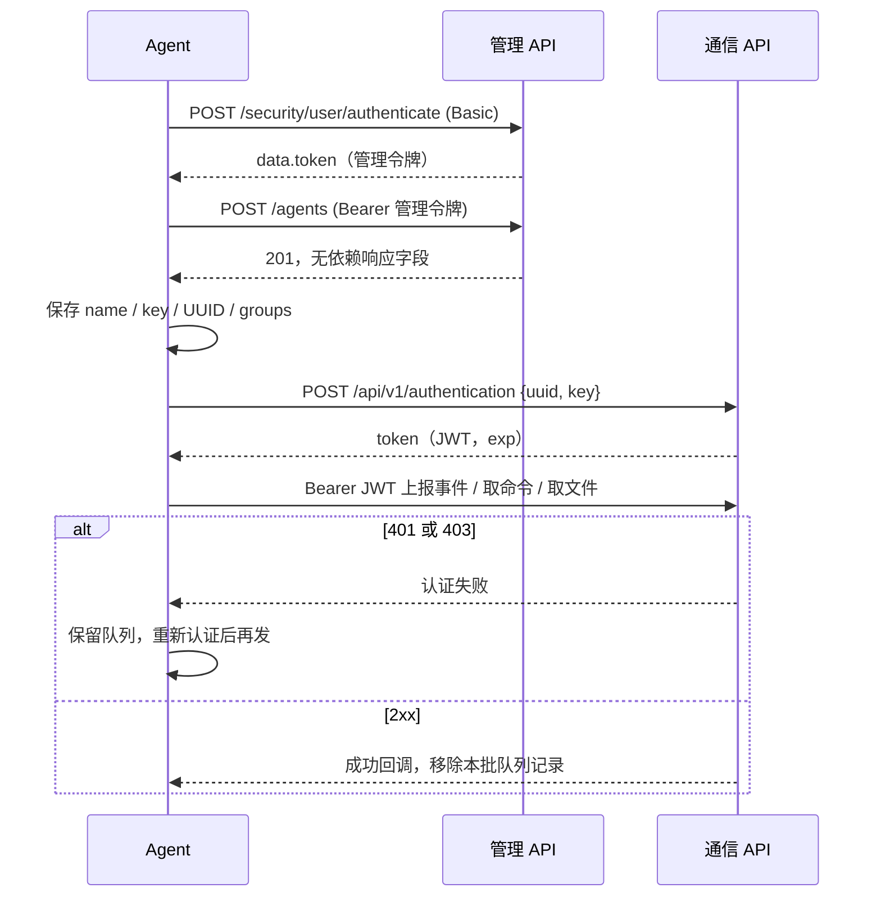

# wazuh-agent 实验实现认证过程

本文从 [接口规格](wazuh-agent.md) 提炼认证过程，配套可运行示例 [demo.py](demo.py)。固定提交 `ca21132`，该实现是独立实验项目，不兼容正式 Wazuh Manager；正式 4.x 链路见 `../wazuh/authentication.md`。

## 角色与凭据

| 角色 | 凭据 | 签发方 | 用途 |
|---|---|---|---|
| Agent → 管理 API | Basic 用户名/密码 | 部署提供 | 换取管理令牌 |
| Agent → 管理 API | Bearer 管理令牌 | 管理 API | 注册 Agent |
| Agent → 通信 API | UUID + 32 字符密钥 | 注册时生成或配置 | 换取运行期 JWT |
| Agent → 通信 API | Bearer JWT | 通信 API，含 `exp` | 事件上报、命令轮询、文件拉取 |

管理令牌与运行期 JWT 分别使用，不可互换。HTTPS 验证模式为 `full`、`certificate` 或 `none`；固定提交未发现为 Agent 装载客户端证书的配置。

## 认证时序



## 逐步过程

1. **管理登录**：`POST /security/user/authenticate`，Basic 凭据、空正文。客户端要求 2xx 且 `data.token` 为字符串；失败时本次不调用注册接口。
2. **注册**：用管理令牌 `POST /agents`，正文含 `id`（UUID）、`name`、`key`（32 字符）、`type=Endpoint`、`version` 与 `host` 元数据。仅 HTTP 201 触发 `AgentInfo.Save`：重置默认值后保存名称、密钥、UUID 和组列表。响应正文无客户端依赖字段。
3. **运行期认证**：`POST /api/v1/authentication` 提交 `uuid` 与 `key`，接受 2xx 中的顶层 `token`，读取 JWT `exp`，在到期前 2 秒唤醒更新。JWT 签发与服务端密钥存储需配套服务端源码确认。
4. **业务请求**：事件批次以 Bearer JWT 发送到 `/api/v1/events/stateful` 或 `/stateless`，正文为换行分隔的 JSON：首行元数据，随后每条记录的元数据与 `data`。命令与文件接口同样带 Bearer。
5. **失败处理**：401/403 触发重新鉴权并保留队列；传输超时或 5xx 按重试间隔等待，队列继续保留。成功回调才移除本批记录。

## 失败与重试

| 场景 | 线上结果 | Agent 行为 |
|---|---|---|
| 管理登录失败 | 非 2xx 或缺少字符串 `data.token` | 本次不调用注册接口 |
| 注册未成功 | 响应非 201 | 不保存 Agent 信息 |
| 运行期认证失败 | 401/403，可带 `message` | 获取令牌失败，重新尝试认证 |
| 上传凭据过期/失效 | 401/403 | 保留待发事件，刷新令牌后重发 |
| 上传超时或 5xx | 无有效成功响应 | 保留队列，按循环规则退避 |

## Demo 说明

`demo.py` 在本机启动 mock 管理 API 与通信 API，走通管理登录、注册、JWT 换取、事件批次上传与 401 刷新。运行：

```powershell
python demo.py
```

脚本验证：登录取得管理令牌、注册返回 201 后本地保存、JWT `exp` 可解析、NDJSON 事件批次格式、401 后重新认证并保留队列。全部通过输出 `PASS`。

Demo 使用占位 JWT 与本地 mock，不实现真实服务端签发、不解密生产载荷，也不验证持久化实现。
