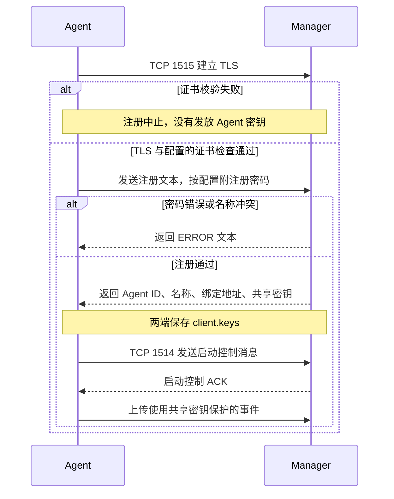

# Wazuh 4.14.0 认证与数据面协议

本章以 [Wazuh v4.14.0 · e0707d7](https://github.com/wazuh/wazuh/tree/e0707d735cc60b38da2723376a2f0faeffe697bb) 为 Agent 与 Manager 的共同固定版本。AIDR 前期引用的 [wazuh-agent · ca21132](https://github.com/wazuh/wazuh-agent/tree/ca211324af5c88caf77fcd57cab0e98475f8e4ce) 是独立实验项目，其 README 说明当前 Agent 尚不完整且不兼容正式 Manager。它可用于参考本地持久化队列，本章的注册和网络协议均来自 Wazuh 4.14.0。

## 先看两条链路

| 阶段 | 默认端口 | 谁验证谁 | 成功后 |
|---|---|---|---|
| 首次注册或重新注册 | TCP 1515 | Agent 可用 CA 验证 Manager。Manager 可要求并验证 Agent 证书，也可配置注册密码 | Manager 签发 Agent ID 和共享密钥，两端维护 `client.keys` |
| 启动、心跳和事件上报 | TCP 1514 | Manager 按 Agent 身份和共享密钥验证安全消息 | 启动返回控制 ACK。普通事件进入分析队列 |

| 接口 | 发起方 → 接收方 | 消息边界 | 响应 |
|---|---|---|---|
| 注册 | Agent → `wazuh-authd` | TCP/TLS，单次注册请求为文本，以 LF 结束 | TLS 内的 `OSSEC K:` 成功文本或 `ERROR:` 失败文本 |
| 启动同步 | Agent → `wazuh-remoted` | TCP 长度前缀或 UDP 数据报，其内为安全消息 | 同通道安全消息，正文为控制 ACK 或启动错误 |
| 心跳、关闭通知 | Agent → `wazuh-remoted` | 同一安全消息通道，正文为控制消息 | 心跳控制路径可返回 ACK，关闭消息不提供业务回执 |
| 遥测 | Agent → `wazuh-remoted` | 同一安全消息通道，正文为事件 | 无逐事件响应，Manager 将验收的事件提交本机分析队列 |

### Agent 有证书认证吗？

**有。Wazuh 4.14.0 在注册链路支持双向证书验证。** Agent 用 `server_ca_path` 配置验证 Manager 的 CA，注册库还检查 Manager 证书身份。反方向由 Agent 通过 `agent_certificate_path` 和 `agent_key_path` 提供证书与私钥，Manager 配置 `ssl_agent_ca` 确定可信 CA，可用 `ssl_verify_host` 额外校验客户端证书身份。注册密码与证书为独立配置。注册成功后，1514 安全消息使用注册取得的共享密钥。 [Agent 配置](https://github.com/wazuh/wazuh/blob/e0707d735cc60b38da2723376a2f0faeffe697bb/src/config/client-config.c) · [Agent 注册库](https://github.com/wazuh/wazuh/blob/e0707d735cc60b38da2723376a2f0faeffe697bb/src/shared/enrollment_op.c) · [Manager 验证](https://github.com/wazuh/wazuh/blob/e0707d735cc60b38da2723376a2f0faeffe697bb/src/os_auth/main-server.c)



## 注册和 Agent 生命周期

1. Agent 配置 Manager 地址，通过默认 TCP 1515 的 TLS 连接向 `wazuh-authd` 注册。可配置验证 Manager CA、校验 Manager 身份、提供客户端证书和私钥以及使用注册密码。证书验证和共享密码开关由部署配置决定。固定 authd 配置默认启用远程注册，`use_password`、`use_source_ip` 与 `verify_host` 默认为关闭。Agent 没有配置 CA 时不会在注册库执行 Manager 身份校验。Agent 自动注册和 `agent-auth` 调用同一注册库。 [Agent 注册库](https://github.com/wazuh/wazuh/blob/e0707d735cc60b38da2723376a2f0faeffe697bb/src/shared/enrollment_op.c) · [agent-auth 入口](https://github.com/wazuh/wazuh/blob/e0707d735cc60b38da2723376a2f0faeffe697bb/src/os_auth/main-client.c#L280-L321) · [Manager TLS 与认证配置](https://github.com/wazuh/wazuh/blob/e0707d735cc60b38da2723376a2f0faeffe697bb/src/config/authd-config.c)
2. Manager 先按顺序解析请求。按配置验证共享密码、名称、版本、地址及组，检查名称或 IP 冲突。可配置替换旧记录，条件包括是否启用替换、旧记录断开时间、注册时间和已有密钥摘要是否相同。默认启用替换与键失配检查，断开和注册时间阈值各为 3600 秒。单节点由 authd 添加记录，集群 worker 把新增请求转交本地集群注册逻辑。成功时返回 ID、名称、绑定地址和新密钥。 [解析与替换](https://github.com/wazuh/wazuh/blob/e0707d735cc60b38da2723376a2f0faeffe697bb/src/os_auth/auth.c#L66-L377) · [Manager 注册处理](https://github.com/wazuh/wazuh/blob/e0707d735cc60b38da2723376a2f0faeffe697bb/src/os_auth/main-server.c#L709-L749)
3. Agent 验证响应四项并保存本地 `client.keys`。Manager 在注册处理与后台写入流程维护自身的键记录。数据链路使用 `client.keys` 中的代理身份和共享密钥，注册密码不进入运行期数据帧。失效方式为 Manager 删除或替换 Agent 记录，地址或密钥不再匹配时后续帧被拒绝。已有密钥的 Agent 在配置的重连阶段可尝试重新注册。 [Agent 响应与持久化](https://github.com/wazuh/wazuh/blob/e0707d735cc60b38da2723376a2f0faeffe697bb/src/shared/enrollment_op.c#L351-L487) · [Manager 键写入](https://github.com/wazuh/wazuh/blob/e0707d735cc60b38da2723376a2f0faeffe697bb/src/os_auth/main-server.c) · [重连逻辑](https://github.com/wazuh/wazuh/blob/e0707d735cc60b38da2723376a2f0faeffe697bb/src/client-agent/start_agent.c) · [密钥记录格式](https://documentation.wazuh.com/4.14/development/client-keys.html)

### 注册报文字段

TLS 内部协议为顺序文本。客户端按下表顺序构造并追加换行。单引号是线上分隔符。以下响应示例是脱敏文本。 [请求构造器](https://github.com/wazuh/wazuh/blob/e0707d735cc60b38da2723376a2f0faeffe697bb/src/shared/enrollment_op.c#L291-L327) · [服务端解析](https://github.com/wazuh/wazuh/blob/e0707d735cc60b38da2723376a2f0faeffe697bb/src/os_auth/auth.c#L66-L232)

按固定版本的 Manager，响应在 TLS 连接中直接写出，成功文本以闭合单引号结束，失败文本以连接结束收尾，响应端未追加 LF。调用方需要保留 ID 的前导零、四个字段的顺序及引号。Agent 写入键文件时只保留引号内的四项内容，再追加 LF。缺失引号、四字段格式不合法或持久化失败时，Agent 不进入注册完成状态。证书失败、响应为空、仅收到错误文本和本地写文件失败是不同的失败阶段。 [响应构造与连接处理](https://github.com/wazuh/wazuh/blob/e0707d735cc60b38da2723376a2f0faeffe697bb/src/os_auth/main-server.c) · [Agent 读取及保存](https://github.com/wazuh/wazuh/blob/e0707d735cc60b38da2723376a2f0faeffe697bb/src/shared/enrollment_op.c#L351-L487)

| 线上段 | 类型、约束与用途 |
|---|---|
| 请求 `OSSEC PASS: <secret> ` | 可选文本前缀，Manager 开启密码验证时要求匹配 |
| 请求 `OSSEC A:'<name>'` | 必需。Agent 名称，使用有效主机名或配置名称 |
| 请求 ` V:'<version>'` | 可选版本字符串。存在时 Manager 做版本验证 |
| 请求 ` G:'<groups>'` | 可选组名或逗号分隔组名。Manager 检查存在性和多组数量限额 |
| 请求 ` IP:'<address>'` | 可选地址文本。显式地址需可解析，`src` 请求使用连接来源。缺省由 Manager 的 `use_source_ip` 决定来源地址或 `any` |
| 请求 ` K:'<digest>'` | 可选既有键的 SHA-1 文本摘要，供重复注册时判断是否为同一键。无既有键时省略 |
| 成功前缀 `OSSEC K:'` | 固定文本，内部键记录由空格分隔并以单引号闭合 |
| 成功字段 `ID` | 十进制字符串，格式由 `OS_IsValidID` 校验。通常展示为 `001` |
| 成功字段 `Name` | Agent 名称，`OS_IsValidName` 校验 |
| 成功字段 `Address` | 地址或 `any`，`OS_IsValidIP` 校验 |
| 成功字段 `Key` | 共享密钥文本，Agent 校验格式后写入键文件 |
| 失败前缀 `ERROR: ` | 诊断文本。原因包括密码、请求、名称或地址无效，版本不受支持，重复 IP/名称、组无效、组数超限及内部添加失败。无整数错误码 |

### 交互案例

**成功。** 请求为带 LF 的一行文本，响应为不带 LF 的一行文本，密钥值已脱敏。

```text
OSSEC A:'example-host'
OSSEC K:'001 example-host any REDACTED'
```

**失败。** 如果 Manager 要求共享注册密码，密码不匹配时返回第一种错误。已有同名记录且不满足替换条件时，返回第二种错误。以下是两个独立响应。

```text
ERROR: Invalid password. Unable to add agent
ERROR: Duplicate agent name: example-host. Unable to add agent
```

**证书验证失败。** 连接会在 TLS 握手或随后的证书检查阶段中止，Agent 不会取得 `OSSEC K:` 响应。排查时先确认是哪一端拒绝证书，再看该端信任的 CA 和证书身份配置。

### 实现路径和状态转换

| 当前状态 | 输入或结果 | 必须执行的处理 | 下一状态 |
|---|---|---|---|
| 无可用键 | 自动注册已启用 | 建立 1515 连接，按配置完成证书检查，发送注册请求 | 等待注册结果 |
| 等待注册结果 | 键文本合法且成功落盘 | 使用本地 ID、地址及新键 | 启动同步 |
| 等待注册结果 | TLS 中断、注册错误、报文无效或落盘失败 | 记录失败阶段，当前注册失败 | 重新连接或结束单次注册调用 |
| 启动同步 | 收到安全通道 ACK | 进入正常发送，按配置发送心跳 | 已连接 |
| 启动同步 | 无 ACK 或收到启动错误 | 在当前服务器上按 `retry_interval` 等待，尝试 `max_retries` 次。用完后若启用注册，则尝试注册，成功后多做一次启动同步 | 已连接或切换到下一配置服务器 |
| 已连接 | 连接中断且需要重连 | 重新进入启动同步流程 | 启动同步 |

服务端处理顺序是 TLS 验证、注册文本解析、操作权限与准入检查、键记录分配、返回结果。启动与事件通道由 remoted 完成凭据与消息校验后区分控制载荷和业务事件。Windows 注册写键文件与非 Windows 的临时文件替换路径不同，见实现。 [Manager 注册处理](https://github.com/wazuh/wazuh/blob/e0707d735cc60b38da2723376a2f0faeffe697bb/src/os_auth/main-server.c) · [Agent 重连状态](https://github.com/wazuh/wazuh/blob/e0707d735cc60b38da2723376a2f0faeffe697bb/src/client-agent/start_agent.c#L128-L186) · [Agent 落盘](https://github.com/wazuh/wazuh/blob/e0707d735cc60b38da2723376a2f0faeffe697bb/src/shared/enrollment_op.c#L398-L447)

## 运行期数据帧

默认数据端口 TCP 1514，Manager 可以配置 UDP。TCP 在数据前写 4 字节小端无符号 `payload_size`，值为后续负载字节数。UDP 直接发送负载。Manager 将可变地址 Agent 的外层 ID 与来源地址用于查找键，固定单主机地址可由地址定位。随后验证并解开安全消息。 [官方架构](https://documentation.wazuh.com/4.14/getting-started/architecture.html) · [TCP 帧代码](https://github.com/wazuh/wazuh/blob/e0707d735cc60b38da2723376a2f0faeffe697bb/src/os_net/os_net.c#L695-L752) · [Manager 收包](https://github.com/wazuh/wazuh/blob/e0707d735cc60b38da2723376a2f0faeffe697bb/src/remoted/secure.c#L556-L787)

| 层 | 线上字段 | 类型与语义 |
|---|---|---|
| TCP 前缀 | `payload_size` | uint32，小端，接收端检查缓冲上限。UDP 无此字段 |
| 负载前缀 | `!<agent_id>!` | 可选文字，Agent 键绑定非单主机地址时写出 |
| 负载前缀 | `crypto_token` | `#AES:` 为默认 AES，`:` 为 Blowfish 分支 |
| 负载 | 密文字节 | 由选定算法处理。解密后的压缩分支先去除 1 至 8 个 `!` 填充字节，再做 zlib 解压 |
| 解压正文 | `checksum` | 32 字节 MD5 十六进制文本，覆盖下述计数头及事件 |
| 解压正文 | `random` | 5 位十进制无符号随机数，补前导零 |
| 解压正文 | `global_count` | 10 位补零十进制全局计数器 |
| 解压正文 | `local_count` | 4 位补零十进制局部计数器。发送端到 9997 后在下一条增加全局计数并从 1 重新编号 |
| 解压正文 | 两个 `:` | 分隔计数器与事件。顺序是 `random + global_count + ":" + local_count + ":" + event` |
| 解压正文 | `event` | 普通事件或 `#!-` 开始的运行期控制载荷 |

校验接收逻辑可返回内部结果 `KS_VALID`（通过）、`KS_CORRUPT`（格式或内容校验失败）、`KS_ENCKEY`（安全消息或密钥错误）及 `KS_RIDS`（重复或旧计数）。这些值不作为遥测回执发送。普通事件由 remoted 交给 Manager 的 Analysis 队列，控制消息另行分派。 [安全消息收发](https://github.com/wazuh/wazuh/blob/e0707d735cc60b38da2723376a2f0faeffe697bb/src/os_crypto/shared/msgs.c#L297-L674) · [Manager 消息处理](https://github.com/wazuh/wazuh/blob/e0707d735cc60b38da2723376a2f0faeffe697bb/src/remoted/secure.c#L760-L938)

### 通用事件与控制报文

普通标准事件为 `<queue>:<location>:<message>`。第一段为单字节类别，第二段为来源，第三段由对应采集器定义，可包含冒号。官方文档列出的常用类别包括 `1`（本地日志）、`2`（远端 Syslog）、`4`（Manager remoted 到 Analysis 的安全消息包装）、`5`（数据库同步）、`8`（Syscheck）、`9`（Rootcheck）、`f`（Windows 事件）、`p`（SCA）、`d`（系统资产）、`u`（Agent 升级完成）。这些常用类别跨越不同队列方向，不构成 Agent 上报的闭集。 [官方消息格式](https://documentation.wazuh.com/4.14/development/message-format.html)

| 消息 | 字段及处理 |
|---|---|
| Agent 启动 | `#!-agent startup <json>`，其中 `version` 为 Agent 版本字符串。Agent 等待 Manager 安全消息内的 ACK 或错误 |
| Agent 关闭 | `#!-agent shutdown `，通知 Manager 停止状态，无额外正文 |
| Agent 保活 | `#!-` 后依次为系统信息文字、可选 ` / <Agent 配置 MD5>`、换行、可选标签、`<merged.mg 摘要或 x> merged.mg`、换行、可选 `#"_agent_ip":<本地连接地址>` 与末尾换行。默认周期 20 秒 |
| Manager ACK | `#!-agent ack `，用于启动握手和控制层活性。没有逐条遥测接收编号、存储确认或业务回执 |
| Manager 启动错误 | `HC_ERROR` 控制前缀后跟 JSON，字段 `message` 为 string。Manager 版本拒绝分支构造描述文本，Agent 解析并记录，保持握手未完成 |

[Agent 启动与关闭](https://github.com/wazuh/wazuh/blob/e0707d735cc60b38da2723376a2f0faeffe697bb/src/client-agent/start_agent.c#L328-L422) · [保活构造器](https://github.com/wazuh/wazuh/blob/e0707d735cc60b38da2723376a2f0faeffe697bb/src/client-agent/notify.c#L80-L208) · [默认周期](https://github.com/wazuh/wazuh/blob/e0707d735cc60b38da2723376a2f0faeffe697bb/src/headers/defs.h#L95) · [Manager 控制面处理](https://github.com/wazuh/wazuh/blob/e0707d735cc60b38da2723376a2f0faeffe697bb/src/remoted/manager.c#L350-L510) · [Manager 错误消息](https://github.com/wazuh/wazuh/blob/e0707d735cc60b38da2723376a2f0faeffe697bb/src/remoted/manager.c#L1515-L1536)

```text
1:/var/log/example.log:application status=healthy
```

启动控制消息中的 JSON 子载荷如下。示例为方便阅读而缩进，外层仍是带 `#!-agent startup ` 前缀的控制消息。

```json
{
  "version": "v4.14.0"
}
```

| 运行期结果 | Agent 看到什么 | Manager 如何处理 |
|---|---|---|
| 启动成功 | 收到 `#!-agent ack ` | 接受启动握手，后续心跳更新连接状态 |
| 版本被拒绝 | 收到带 `err ` 控制类型的错误消息 | 拒绝启动，Agent 保持握手未完成 |
| 普通事件接收成功 | 没有逐事件回执 | 解包后交给分析队列 |
| 密钥或计数校验失败 | 没有逐事件错误回执 | 拒绝该帧，内部记录如 `KS_ENCKEY` 或 `KS_RIDS` |

版本被拒绝时，错误控制消息里的 JSON 子载荷示例为：

```json
{
  "message": "Agent version must be lower or equal to manager version"
}
```

## 核验边界

本章核对了固定版本的注册、传输帧、共享密钥校验和通用事件字段。各采集器的专有载荷 schema、完整 Manager 下行控制分支、REST 管理接口与不同部署的具体 TLS 和注册参数需另行核对。未进行在线互操作测试。
