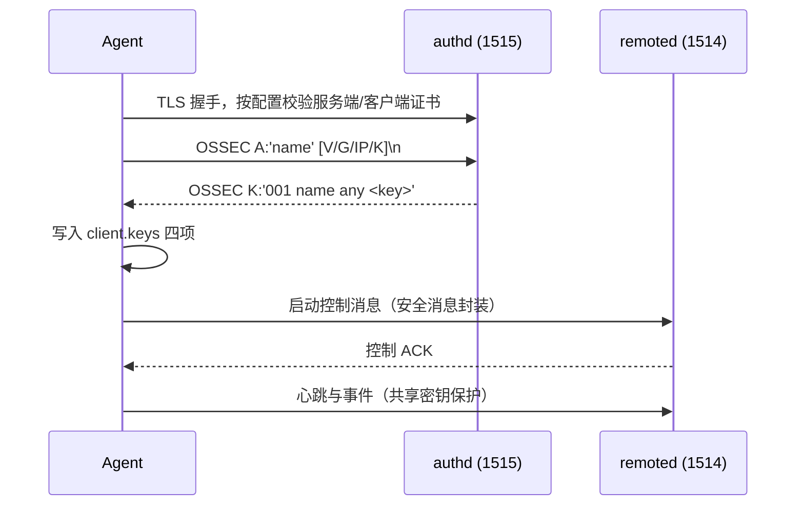

# Wazuh 4.14.0 认证过程

本文从 [接口规格](wazuh.md) 提炼认证过程，配套可运行示例 [demo.py](demo.py)。固定版本 `e0707d7`，注册与运行期帧结论以接口规格为准。

## 角色与凭据

| 阶段 | 链路 | 凭据 | 结果 |
|---|---|---|---|
| 首次注册/重新注册 | TCP 1515，TLS | 可选双向证书、注册密码 | Agent ID 与共享密钥，两端维护 `client.keys` |
| 启动、心跳、事件 | TCP 1514（或 UDP） | 注册取得的共享密钥 | 安全消息，启动有 ACK，普通事件无逐条回执 |

`wazuh/wazuh-agent` 独立实验实现不兼容正式 Manager，不能混用其 HTTP/JWT 流程；本文只描述正式 4.x 链路。

## 认证时序



## 逐步过程

### 1. Agent 建立注册连接

- **发起方**：Agent → `wazuh-authd`，TCP 1515 TLS
- **可选配置**：验证 Manager CA 与身份、提供客户端证书和私钥、使用注册密码
- **默认值**：固定 authd 配置默认启用远程注册；`use_password`、`use_source_ip`、`verify_host` 默认关闭

### 2. Agent 发送注册文本

- **发起方**：Agent → `wazuh-authd`，在 TLS 连接内发送
- **顺序**：`OSSEC PASS:`（可选）、`OSSEC A:'<name>'`、`V:'<version>'`、`G:'<groups>'`、`IP:'<address>'`、`K:'<digest>'`
- **结束**：以 LF 结束

### 3. Agent 读取并保存注册响应

- **成功响应**：`wazuh-authd` 返回 `OSSEC K:'ID Name Address Key'`，以闭合单引号结束且不追加 LF
- **失败响应**：`ERROR: ` 加诊断文本，随后结束连接
- **落盘**：Agent 保留 ID 前导零、四字段顺序和引号；写入 `client.keys` 时只取引号内四项

### 4. Agent 启动同步

- **发起方**：Agent → Manager，TCP 1514
- **请求**：启动控制消息 `#!-agent startup <json>`，封装为安全消息
- **封装**：外层 TCP 4 字节小端 `payload_size`；负载前缀可选 `!<agent_id>!` 与 `#AES:`（或 Blowfish 分支）；解密后校验 32 字节 MD5 与计数器；正文为事件或 `#!-` 控制载荷
- **响应**：Manager 启动成功时返回 `#!-agent ack `

### 5. Agent 运行期上报

- **心跳**：Agent 默认每 20 秒向 Manager 发送
- **事件**：普通事件进入 Manager 分析队列
- **回执**：心跳与事件上报没有逐事件回执；密钥或计数校验失败时产生 `KS_ENCKEY`、`KS_RIDS` 等内部结果

## 失败与重试

| 场景 | 结果 |
|---|---|
| 证书校验失败 | 握手或随后证书检查中止，无 `OSSEC K:` 响应 |
| 密码错误/名称冲突 | `ERROR: Invalid password` / `ERROR: Duplicate agent name` |
| 响应格式或落盘失败 | 不进入注册完成状态 |
| 启动无 ACK | 按 `retry_interval` 尝试 `max_retries` 次，用完后可尝试重新注册 |
| 密钥或计数不匹配 | 帧被拒，内部记录 `KS_ENCKEY` / `KS_RIDS` |

## Demo 说明

`demo.py` 在本机启动 mock `authd`，以 TCP 文本交换复现注册、密码错误与响应落盘格式；随后演示 1514 安全消息的封帧与 MD5/计数器校验（加密体用明文占位，明确标注简化）。运行：

```powershell
python demo.py
```

脚本验证：正确注册文本换得 `OSSEC K:` 响应、错误密码返回 `ERROR:`、响应四项解析与 `client.keys` 格式、简化帧的校验通过。全部通过输出 `PASS`。

Demo 不建立真实 TLS、不实现 AES/Blowfish 加解密，也不连接 Manager 分析队列。
