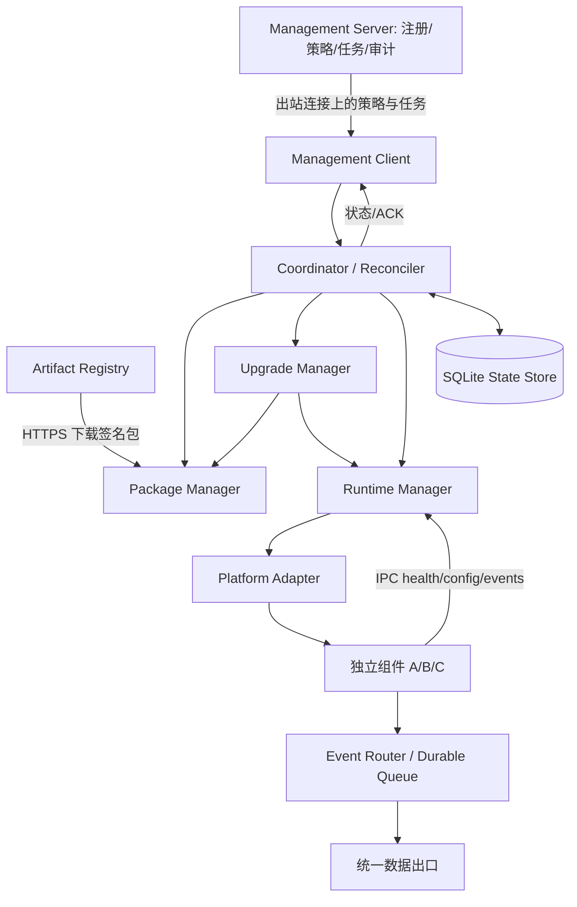

# 跨平台 Supervisor 架构调研与 Demo 实施指南

版本：0.1 | 用途：本地 Code Agent 调研、设计、编码与验收输入

## 1. 项目背景与目标

构建 Go 实现的跨平台终端能力运行底座。终端初始仅安装 Supervisor，由管理端动态分发独立组件，实现安全能力按需增加、移除和更新。Rustinel、AV（安天 SDK）、AIDR（方寸 SDK）、响应引擎及其他第三方能力均通过独立进程接入，第三方 SDK 不加载到 Supervisor 地址空间。

已确定：参考 Elastic Agent 架构，自主实现；Go；优先独立进程，少量基础模块内置；支持 Windows、Linux、macOS。amd64/arm64 为目标矩阵，实际组件可用性由 manifest 声明，不承诺所有厂商 SDK 均支持六种组合。

原架构保留：注册、心跳、远程控制、插件生命周期、IPC、WAL、幂等序列、离线重试、zstd 1–4 MB 批次（建议目标，需压测）、HTTP/2+mTLS、独立大文件通道。Demo 先验证运行管理闭环，数据面作为第二阶段；不开发真实检测引擎、不开发完整管理 UI、不引入 Kubernetes 或容器运行时。

## 2. 开源调研结论与复用边界

下表是此前调研的综合结论，并非已运行的 PoC。源码入口基于前期讨论，分支可能变化；实施前必须固定 commit、核对文件和符号、许可证及平台测试。不得将架构参考当作已验证可直接复用的代码。

| 项目 | 源码入口/重点 | 复用决策 | 许可证注意 |
|---|---|---|---|
| [Elastic Agent](https://github.com/elastic/elastic-agent) | `docs/architecture.md`、`docs/component-specs.md`、`pkg/component/runtime/manager.go`、`command.go`、`service.go`、Coordinator | 主架构参考：期望/实际模型、协调、进程/服务运行时；不 Fork | ELv2，非宽松 OSI 许可证 |
| [Fleet Server](https://github.com/elastic/fleet-server) | enrollment、check-in、actions、ack、policy；具体路径待核对 | 管理端与终端协同参考，不照搬 Elastic 生态 | 按固定版本核查 |
| [go-plugin](https://github.com/hashicorp/go-plugin) | `client.go`、`server.go`、`plugin.go`、`runner/`、`docs/internals.md`；`NewClient`、`Client.Start`、`GRPCPlugin`、`ReattachConfig` | 直接依赖候选，与原生 gRPC IPC 做 A/B PoC | MPL-2.0，核查分发义务 |
| [Nomad](https://github.com/hashicorp/nomad) | `plugins/drivers/driver.go`、`client/pluginmanager/`、`client/pluginmanager/drivermanager/`、`client/allocrunner/taskrunner/`；DriverPlugin、RecoverTask、WaitTask、InspectTask | 参考 Runtime/Instance 分离、恢复；不嵌入 Client | 主体 BUSL-1.1，部分文件 MPL-2.0，逐文件核查 |
| [Go supervisord](https://github.com/ochinchina/supervisord) | `process/process.go`、`process/process_manager.go`、LivenessChecker（位置和签名待核对） | 状态机、重启、健康阈值参考；局部代码复用候选 | MIT（固定版本核查） |
| [Mender](https://github.com/mendersoftware/mender)、[Artifact](https://github.com/mendersoftware/mender-artifact) | Update Module、Artifact、升级状态机 | 参考事务、版本切换、回滚；主要 Linux | 逐仓库核查 |
| [Elkeid](https://github.com/bytedance/Elkeid) | Agent 插件管理、Pipe IPC、SDK | 独立进程和 SDK 参考，非三端底座 | 逐模块核查 |
| [Wazuh Agent](https://github.com/wazuh/wazuh-agent) | 新 Agent 的队列、任务管理、通信 | 持久化队列参考；与传统 Wazuh 4.x 区分 | 逐版本核查 |
| [MiNiFi C++](https://github.com/apache/nifi-minifi-cpp) | C2 心跳、远程配置和命令 | 次要参考，不引入 C++ 框架 | Apache-2.0 |
| [FleetDM](https://github.com/fleetdm/fleet) | 注册、资产、软件分发、任务 | 次要参考，区分商业功能 | 逐模块核查 |

关键判断：go-plugin 不提供完整的安装、升级、状态协调；Nomad 面向集群任务而非终端能力；supervisord 主要管理普通进程；Elastic Integration 不是任意第三方二进制插件分发机制。Elastic Agent 的 agent-component 协议需检查 elastic-agent-client，`pkg/control/v2` 不应误认为组件协议（它主要是 Agent 控制接口）。

## 3. 目标架构



管理端负责终端身份、策略版本、组件目录、制品、任务、审计；不直接连接终端监听端口。终端主动建立连接。原方案 WS 可保留为生产候选；Demo 默认 HTTPS check-in/长轮询+mTLS，减少实现成本，最终传输由 ADR 决定。组件包下载与控制消息分离。

Supervisor 模块：Management Client、Coordinator、Registry、Package Manager、Upgrade Manager、Runtime Manager、Health Manager、State Store、IPC、Event Router、Transport。基础模块作为 Go 内部服务，不必人为包装成插件。Process Runtime 是 P0；Service Runtime 保留接口，驱动、macOS System Extension 另行适配，不承诺普通进程模型覆盖它们。

## 4. 技术选型（拟议，需验证）

| 能力 | 选型 |
|---|---|
| RPC | grpc-go + protobuf；go-plugin 作为候选而非强制依赖 |
| 进程 | os/exec + golang.org/x/sys |
| IPC | Unix socket (Linux/macOS)、Named Pipe (Windows, Microsoft/go-winio)；go-plugin PoC 可使用回环 TCP+AutoMTLS |
| 状态/队列 | SQLite WAL；优先评估 modernc.org/sqlite 纯 Go 构建，必要时比较 go-sqlite3 |
| 压缩 | klauspost/compress/zstd |
| 日志 | Go slog |
| CLI | 标准 flag 或 Cobra |
| 包 | ZIP + JSON manifest + 签名元数据；HTTPS 文件仓库，OCI Registry 后续评估 |
| 签名 | Ed25519；生产评估 TUF/go-tuf，信任根独立于下载服务 |
| 服务 | Windows SCM、Linux systemd、macOS launchd；kardianos/service 候选 |

不使用 Go plugin 动态库。独立进程不是沙箱。Windows Job Object（避免子进程逃逸的启动竞态）、Linux 进程组/cgroup v2、macOS 进程组/launchd 分别实现；macOS 资源限制不能假设等同 cgroup。IPC ACL、peer identity 或每实例短期凭证；不能仅相信组件自报 ID。

## 5. 数据模型与协议

### 5.1 期望状态策略

```json
{"policy_id":"demo","revision":12,"components":[{"id":"mock-a","version":"1.1.0","desired_state":"running","artifact_id":"mock-a-1.1.0","config_revision":2},{"id":"mock-b","version":"1.0.0","desired_state":"absent"}]}
```

采用完整快照，明确 `running/stopped/absent`；Demo 约定未列出的既有组件保持不变，卸载必须显式 absent，防止误删。策略 revision 单调递增，重复版本幂等，旧版本拒绝；同 revision 不同内容拒绝。先持久化再确认接收。离线继续执行最后可信策略；重连同步最新策略，不重放过时安装命令。临时扫描/诊断/重启采用带 action_id、期限、授权范围的命令，结果持久化去重。策略回滚以新 revision 指向旧的已授权制品，不降低策略 revision。

### 5.2 组件包

```text
mock-a-1.1.0-windows-amd64.zip
  manifest.json
  bin/mock-a.exe
  config/default.json
  lib/...
```

```json
{"id":"mock-a","version":"1.1.0","os":"windows","arch":"amd64","entrypoint":"bin/mock-a.exe","runtime":"process","protocol_version":1,"min_supervisor_version":"0.1.0","health":{"interval_seconds":5,"timeout_seconds":2,"failure_threshold":3},"restart":{"max_retries":5,"initial_backoff_seconds":1},"capabilities":["demo.echo"],"privilege":"standard"}
```

外部签名制品描述包含 artifact_id、组件 ID、版本、OS/arch、ZIP SHA256、大小、签名 key_id；签名覆盖确定性序列化的描述，避免 ZIP 内签名自引用。先验证签名与下载摘要，再解压。拒绝路径穿越、绝对路径、符号链接/重解析点、重复路径、超限解压及不兼容平台；不执行任意安装脚本。版本目录不可由普通组件写入，业务数据与版本文件分离。

### 5.3 管理接口（Demo 拟议）

| 接口 | 职责 |
|---|---|
| POST /v1/agents/enroll | 一次性注册凭据，绑定终端身份/证书 |
| POST /v1/agents/checkin | 心跳、已接收/已应用 revision、组件状态；返回新策略及任务 |
| POST /v1/agents/actions/ack | 任务接收/执行结果，幂等 |
| POST /v1/admin/artifacts | 授权管理员登记签名制品 |
| PUT /v1/admin/agents/{id}/policy | 发布期望状态 |
| GET /v1/admin/agents/{id} | 查询实际状态、错误、版本 |
| GET /v1/artifacts/{id} | 授权下载 |

管理端和 Agent 权限分离；Demo 使用本地测试 CA、独立管理员凭据和组件签名密钥，不允许跳过 TLS/签名验证。不得允许管理端下发任意 shell 命令。仅在授权测试机运行。

### 5.4 组件协议

统一 protobuf：GetInfo、Configure(revision,config)、Health、Shutdown、Execute（仅声明并授权的动作）；数据面独立 EventStream。Supervisor 启动进程，组件建立 IPC 或提供 RPC endpoint，握手校验实例身份与协议版本。Start 不依赖尚未运行的组件 RPC。明确 RPC 方向、超时、错误码、配置确认。Go SDK 优先，Rust mock 验证跨语言；Python 可选，不要求终端预装 Python。

### 5.5 Runtime 接口（拟议）

```go
type Runtime interface {
    Start(ctx context.Context, spec InstanceSpec) (Handle, error)
    Stop(ctx context.Context, h Handle) error
    Inspect(ctx context.Context, h Handle) (Observed, error)
    Wait(ctx context.Context, h Handle) (ExitResult, error)
}
```

PackageManager 独立提供 Stage/Verify/Install/Remove；UpgradeManager 管理版本事务；Coordinator 唯一决定期望状态变更。每组件串行操作，不同组件可并发。Handle 包含实例代次和进程身份，不只保存 PID。

## 6. 生命周期与可靠性

状态拆分：安装状态（absent/staged/installed）、运行状态（starting/running/stopping/stopped/backoff/failed）、健康状态（unknown/healthy/degraded/unhealthy）、升级事务状态。记录 desired/observed version、config revision、instance generation、restart count、last error、更新时间。

协调流程：接收策略→校验并持久化→按组件计算差异→安装/配置/启动/停止/卸载→健康确认→上报。区分 received 与 applied；部分失败不宣称全部成功。指数退避带抖动，达到阈值进入 failed，新的策略或明确重试可解除；主动停止不触发重启。过期实例的异步事件不能覆盖新实例状态。

升级：下载并校验新包→staging→记录事务和旧版本→停止旧实例→切换 active version（SQLite 事务或平台安全指针，不覆盖正在执行的文件）→启动新实例→连续健康检查→提交；失败则停止新实例、恢复旧版本并验证。重启后根据事务日志恢复。回滚失败必须明确上报。保留业务数据；有不兼容数据迁移的组件不能承诺自动回滚。卸载先停止并确认进程树退出，再删除安装文件；默认保留业务数据和审计。Supervisor 自身升级不在 P0 范围。

Supervisor 崩溃恢复：P0 允许清理已验证归属的残留实例后重启组件；不允许按裸 PID 杀进程。存活进程重连（go-plugin ReattachConfig）为专项验证，不是 P0 必须能力。必须防止重复实例。

## 7. 数据面（P1）

事件 envelope：event_id、component_id、instance_id、schema_version、timestamp、payload、sequence。Supervisor 持久化提交后才向组件 ACK；服务端持久化确认后才删除队列记录。SQLite WAL 是数据库日志模式，仍需自行实现队列状态、重试、配额和 ACK。采用至少一次交付，服务端 event_id 幂等；断网/重启恢复。明确磁盘满时背压和丢弃策略，不声称无限缓存。zstd 批量与 HTTP/2+mTLS，1–4 MB 为待压测目标。大文件独立受控 spool/上传通道，限制大小、路径、权限及生命周期，不直接塞进事件 WAL。

## 8. Code Agent 执行计划

### M0：源码验证与 ADR

克隆或获取 Elastic Agent、Fleet Server、go-plugin、Nomad、supervisord、Mender 的固定版本。记录 URL、commit、许可证、实际文件和符号、调用链及测试证据。重点验证 go-plugin 握手、Windows 传输、长连接、跨语言、重连；supervisord 进程状态/健康检查；Nomad Driver 生命周期/恢复；Elastic policy/check-in 与 runtime；Mender 更新事务。源码无法获取时标记 blocker，不编造。输出 `docs/research/research.md`、`docs/adr/`。不要因次要项目调研阻塞最小 Demo。

### M1：本地 Runtime + IPC A/B

实现 Go Supervisor、SQLite 状态、manifest、进程管理、Go mock。A：go-plugin；B：原生 gRPC + os/exec + 平台 IPC。比较依赖、协议复杂度、跨语言、认证、长连接、进程树控制及恢复。用实测选择，默认倾向 B 若 go-plugin 需要大量改造。实现 Rust mock（至少一个非 Go 组件）。从首阶段建立三端 CI，不把平台适配全部推迟。

### M2：远程管理闭环（P0 核心）

Go 管理端 + SQLite + 本地制品仓库 + 管理 CLI/API；实现注册、mTLS、check-in、策略、状态、签名包分发。初始终端无业务组件，远程新增 mock-a/mock-b、停止、重新启动、卸载，不重启 Supervisor。实现离线恢复、revision 幂等、失败状态上报。

### M3：升级回滚与故障注入（P0）

准备 mock-a v1 正常、v2 正常、v3 健康失败；验证升级、回滚、Supervisor 中途崩溃恢复、重复任务、签名错误、平台不匹配、磁盘不足、组件卡死、主动停止不重启。测试其他组件不受影响。

### M4：三端原生验收（P0）

Windows/Linux/macOS 原生机器或 CI runner 执行测试；amd64/arm64 构建矩阵，实际运行覆盖单独记录。没有对应机器就标记未验证，不以交叉编译替代运行。验证服务安装、进程树、IPC ACL；Service Runtime 高权限扩展另立任务。

### M5：数据面（P1）

EventStream、持久化队列、断网重试、批量压缩、服务端幂等；验证持续事件流不阻塞控制面。真实 Rustinel/AV/AIDR 集成待厂商 SDK 和平台权限具备后进行。

## 9. 建议工程结构

```text
cmd/{supervisor,management-server,supervisorctl,mock-go}/
api/proto/component/v1/
internal/{coordinator,registry,runtime,platform,ipc,package,upgrade,health,state,management,queue,transport}/
internal/runtime/{process,service}/
pkg/component-sdk/
plugins/mock-rust/
configs/
test/{integration,e2e,fixtures}/
scripts/{build,package,sign,demo}/
docs/{research.md,architecture.md,adr,acceptance.md}/
```

提供 PowerShell 与 shell 或 Go 跨平台构建/打包工具；锁定依赖版本，支持离线制品交付，生成依赖及许可证清单。禁止将私钥、真实凭据提交仓库。

## 10. Demo 操作与验收

拟议命令（由 Code Agent 实现并在 README 给出实际可执行命令，不代表已有程序）：

```text
management-server --config configs/server.yaml
supervisor --config configs/agent.yaml
supervisorctl artifact publish <signed-package>
supervisorctl policy apply --agent demo-01 --file policy.json
supervisorctl agent status demo-01
```

| ID | 验收场景 | 通过条件 |
|---|---|---|
| T01 | 空白终端注册 | 管理端显示终端，零业务组件 |
| T02 | 远程安装 A/B | 自动下载校验、启动、健康上报；Supervisor PID 不变 |
| T03 | 动态新增能力 | 新组件无需修改或重新编译 Supervisor |
| T04 | 停止/恢复/卸载 | 无自动误拉起；卸载后无残留受管进程，数据按策略保留 |
| T05 | 崩溃/卡死 | 退出或健康超时可检测，按策略恢复；B 不受 A 影响 |
| T06 | 断网/重连 | 保持最后可信策略；上线同步最新 revision |
| T07 | 重复/旧策略 | 不重复安装，旧 revision 拒绝 |
| T08 | 正常升级 | v1→v2，健康确认，其他组件不重启 |
| T09 | 失败回滚 | v3 不健康，恢复 v2，报告升级失败和实际版本 |
| T10 | 中途崩溃 | 事务可恢复，无重复实例、无半安装状态 |
| T11 | 安全拒绝 | 篡改包、错误签名、路径穿越、未授权请求均拒绝 |
| T12 | 跨语言 | Go Supervisor 管理 Go 与 Rust mock |
| T13 | 三端 | 每平台原生运行报告，进程树回收与 IPC 验证 |
| T14 | 数据面 P1 | 已 ACK 事件断网/重启后可恢复，服务端去重 |

建议测试参数：健康间隔 5s、超时 2s、连续失败 3 次；正常停止 10s 后强制清理；重启退避 1–30s；这些均为 Demo 默认值，不是生产 SLA。记录实际延迟、CPU、RSS、磁盘占用，不虚构性能数据。

## 11. 交付物与工作约束

交付可编译源码、README（从零启动与远程操作）、固定版本调研报告、ADR、protobuf/manifest 规范、架构图、测试脚本、三端测试矩阵、故障注入日志、验收报告、已知问题清单。每个里程碑先提交可运行最小版本再扩展。优先 `go test ./...`、`go vet ./...`、支持平台的 race test、原生集成测试；保存命令与退出码。未执行的测试必须明确标记。不要为了演示绕过安全校验；不要自动部署到生产或安装真实高权限安全组件。

最终验收重点：管理端发布新能力 → 空白终端下载签名组件 → 独立运行 → 状态反馈 → 升级失败回滚 → 远程卸载。全过程无需修改 Supervisor 核心或重启 Supervisor（故障注入测试除外）。

## 12. 当前限制与待决策

此前工作属于源码/架构调研，尚未实际构建或运行三端 PoC；未固定全部仓库 commit，部分源码路径、接口签名、许可证及 macOS/Windows ARM64 支持需复核。HTTPS check-in、SQLite 驱动、签名包格式、默认健康参数、Go/Rust mock 是本文为 Demo 提出的默认选择，并非用户已锁定的生产技术决策。生产 WS/gRPC、证书轮换、TUF 信任根轮换、强沙箱、灰度发布、Supervisor 自升级、真实 SDK 授权与系统扩展另行设计。
